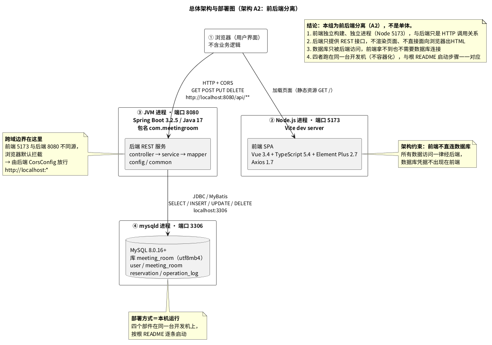
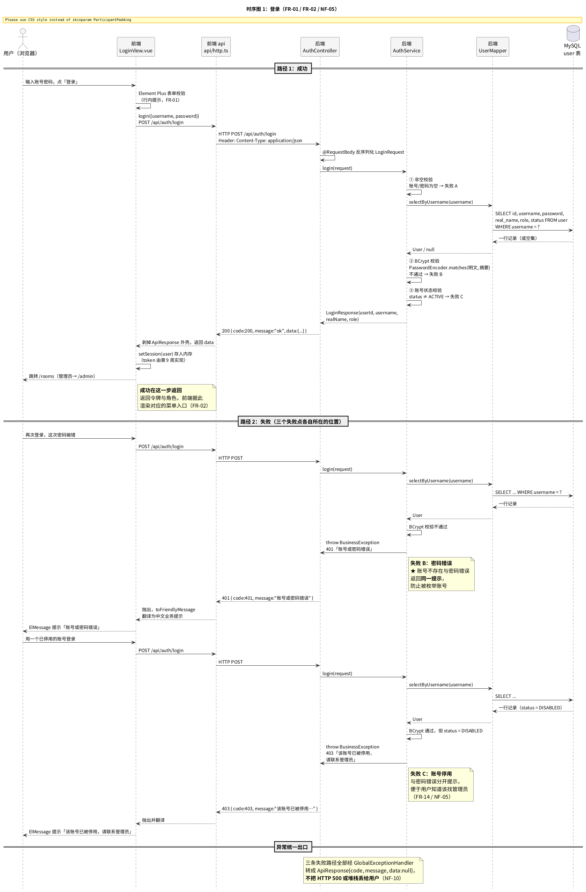
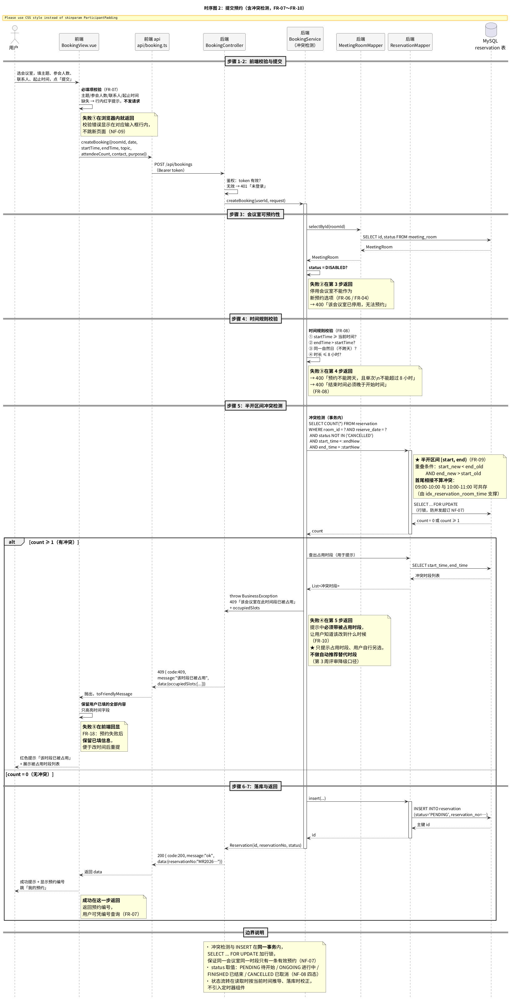

# 智能会议室管理系统 —— 系统设计说明书

| 项目 | 内容 |
|------|------|
| 小组 | 第 4 组 |
| 文档 | 第 7 周交付物：《系统设计说明书》 |
| 版本 | v0.1（第 7 周骨架设计，接口边界已于 2026-10-20 冻结） |
| 编制日期 | 2026-10-19 |
| 主笔 | 李知渔（统筹、架构、提交预约时序图、接口冻结） |
| 参编 | 虞业宸（接口草案主笔、登录时序图）、孙若普（前端模块与调用栏）、李牧远（交叉验收） |
| 依据 | 《智能会议室管理系统I——第7-8周项目实践任务.docx》第一节；《需求清单 V1.1》（`docs/week05/04_需求清单V1.1.docx`）；`docs/week07-08/周推进计划_第7-8周.md` |
| 状态 | ⚠️ **骨架设计稿**。第 8 周补齐《数据库与接口设计》与 `schema.sql`；三样材料 10-26 课前一并交 |

> **口径声明（全篇适用）**
> 1. 最终方案 = **方案 A（自由时间段预约）**，本文件不出现"方案 B"作为结论性表述。
> 2. 冲突检测 = **半开区间 `[start, end)`**，首尾相接不算冲突（FR-09）。
> 3. **本学期暂不实现 9 项**：人脸识别、物联网设备控制、3D 场景、智能推荐、重复预约（周期性／批量）、多级审批、消息推送、统一身份认证对接、移动端原生应用——**不画进本文件任何图表**。
> 4. 「管理员处理预约」= **强制取消异常预约／更正错误记录**（FR-16），**不是逐条审批**。
> 5. 编号：FR-01～20／NF-01～15／QR-01～03／UC-U01～U05、UC-A01～A05；技术选型编号 A1／A2、B1／B2。

---

## 一、总体架构与部署

### 1.1 架构结论

**本组为前后端分离（A2），不是单体。**

第 6 周《技术选型报告》定稿：**A2 前后端分离（Vue3 SPA + Spring Boot REST）+ B1 MySQL 8.0 + 本机运行**。本节的部件与部署严格按该结论填写，与根 `README.md` 的启动步骤一一对应。

### 1.2 总体架构与部署图



> 源文件：`图/01_总体架构与部署图.puml`｜矢量版：`图/01_总体架构与部署图.svg`

### 1.3 部署要素逐项（任务书要求"标出每个部件跑在哪台机器、哪个进程、哪个端口"）

| 部件 | 是什么 | 跑在哪台机器 | 哪个进程 | 哪个端口 | 启动命令 |
|------|--------|-------------|----------|----------|----------|
| 客户端 | 浏览器（用户界面，不含业务逻辑） | 开发机（单台） | 浏览器进程（由Node 进程供页） | 由前端决定 | 用户打开 `http://localhost:5173` |
| 前端 | Vue 3.4 + TypeScript 5.4 + Element Plus 2.7 + Axios 1.7，Vite 5.2 构建 | 开发机（单台） | **Node.js 进程**（Vite dev server） | **5173** | `cd frontend && npm install && npm run dev` |
| 后端 | Spring Boot 3.2.5 / Java 17，REST，包名 `com.meetingroom` | 开发机（单台） | **JVM 进程** | **8080** | `cd backend && mvn spring-boot:run` |
| 数据库 | MySQL 8.0.16+，库 `meeting_room`（utf8mb4），4 张表 | 开发机（单台） | **mysqld 进程** | **3306** | `mysql -u root -p < docs/week07-08/schema.sql` |

### 1.4 调用关系与两条硬约束

```
浏览器 ──静态资源──> 前端 Vite（5173）
  │
  └──HTTP + CORS──> 后端 REST（8080）──JDBC/MyBatis──> MySQL（3306）
```

| # | 约束 | 落地方式 | 对应配置 |
|---|------|----------|----------|
| 1 | **前端不直连数据库** | 数据库凭据不出现在前端；所有数据访问一律经后端接口 | 前端只有 `src/api/*.ts` 三个文件调 HTTP，无任何 JDBC 代码 |
| 2 | **跨域边界在浏览器↔后端之间** | 前端 5173 与后端 8080 不同源，由后端主动放行 | `config/CorsConfig.java`：放行 `http://localhost:*`，方法 GET/POST/PUT/DELETE/OPTIONS |

### 1.5 与根 README 启动步骤的对应（课堂汇报要"对得上"）

| 部件 | README 中的启动章节 | 端口 | 本文档口径 |
|------|-------------------|------|-----------|
| 数据库 | 「数据库初始化」`mysql -u root -p < ...schema.sql` | 3306 | 一致（**第 8 周脚本改为自包含单文件**，README 同步更新） |
| 后端 | 「启动后端」`mvn spring-boot:run` | 8080 | 一致 |
| 前端 | 「启动前端」`npm install && npm run dev` | 5173 | 一致 |
| 默认账号 | `admin` / `user1` / `user2`，口令 `123456`（库中存 BCrypt 摘要） | — | 一致（**口令只写在 README，不入库**） |

---

## 二、模块划分

> 口径：前后端各拆成哪几个模块，每个模块做什么、**对应需求清单 V1.1 哪几条**。
> **挂不上 FR／NF／QR 编号的模块不设**——防"综合管理"这类糊口径。

### 2.1 后端模块划分（Spring Boot，包名 `com.meetingroom`）

后端按**四层**拆分，类名与第 6 周仓库现状一一对应。

| # | 层 | 模块（现有类） | 做什么 | 对应需求 |
|---|----|---------------|--------|---------|
| B1 | controller | `AuthController` | 登录接口入口：接参（`LoginRequest`）、调service、返 `ApiResponse` | FR-01 |
| B1 | controller | `MeetingRoomController` | 会议室查询入口：接 4 个查询参数、返 `RoomVO` 列表 | FR-05、FR-06 |
| B1 | controller | `BookingController`（第 9 周新建） | 预约相关入口：提交/查询/修改/取消 | FR-07、FR-11～FR-13 |
| B1 | controller | `AdminController` 系列（第 9 周新建） | 管理端入口：会议室管理、用户管理、全部预约、强制取消 | FR-03、FR-04、FR-14～FR-16 |
| B2 | service | `AuthService` | 登录业务规则：非空校验 → BCrypt 比对 → 账号状态校验 | FR-01、FR-02、NF-05 |
| B2 | service | `MeetingRoomService` | 查询业务规则：条件拼装、占用时段聚合 | FR-05、FR-06 |
| B2 | service | **`BookingService`（第 9 周新建）** | **★ 冲突检测（FR-09）、时间规则校验（FR-08）、预约编号生成、事务边界** | **FR-07～FR-10**、NF-07 |
| B2 | service | `AdminService`（第 9 周新建） | 管理端业务规则 + **操作日志写入（NF-14）** | FR-03、FR-04、FR-14、FR-16、NF-14 |
| B3 | mapper | `UserMapper` | `user` 表数据访问 | FR-01、FR-14 |
| B3 | mapper | `MeetingRoomMapper` | `meeting_room` 表数据访问；`selectOccupiedSlots` 供查询页展示占用 | FR-05、FR-06、FR-17 |
| B3 | mapper | **`ReservationMapper`（第 9 周新建）** | `reservation` 表数据访问；**冲突检测 SQL（`start_time < :endNew AND end_time > :startNew`）** | FR-09、FR-11 |
| B4 | config | `CorsConfig` | 跨域放行（架构 A2 的必要配置） | NF-11 |
| B4 | config | `PasswordConfig` | 暴露 `BCryptPasswordEncoder`（cost=10） | NF-05 |
| B5 | common | `ApiResponse<T>` | **统一响应外壳** `{code, message, data}`，成功 200／失败带业务码 | NF-10 |
| B5 | common | `BusinessException` + `GlobalExceptionHandler` | 业务异常与**统一异常出口**，不把HTTP 500 或堆栈丢给用户 | NF-10 |
| B5 | dto / entity | `LoginRequest/Response`、`RoomVO`、`OccupiedSlotDTO`、`User`、`MeetingRoom`、`Reservation` | 入参出参与表映射 | 随所属模块 |

**为什么是这四层**：controller 只做"接参—转发—包装"，service 承载全部业务规则（**冲突检测只在 service 一处实现**，不散落到 controller 或 mapper），mapper 只做数据访问，config/common 是横切关注点。这样第 9 周实现时，冲突检测规则有唯一落点，便于事务包裹与测试。

> **命名口径（易混，特此声明）**：**对外资源名用 booking**（接口路径 `/api/bookings/**`、类名 `BookingController/BookingService`、前端 `BookingView.vue`／`api/booking.ts`），**对内数据库表名用 reservation**（`reservation` 表、`Reservation` 实体、`ReservationMapper`、字段 `reservation_no`／`reserve_date`）。这是"用户眼中的预约动作＝booking，落库的记录＝reservation"的刻意区分，**第 9 周写代码时不要混用**：URL 用 bookings，SQL 与实体用 reservation。

### 2.2 前端模块划分（Vue 3 + TypeScript）

| # | 模块 | 目录 | 做什么 | 对应需求 |
|---|------|------|--------|---------|
| F1 | views | `src/views/` | 页面：`LoginView`（已建）、`RoomListView`（已建）、`BookingView`（第 9 周）、`MyBookingView`（第 9 周）、`AdminView` 系列（第 9 周） | FR-01、FR-05、FR-07、FR-11、FR-03 |
| F2 | router | `src/router/index.ts` | 路由表 + **权限守卫**（未登录跳`/login`，管理员才能进 `/admin`） | FR-02、NF-03 |
| F3 | store | `src/store/session.ts` | 会话与角色状态：`setSession` / `clearSession` / `isLoggedIn` | FR-02 |
| F4 | api | `src/api/http.ts` | **统一请求封装**：剥 `ApiResponse` 外壳、判 `code`、异常翻译为中文提示 | NF-10 |
| F4 | api | `src/api/auth.ts`、`room.ts`、`booking.ts`（第 9 周） | 按资源拆分的接口函数 | 随所属业务 |
| F5 | types | `src/types/api.ts` | `ApiResponse` / `LoginRequest` / `LoginResponse` / `RoomVO` 类型定义 | 随所属业务 |
| F6 | styles | `src/styles/main.css` | 全局样式与 Element Plus 主题覆盖 | NF-12 |

### 2.3 模块与需求的对应总览（一句话验"模块是否覆盖需求"）

| 需求段 | 主要承载模块 |
|--------|-------------|
| FR-01／FR-02 登录与权限 | B1 `AuthController` + B2 `AuthService` + F1 `LoginView` + F2 路由守卫 + F3 session |
| FR-03／FR-04 会议室管理与启停 | B1 `AdminController` + B2 `AdminService` + F1 `AdminView` |
| FR-05／FR-06 查询与可用状态 | B1 `MeetingRoomController` + B2 `MeetingRoomService` + F1 `RoomListView` |
| FR-07～FR-10 提交预约与冲突检测 | B1 `BookingController` + **B2 `BookingService`** + B3 `ReservationMapper` + F1 `BookingView` |
| FR-11～FR-13 我的预约 | B1 `BookingController` + F1 `MyBookingView` |
| FR-14～FR-16 管理端| B1 `AdminController` + B2 `AdminService` + F1 `AdminView` |
| FR-17 占用日历 | B3 `MeetingRoomMapper.selectOccupiedSlots` + F1 `RoomListView`（有时间再完成） |
| FR-18 失败保留已填信息 | F1 `BookingView`（前端职责，后端只负责返回错误码与占用时段） |
| FR-19／FR-20 筛选与利用率 | B1 `AdminController` + B2 `AdminService`（有时间再完成） |
| NF-03 越权 403 | B1 权限校验 + F2 路由守卫（双层） |
| NF-05 密码加密 | B4 `PasswordConfig` + `user.password` 存 BCrypt |
| NF-07 并发不超订 | B2 `BookingService` 事务 + `SELECT ... FOR UPDATE` |
| NF-08 状态四态 | B2 状态推导 + `reservation.status` |
| NF-10 易懂中文提示 | B5 `GlobalExceptionHandler` + F4 `toFriendlyMessage` |
| NF-14 操作日志 | B2 `AdminService` 写日志 + B1 `GET /api/admin/logs` |

---

## 三、关键业务时序（2 张）

> 口径：逐步画清**谁发起、经过哪些层、传什么数据、成功和失败分别在哪一步返回**。
> **失败分支画在产生它的那一步上**，不堆在末尾——这样课堂上被问"失败在哪一步返回"能当场指出来。

### 3.1 时序图 1：登录



> 源文件：`图/02_时序图_登录.puml`｜矢量版：`图/02_时序图_登录.svg`
> 覆盖需求：FR-01（登录）、FR-02（角色区分）、FR-14（账号停用）、NF-05（密码加密与停用后失效）

**逐步说明**：

| 步 | 谁发起 | 经过哪些层 | 传什么数据 | 成功 | 失败在哪一步返回 |
|---|--------|-----------|-----------|------|-----------------|
| 1 | 用户 | 前端 `LoginView` | 账号、密码 | — | **失败①表单校验**：行内红字提示，不发请求 |
| 2 | 前端 | `api/http.ts` → `AuthController` | `{username, password}` | — | 鉴权失败 → 401「未登录」（本接口不需登录，供未登录用户调用） |
| 3 | 后端 | `AuthService` → `UserMapper` → MySQL | `SELECT ... WHERE username=?` | 查到记录 | 查不到 → **走失败B 同一提示** |
| 4 | 后端 | `AuthService` | `PasswordEncoder.matches(明文, 摘要)` | 匹配 | 不匹配 → **失败B 在此返回**：401「账号或密码错误」 |
| 5 | 后端 | `AuthService` | `status == ACTIVE？` | 是 | 否 → **失败C 在此返回**：403「该账号已被停用，请联系管理员」 |
| 6 | 后端 | `ApiResponse` → 前端 | `{userId, username, realName, role}` | **成功在此返回**：200，前端 `setSession` 后跳`/rooms` | — |

**两条设计要点**：

1. **失败 B 的关键设计**：账号不存在与密码错误返回**完全相同的提示文案**。否则攻击者可以用"提示文案差异"枚举出哪些账号存在——这是登录接口最常见的漏洞。
2. **失败 C 与失败 B 分开**：停用账号的密码是对的，只是被管理员禁用了，用户需要知道"该找管理员"而不是"再试一次密码"。所以403 与 401 分开，文案也不同。

**三条失败路径的统一出口**：全部经 `GlobalExceptionHandler` 转成 `ApiResponse{code, message, data:null}`，前端 `toFriendlyMessage` 翻译为中文业务提示。**不把 HTTP 500、异常类名或堆栈丢给用户**（NF-10）。

### 3.2 时序图 2：提交预约（含冲突检测）



> 源文件：`图/03_时序图_提交预约含冲突检测.puml`｜矢量版：`图/03_时序图_提交预约含冲突检测.svg`
> 覆盖需求：FR-06（停用不可约）、FR-07（必填项）、FR-08（时间规则）、**FR-09（半开区间冲突检测）**、FR-10（提示占用时段）、FR-18（失败保留已填信息）、NF-07（并发不超订）

**逐步说明**：

| 步 | 谁发起 | 经过哪些层 | 传什么数据 | 成功 | 失败在哪一步返回 |
|---|--------|-----------|-----------|------|-----------------|
| 1 | 用户 | 前端 `BookingView` | 会议室、主题、参会人数、联系人、起止时间 | — | **失败①**：必填项缺失，行内提示，不发请求 |
| 2 | 前端 | `api/booking.ts` → `BookingController` | `{roomId, date, startTime, endTime, topic, attendeeCount, contact, purpose}` | — | token 无效 → 401「未登录」 |
| 3 | 后端 | `BookingService` → `MeetingRoomMapper` | `SELECT status FROM meeting_room` | 状态可用 | **失败②**：DISABLED → 400「该会议室已停用，无法预约」（FR-06） |
| 4 | 后端 | `BookingService`（内存） | 起止时间、当前时间 | 四条规则全过 | **失败③**：不跨天／≤8h／end>start → 400（FR-08） |
| 5 | 后端 | `BookingService` → `ReservationMapper` → MySQL（**事务内**） | `start_time < :endNew AND end_time > :startNew` | `count = 0` | **失败④**：`count ≥ 1` → 409＋**返回被占用时段**（FR-10） |
| 6 | 后端 | `ReservationMapper` | `INSERT ... status='PENDING'` | 插入成功 | 唯一约束冲突 → 回滚事务，返回 409 |
| 7 | 后端 | `ApiResponse` → 前端 | `{reservationNo, id, status}` | **成功在此返回**：200＋预约编号 | — |

**第5 步是本图的核心，冲突判定的准确口径**：

```sql
-- 半开区间 [start, end)（FR-09）
SELECT COUNT(*) FROM reservation
 WHERE room_id = :roomId
   AND reserve_date = :date
   AND status <> 'CANCELLED'          -- 已取消的时段已释放，不再参与冲突判定
   AND start_time < :endNew      -- ★ 半开区间核心条件一
   AND end_time   > :startNew         -- ★ 半开区间核心条件二
```

| 用例 | 已有预约 | 新预约 | 判定 | 依据 |
|------|---------|--------|------|------|
| 完全重叠 | 09:00–10:00 | 09:00–10:00 | **冲突** | 09:00<10:00 且 10:00>09:00 |
| 部分重叠（左侧） | 09:00–10:00 | 08:00–09:30 | **冲突** | 08:00<10:00 且 09:30>09:00 |
| 部分重叠（右侧） | 09:00–10:00 | 09:30–11:00 | **冲突** | 09:30<10:00 且 11:00>09:00 |
| **首尾相接（左）** | 09:00–10:00 | 08:00–09:00 | **不冲突** | 09:00<10:00 成立，但 end_new(09:00) > start_old(09:00) **不成立** |
| **首尾相接（右）** | 09:00–10:00 | 10:00–11:00 | **不冲突** | start_new(10:00) < end_old(10:00) **不成立** |
| 包含 | 09:00–12:00 | 10:00–11:00 | **冲突** | 两条都成立 |
| 跨两条相接处 | 09:00–10:00、11:00–12:00 | 10:00–11:00 | **不冲突** | 两条都不与新区间重叠 |

> 这 7 组用例与第 6 周真库实测的 **8/8 通过**（`tests/sql/`）口径一致，第 9 周写实现后须再跑一遍。

**三条边界说明**：

1. **并发不超订（NF-07）**：冲突检测的 `SELECT` 与后续 `INSERT` 在**同一事务**内，并对目标会议室的当日记录加 `SELECT ... FOR UPDATE` 行锁。多个客户端同时提交同一会议室同一时段时，只有第一个拿到锁并插入成功，其余全部被行锁串行化后判定为冲突。**仅靠应用层判断而不加锁会有超订窗口**。
2. **状态流转不引入定时器**：`reservation.status` 只存 `PENDING / ONGOING / FINISHED / CANCELLED`（NF-08 四态），流转规则为"**读取时按当前时间推导 + 落库时校正**"，不写定时任务——需求清单里没有定时任务功能，加了属超范围。
3. **冲突后不自动推荐替代时段**：第 3 周评审已把"推荐替代时段"降级为"仅展示当日占用时段，用户自行另选"。本图第5 步的失败④**只返回被占用时段**，不做算法推荐（FR-10 要求的是"说明冲突原因和已被占用的时间段"）。

---

## 四、接口草案（第 7 周版，第 8 周补齐错误提示定稿）

> **接口边界在第 7 周冻结**：第 8 周只补错误提示文案与字段说明；第 9 周照此实现。
> **路径或入参结构若要改，必须在本节写明"改了哪一条、为什么改"**（任务书第六节硬要求）。
> 全部路径前缀 `/api`，与第 6 周后端现有 `@RequestMapping("/api/auth")`、`("/api/rooms")` **完全一致**。

### 4.1 接口清单（共 14 条：必须 12 + 有时间 2）

| # | 接口名 | 方法与路径 | 对应需求 | 优先级 | 实现状态 |
|---|--------|-----------|---------|--------|----------|
| 1 | 登录 | `POST /api/auth/login` | FR-01、FR-02 | 必须 | ✅ 已实现（第 6 周） |
| 2 | 登出（令牌失效） | `POST /api/auth/logout` | NF-04 | 必须 | 第 9 周 |
| 3 | 会议室列表 | `GET /api/rooms` | FR-05、FR-06、FR-17 | 必须 | ✅ 已实现（第 6 周） |
| 4 | 会议室占用时段 | `GET /api/rooms/{id}/occupancy` | FR-17、FR-10 | 有时间 | 第 9 周 |
| 5 | 提交预约 | `POST /api/bookings` | FR-07～FR-10、FR-18 | 必须 | 第 9 周 |
| 6 | 我的预约 | `GET /api/bookings/mine` | FR-11 | 必须 | 第 9 周 |
| 7 | 修改我的预约 | `PUT /api/bookings/{id}` | FR-12 | 必须 | 第 9 周 |
| 8 | 取消我的预约 | `DELETE /api/bookings/{id}` | FR-13 | 必须 | 第 9 周 |
| 9 | 全部预约（管理员） | `GET /api/admin/bookings` | FR-15、FR-19 | 必须 | 第 9 周 |
| 10 | 强制取消异常预约 | `PUT /api/admin/bookings/{id}/cancel` | FR-16 | 必须 | 第 9 周 |
| 11 | 会议室管理 | `GET /api/admin/rooms`｜`POST /api/admin/rooms`｜`PUT /api/admin/rooms/{id}`｜`DELETE /api/admin/rooms/{id}` | FR-03、FR-04 | 必须 | 第 9 周 |
| 12 | 用户管理 | `GET /api/admin/users`｜`POST /api/admin/users`｜`PUT /api/admin/users/{id}` | FR-14 | 必须 | 第 9 周 |
| 13 | **操作日志查询** | `GET /api/admin/logs` | **NF-14** | 必须 | 第 9 周 |
| 14 | 利用率概览 | `GET /api/admin/stats/utilization` | FR-20 | 有时间 | 第 9～10 周 |

> **第 13 条为什么不能砍**：NF-14（可审计性）在需求清单 V1.1 中是**必须完成项且带验证方式**（查系统操作日志、校验字段完整、普通用户访问被拒）。若接口与表都不落这一条，第 8 周的 ER 图与建表脚本就与需求清单**不同源**，违反"两处对不上以需求清单为准"的硬要求。

### 4.2 逐条入参出参（后端视角，虞业宸主笔）

#### #1 登录 `POST /api/auth/login`

| 项 | 内容 |
|---|---|
| 入参 | `username: string`（必填）、`password: string`（必填） |
| 出参 | `userId: number`、`username: string`、`realName: string`、`role: "USER"｜"ADMIN"` |
| 错误提示 | 400「账号和密码不能为空」／**401「账号或密码错误」（账号不存在与密码错误同提示）**／403「该账号已被停用，请联系管理员」 |
| 前端调用 | `LoginView.vue` 提交 → `api/auth.ts: login(payload)` |
| 备注 | 当前实现返回用户信息未带 token；第 9 周按 NF-04 加 token 与有效期字段（**新增字段不改路径**，属草案内的实现细节） |

#### #2 登出 `POST /api/auth/logout`

| 项 | 内容 |
|---|---|
| 入参 | 无（token 从请求头 `Authorization` 取） |
| 出参 | 无业务数据，仅 `code=200`（`ApiResponse.success()`，data 为 null） |
| 错误提示 | token 缺失或已失效 → **401「登录状态已失效，请重新登录」**；已登出后重复调用按幂等处理，仍返回成功 |
| 前端调用 | 顶部栏「退出登录」→ `api/auth.ts: logout()`，成功后清 `localStorage` 并跳回 `/login` |
| 备注 | 服务端只做**令牌失效标记**（不引入 JWT 时即服务端内存/DB 记录黑名单），NF-04 的最小实现；不做"登出即撤销该用户全部预约"这类范围外动作 |

#### #3 会议室列表 `GET /api/rooms`

| 项 | 内容 |
|---|---|
| 入参（查询串） | `location: string`（可空，位置或名称模糊匹配）、`minCapacity: number`（可空）、`status: "ENABLED"｜"DISABLED"`（可空，查询页传 ENABLED 即可过滤停用，FR-06）、`date: string`（可空，`yyyy-MM-dd`，传则返回各室当日占用时段） |
| 出参 | `RoomVO[]`：`id`、`name`、`location`、`capacity`、`equipment`、`status`、`occupiedSlots: string[]`（形如 `["09:00-10:00",...]`） |
| 错误提示 | 无条件无结果时**返回空数组**（不报错），前端显示「未找到符合条件的会议室」（FR-05） |
| 前端调用 | `RoomListView.vue` 筛选栏 → `api/room.ts: listRooms(params)` |
| 实现状态 | ✅ 已实现，参数名即上述四项 |

#### #4 会议室占用时段 `GET /api/rooms/{id}/occupancy`（有时间再完成）

| 项 | 内容 |
|---|---|
| 入参（路径 + 查询串） | 路径 `id: number`；查询串 `date: string`（必填，`yyyy-MM-dd`） |
| 出参 | `roomId: number`、`roomName: string`、`date: string`、`occupiedSlots: {startTime: string, endTime: string}[]`（**只含 `status <> 'CANCELLED'` 的记录**） |
| 错误提示 | 404「会议室不存在」／400「请选择预约日期」 |
| 前端调用 | 提交预约失败（409）后展示"当日已占用时段"，或会议室卡片展开当日占用（FR-17） |
| 备注 | FR-17 属"有时间再完成"，但**冲突检测的 409 响应本身必须返回被占用时段（FR-10，必须实现）**——两者数据同源，前者可后置，后者不可 |

#### #5 提交预约 `POST /api/bookings`

| 项 | 内容 |
|---|---|
| 入参 | `roomId: number`、`date: string`、`startTime: string`、`endTime: string`、`topic: string`（会议主题，**必填** FR-07）、`attendeeCount: number`（参会人数，**必填**）、`contact: string`（联系人，**必填**）、`purpose: string`（用途，选填） |
| 出参 | `id: number`、`reservationNo: string`（预约编号，形如 `MR20261012001`）、`status: "PENDING"` |
| 错误提示 | 401「未登录」／400「该会议室已停用，无法预约」（FR-06）／400「预约不能跨天，且单次不能超过 8 小时」／400「结束时间必须晚于开始时间」（FR-08）／**409「该会议室在此时间段已被占用」＋ `data.occupiedSlots` 返回被占用时段**（FR-09、FR-10）／403「不能操作他人的预约」 |
| 前端调用 | `BookingView.vue` 提交 → `api/booking.ts: createBooking(payload)`；409 时**保留已填内容**（FR-18） |

#### #6 我的预约 `GET /api/bookings/mine`

| 项 | 内容 |
|---|---|
| 入参 | 无（登录态由token 携带） |
| 出参 | `ReservationVO[]`：`id`、`reservationNo`、`roomId`、`roomName`、`startTime`、`endTime`、`topic`、`attendeeCount`、`contact`、`status`（四态中文文案由前端映射） |
| 错误提示 | 401「未登录」 |
| 前端调用 | `MyBookingView.vue` → `api/booking.ts: listMyBookings()` |

#### #7 修改我的预约 `PUT /api/bookings/{id}`

| 项 | 内容 |
|---|---|
| 入参 | 路径参数 `id: number`；请求体`{roomId?, startTime?, endTime?, topic?, attendeeCount?, contact?}` |
| 出参 | 更新后的 `ReservationVO` |
| 错误提示 | 401「未登录」／403「不能修改他人的预约」／**400「距会议开始不足 30 分钟，无法修改或取消」**（FR-12、FR-13）／400 时间规则错误（同 #5）／409 冲突＋占用时段（**修改后重新检测冲突** FR-12）／404「预约不存在或已被删除」 |
| 前端调用 | `MyBookingView.vue` 编辑弹窗 |
| 规则要点 | 距会议开始**超过 30 分钟**才可修改；修改后**必须重新跑冲突检测** |

#### #8 取消我的预约 `DELETE /api/bookings/{id}`

| 项 | 内容 |
|---|---|
| 入参 | 路径参数 `id: number` |
| 出参 | 无（`ApiResponse.success()` 空data） |
| 错误提示 | 401「未登录」／403「不能取消他人的预约」／400「距会议开始不足 30 分钟，无法修改或取消」／**400「会议已开始，无法取消」**（FR-13） |
| 规则要点 | 取消后 `status='CANCELLED'`，**时段立即释放**可被他人预约（NF-08） |

#### #9 全部预约 `GET /api/admin/bookings`

| 项 | 内容 |
|---|---|
| 入参 | `userId?`、`roomId?`、`status?`、`startDate?`、`endDate?`（均可空，FR-19 筛选） |
| 出参 | `ReservationVO[]`（含预约人姓名与会议室名称）；无记录返回空数组 + 前端提示「暂无预约」（FR-15） |
| 错误提示 | 401「未登录」／**403「无权访问该功能」**（NF-03，普通用户调用必须被拒） |
| 前端调用 | `AdminView` 预约页 |

#### #10 强制取消异常预约 `PUT /api/admin/bookings/{id}/cancel`

| 项 | 内容 |
|---|---|
| 入参 | 路径参数 `id: number`；请求体 `{cancelReason: string}`（**必填**，FR-16） |
| 出参 | 更新后的 `ReservationVO` |
| 错误提示 | 400「请填写取消原因」／404「预约不存在」 |
| 规则要点 | 管理员**强制取消**异常预约并填原因，**不是逐条审批**（方案 A 无人工审核环节）；写入 `operation_id` 与 `cancel_reason`；同时写操作日志（NF-14） |

#### #11 会议室管理 `GET /api/admin/rooms`｜`POST /api/admin/rooms`｜`PUT /api/admin/rooms/{id}`｜`DELETE /api/admin/rooms/{id}`

| 方法与路径 | 入参 | 出参 | 错误提示 |
|-----------|------|------|----------|
| `GET /api/admin/rooms` | `status?`、`location?` | `RoomVO[]` | 403「无权访问该功能」 |
| `POST /api/admin/rooms` | `name`、`location`、`capacity`、`equipment?`、`remark?` | 新建 `RoomVO` | 400「会议室名称与位置不能为空」／**409「同名会议室已存在」**（FR-03 拒绝重复新增，唯一键 `uk_room_name`） |
| `PUT /api/admin/rooms/{id}` | 可改字段 | 更新后 `RoomVO` | 404「会议室不存在」／409 重名 |
| `DELETE /api/admin/rooms/{id}` | — | 无 | **409「该会议室存在有效预约，请先处理预约」（FR-03）** |

> `PUT` 同时承载**启用/停用**：传 `status = DISABLED` 即停用。停用后**已有预约保留**，但不允许产生新预约（FR-04）。

#### #12 用户管理 `GET /api/admin/users`｜`POST /api/admin/users`｜`PUT /api/admin/users/{id}`

| 方法与路径 | 入参 | 出参 | 错误提示 |
|-----------|------|------|----------|
| `GET /api/admin/users` | `status?`、`role?` | `UserVO[]`（**不含 password 字段**） | 403「无权访问该功能」 |
| `POST /api/admin/users` | `username`、`realName`、`password`、`phone?` | 新建 `UserVO` | 400「账号和密码不能为空」／**409「该账号已存在」**（FR-14） |
| `PUT /api/admin/users/{id}` | `status?`（启用/停用）、`realName?`、`phone?` | 更新后 `UserVO` | 404「用户不存在」 |

> **新建账号的密码必须经 `PasswordEncoder.encode()` 加密后入库**，不落明文（NF-05）。停用后该账号所有活跃会话立刻失效（NF-05）。

#### #13 操作日志查询 `GET /api/admin/logs`

| 项 | 内容 |
|---|---|
| 入参 | `operator?`、`actionType?`、`startTime?`、`endTime?`（均可空） |
| 出参 | `OperationLogVO[]`：`id`、`operatorId`、`operatorUsername`、`actionType`、`targetType`、`targetId`、`beforeData`、`afterData`、`createdAt` |
| 错误提示 | 401「未登录」／**403「无权访问该功能」（普通用户不可查看，NF-14）** |
| 规则要点 | 记录管理员敏感操作：新增/停用用户、新增/删除会议室、强制取消预约；**日志不能被业务界面删除**（只提供 GET，无DELETE） |

#### #14 利用率概览 `GET /api/admin/stats/utilization`（有时间再完成）

| 项 | 内容 |
|---|---|
| 入参 | `startDate`、`endDate` |
| 出参 | `[{roomId, roomName, bookingCount, bookedHours}]` |
| 错误提示 | 403「无权访问该功能」 |

### 4.3 禁写项核验（14 条接口逐条查过）

| 禁写项 | 是否出现在 14 条接口中 |
|--------|---------------------|
| 周期性／批量重复预约 | ❌ 无（只有单次 `POST /api/bookings`） |
| 多级审批 / 审批流 | ❌ 无（#10 是强制取消，不是审批） |
| 消息推送 / 短信通知 | ❌ 无（预约成功只在前端提示） |
| 统一身份认证对接 | ❌ 无（自建 `user` 表 + 本地登录） |
| 移动端原生应用 | ❌ 无（全部为 Web SPA 调用） |
| 人脸识别 / 物联网设备控制 / 3D 场景 / 智能推荐 | ❌ 无 |

### 4.4 接口边界变更记录

> 冻结后如需改动，在此逐条登记：**改了哪一条、改动内容、为什么改**。

| 日期 | 接口 | 改动 | 原因 |
|------|------|------|------|
| 2026-10-20 | —— | **接口边界冻结，此后不再新增/删除条目** | 第 7 周任务书要求 |
| 2026-10-21 | 全部 14 条 | **统一响应体 `code` 语义：`code=0` → `code=200`**（`message` 由"成功"改为"ok"，与既有 `ApiResponse.success()` 一致） | 《04_接口可实现性自查记录》§3 发现：既有代码 `ApiResponse.CODE_OK = 200`、前端 `http.ts` 硬判 `body.code !== 200`，若按 `code=0` 实现，**第 9 周前端会把每个成功请求都当失败**。**路径、方法、入参出参结构均未变** |
| 2026-10-21 | #11、#12 | **方法与路径列内分行写全**：`GET /api/admin/rooms`｜`POST /api/admin/rooms`｜`PUT /api/admin/rooms/{id}`｜`DELETE /api/admin/rooms/{id}`；`GET /api/admin/users`｜`POST /api/admin/users`｜`PUT /api/admin/users/{id}` | 《04_接口可实现性自查记录》§4 发现：原写法 `GET·POST·PUT·DELETE /api/admin/rooms` **未体现路径参数 `{id}`**，未参与设计的人会照抄后写错。**接口条数仍为 14，需求映射与优先级不变** |
| 2026-10-21 | #5（提交预约） | **登记待办（非本次改动）**：`http.ts` 抛出的 `Error` 需挂 `data` 字段，否则 409 响应的 `occupiedSlots` 到不了前端 | 《04_接口可实现性自查记录》§5.3：既有 `http.ts` 在抛异常时丢弃 `body.data`，FR-10「冲突时返回被占用时段」前端拿不到。**已定：第 7 周不改 `http.ts`，挂到第 9 周写 `BookingView.vue` 之前处理** |

---

## 五、验收自查（任务书口径：前后端职责清楚、接口可实现）

> 验收看一件事——**把接口草案交给没参与设计的同学，他能直接写出接口签名和前端调用**。

| 项 | 说明 | 负责人 | 状态 |
|---|------|--------|------|
| 交叉验收人 | **李牧远**（未参与设计撰写） | —— | — |
| 自查产物 | `04_接口可实现性自查记录.md`：独立写出接口签名 + 前端调用示例 | 李牧远 | ⏳ 待交（10-22 检查点 ②） |
| 判定标准 | 拿到 §4.2 后**不查后端代码**也能写出签名与调用；写不出即视为第 7 周未达成，当周返工 | —— | — |

**自查抽样题（预演）**：

1. 随机点一条接口（预演：`POST /api/bookings`），问"入参出参是什么、对应需求清单哪一条" → 答：入参 8 字段含 3 个必填，出参 `id/reservationNo/status`，对应 **FR-07～FR-10、FR-18**。
2. 问"冲突怎么判、首尾相接算不算" → 答：**半开区间 `[start, end)`**，条件 `start_new < end_old AND end_new > start_old`，**首尾相接不算冲突**。
3. 问"管理员处理预约是审批吗" → 答：**不是**，是强制取消异常预约并填原因（方案 A 无人工审核）。

---

## 六、与后续周次的衔接

| 周次 | 交付 | 与本文件的关系 |
|------|------|---------------|
| 第 8 周 | 《数据库与接口设计》（E-R 图、物理表结构、接口清单定稿）+ `schema.sql` | 本文件 §4.1 接口清单**补齐错误提示**后定稿；模块划分表 §2 决定要建哪几张表 |
| 第 9 周 | 接口实现 + 业务功能 | **严格照 §4.1 的 14 条接口路径与方法实现**，不得擅自改动 |
| 第 9～10 周 | 完整业务闭环 | 按 §3.2 的冲突检测口径实现并复测 |

---

## 附：本文档的图与源文件

| 文件 | 说明 |
|------|------|
| `图/01_总体架构与部署图.puml` / `.png` / `.svg` | 总体架构与部署图（架构 A2） |
| `图/02_时序图_登录.puml` / `.png` / `.svg` | 时序图 1：登录 |
| `图/03_时序图_提交预约含冲突检测.puml` / `.png` / `.svg` | 时序图 2：提交预约（含冲突检测） |

> 出图方式：PlantUML 源文件经 kroki.io 渲染（中文字体 Noto Sans CJK SC）。`.puml` 一并入库，便于后续修改重出图。