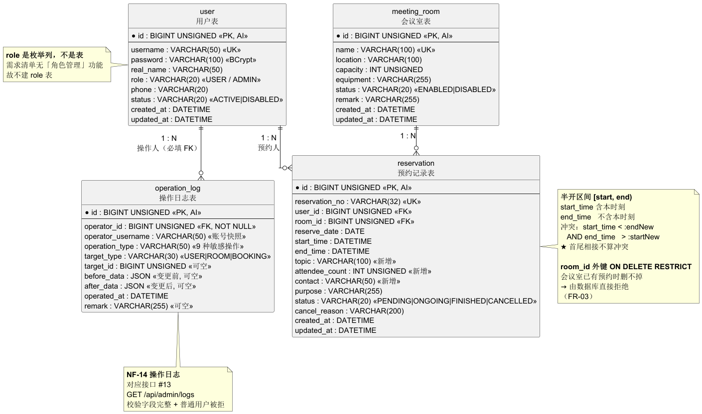

# 智能会议室管理系统 —— 数据库与接口设计

| 项 | 内容 |
|---|---|
| 项目 | 智能会议室管理系统（第 4 组） |
| 阶段 | 第 8 周 · 数据库与接口设计定稿 |
| 配套文档 | 《01_系统设计说明书》（第 7 周）、《周推进计划_第7-8周》 |
| 建表脚本 | `docs/week07-08/schema.sql`（自包含）、`database/01_schema.sql` + `02_seed.sql`（拆分版，同源） |
| 需求依据 | 需求清单 V1.1（FR-01~20、NF-01~15、QR-01~03） |
| 技术基线 | MySQL 8.0.16+、Spring Boot 3.2.5、Java 17 |

---

## 0. 口径声明（先对口径，再看表）

本文档所有设计受以下七条硬约束支配，**任何一条与本文档冲突，以需求清单为准**。

| # | 口径 | 说明 |
|---|------|------|
| 1 | **最终方案 = 方案 A（自由时间段预约）** | 表结构里不存在"固定时段编号""时段表"等字段，是方案 A 的直接体现 |
| 2 | **冲突判定用半开区间 `[start, end)`** | 含开始时刻、不含结束时刻；**首尾相接不算冲突** |
| 3 | **`role` 不单独建表** | 需求清单无「角色管理」功能，角色以 `user.role` 枚举列承载（FR-02） |
| 4 | **`reservation.status` 四态** | 待开始／进行中／已结束／已取消（NF-08），**不是**任务书示例的 3 态 |
| 5 | **实体表 4 张** | `user`／`meeting_room`／`reservation`／`operation_log`。第 4 张是 NF-14 要求的，不可省 |
| 6 | **接口锁定 14 条** | 必须 12 条 + 有时间 2 条，与《01_系统设计说明书》§4.1 完全一致 |
| 7 | **禁写 9 项一条不落地** | 表结构里不存在任何支撑人脸识别／物联网／3D 场景／智能推荐／周期性预约／多级审批／消息推送／统一认证对接／移动端原生的字段 |

> **第 4 条要特别说明**：任务书示例给的是 `status TINYINT` 三态（0 已预约／1 已取消／2 已结束）。任务书同一节又写明"图和表只是格式参照，照抄不算完成"。本组按需求清单 NF-08 取**四态语义**，但**存储类型沿用第 6 周既有骨架的 `VARCHAR(20)` 枚举**——语义以需求清单为准，格式与既有工程同源，两边都不违背。

---

## 1. 设计概述

### 1.1 从需求到存储的映射

需求清单里的东西落在哪儿，一张表说清：

| 需求 | 落在哪个表 | 关键字段 |
|------|-----------|---------|
| FR-01／FR-02 登录与角色 | `user` | `username`、`password`、`role` |
| FR-03／FR-04 会议室增删改启停 | `meeting_room` | `name`、`status` |
| FR-05／FR-06 查询与过滤 | `meeting_room` | `location`、`capacity`、`status` |
| FR-07～FR-10 预约与冲突检测 | `reservation` | `room_id`、`reserve_date`、`start_time`、`end_time`、`topic`、`attendee_count`、`contact` |
| FR-11～FR-13 我的预约增删改 | `reservation` | `user_id`、`status`、`cancel_reason` |
| FR-14 用户管理 | `user` | `status`、`phone` |
| FR-15／FR-16 管理员处理预约 | `reservation` | `operator_id`、`cancel_reason` |
| FR-17 会议室占用时段 | `reservation`（读） | `start_time`、`end_time`、`status` |
| FR-19 预约筛选 | `reservation` | `reserve_date`、`status` |
| NF-07 并发不超订 | `reservation` ＋ 联合索引 | `idx_reservation_room_time` |
| NF-08 状态四态 | `reservation.status` | 枚举 + CHECK |
| NF-14 操作日志 | **`operation_log`** | 全表 |

### 1.2 与第 6 周既有骨架的关系（新增了什么、为什么）

既有 `database/01_schema.sql` 是第 6 周工程骨架，只含 3 张表。本文档相对它的变动**共两处，全部有理由**：

| 变动 | 内容 | 理由 |
|------|------|------|
| **新增 3 个字段** | `reservation.topic`（会议主题）、`reservation.attendee_count`（参会人数）、`reservation.contact`（联系人） | FR-07 要求提交预约时填会议主题、参会人数、联系人，三者是**必填业务信息**；既有骨架只有 `purpose` 一个，不足以承载 FR-07 |
| **新增 1 张表** | `operation_log` | NF-14「可审计性」在需求清单中是**必须完成项且带验证方式**（查系统操作日志、校验字段完整、普通用户访问被拒）。不建表则第 8 周 ER 图与建表脚本与需求清单**不同源** |

**除此之外既有字段一律不动**（`reservation_no`／`reserve_date`／`operator_id`／`purpose`／`meeting_room.name`／`meeting_room.location`／三条时间 CHECK 等全部保留），避免第 9 周代码与第 6 周已跑通的骨架打架。

> **会议室定位字段的口径**：既有骨架与既有后端实体 `MeetingRoom` 用的是 **`name`（唯一）＋ `location`（位置）＋ `remark`（备注）**，不是 `building`／`room_no`。本组计划与说明书早期版本曾误写过 `building`／`room_no`，**已于 10-19 全部对齐到既有骨架**——因为第 6 周的前后端已按 `name`／`location` 联调通过，改字段名等于让已跑通的代码失效。唯一约束也从 `UNIQUE(building, room_no)` 改为 **`uk_room_name(name)`**。

### 1.3 E-R 图



> 源文件 `docs/week07-08/图/04_ER图.puml`，另有 `.svg` 同名矢量版。

三组关系：

- `user` 1 : N `reservation` —— 一个用户有多条预约（`reservation.user_id`）
- `meeting_room` 1 : N `reservation` —— 一个会议室有多条预约（`reservation.room_id`）
- `user` 1 : N `operation_log` —— 一个用户有多条操作日志（`operation_log.operator_id`，**可空**：登录失败等场景尚无用户身份）

---

## 2. 物理表结构（4 张）

> 环境要求 **MySQL 8.0.16 及以上**：`CHECK` 约束自 8.0.16 起才被真正执行，低版本会静默忽略。
> 全部 `ENGINE = InnoDB`、`CHARSET = utf8mb4`、`COLLATE = utf8mb4_general_ci`。

### 2.1 `user` 用户信息表

| 字段 | 类型 | 约束 | 默认 | 说明 | 依据 |
|------|------|------|------|------|------|
| `id` | BIGINT UNSIGNED | PK, AUTO_INCREMENT | | 用户ID | |
| `username` | VARCHAR(50) | NOT NULL, **UNIQUE** | | 登录账号 | FR-01 |
| `password` | VARCHAR(100) | NOT NULL | | **BCrypt 摘要（cost=10，60 字符）**。不存明文；校验用 `PasswordEncoder.matches()`，**不可用字符串相等比较** | NF-05 |
| `real_name` | VARCHAR(50) | NOT NULL | `''` | 姓名 | |
| `role` | VARCHAR(20) | NOT NULL, CHECK ∈ {USER, ADMIN} | | 角色（**枚举列，不建 role 表**） | FR-02 |
| `phone` | VARCHAR(20) | 可空 | NULL | 联系电话 | FR-07 联系信息 |
| `status` | VARCHAR(20) | NOT NULL, CHECK ∈ {ACTIVE, DISABLED} | `ACTIVE` | 账号状态 | FR-14、NF-05 |
| `created_at` | DATETIME | NOT NULL | `CURRENT_TIMESTAMP` | 创建时间 | |
| `updated_at` | DATETIME | NOT NULL | 当前时间，ON UPDATE | 更新时间 | |

索引：`PRIMARY KEY(id)`、`UNIQUE KEY uk_user_username(username)`、`KEY idx_user_role(role)`

表注释：`D1 用户信息表（普通用户 + 管理员）`

### 2.2 `meeting_room` 会议室信息表

| 字段 | 类型 | 约束 | 默认 | 说明 | 依据 |
|------|------|------|------|------|------|
| `id` | BIGINT UNSIGNED | PK, AUTO_INCREMENT | | 会议室ID | |
| `name` | VARCHAR(100) | NOT NULL, **UNIQUE** | | 会议室名称 | FR-03 |
| `location` | VARCHAR(100) | NOT NULL | | 位置（如"逸夫楼A座1层"） | FR-05 筛选字段 |
| `capacity` | INT UNSIGNED | NOT NULL, CHECK > 0 | | 可容纳人数 | FR-05 筛选字段 |
| `equipment` | VARCHAR(255) | NOT NULL | `''` | 设备描述，仅作展示 | |
| `status` | VARCHAR(20) | NOT NULL, CHECK ∈ {ENABLED, DISABLED} | `ENABLED` | 启用状态 | FR-04、FR-06 |
| `remark` | VARCHAR(255) | 可空 | NULL | 备注 | |
| `created_at` / `updated_at` | DATETIME | NOT NULL | 同上 | 创建／更新时间 | |

索引：`PRIMARY KEY(id)`、`UNIQUE KEY uk_room_name(name)`、`KEY idx_room_status(status)`

表注释：`D2 会议室信息表；停用后前台查询须过滤掉（FR-06）`

### 2.3 `reservation` 预约记录表 ★核心表

| 字段 | 类型 | 约束 | 默认 | 说明 | 依据 |
|------|------|------|------|------|------|
| `id` | BIGINT UNSIGNED | PK, AUTO_INCREMENT | | 预约ID | |
| `reservation_no` | VARCHAR(32) | NOT NULL, **UNIQUE** | | 预约编号（对外展示），规则 = `MR` + yyyyMMdd + 三位流水号 = **13 位字符**，形如 `MR20261012001`。★ 2026-10-21 修正：脚本注释曾误写为"BK + yyyyMMdd + 4 位"且示例 16 位，三处口径已统一为 13 位（详见 `05_…实测记录.md` §9.4） | FR-07 |
| `user_id` | BIGINT UNSIGNED | NOT NULL, **FK → user.id** | | 预约人 | FR-11 |
| `room_id` | BIGINT UNSIGNED | NOT NULL, **FK → meeting_room.id，ON DELETE RESTRICT** | | 被预约会议室 | FR-07 |
| `reserve_date` | DATE | NOT NULL | | 预约日期。**与 start_time 冗余存储**，便于按日查询与"禁止跨天"校验 | FR-08 |
| `start_time` | DATETIME | NOT NULL | | 开始时间（**★含本时刻，半开区间左闭**） | FR-09 |
| `end_time` | DATETIME | NOT NULL | | 结束时间（**★不含本时刻，半开区间右开**） | FR-09 |
| `topic` | VARCHAR(100) | NOT NULL | | 会议主题（**本轮新增**） | FR-07 必填 |
| `attendee_count` | INT UNSIGNED | NOT NULL, CHECK > 0 | | 参会人数（**本轮新增**） | FR-07 必填 |
| `contact` | VARCHAR(50) | NOT NULL | | 联系人（**本轮新增**） | FR-07 必填 |
| `purpose` | VARCHAR(255) | NOT NULL | | 用途 | FR-07 |
| `status` | VARCHAR(20) | NOT NULL, CHECK ∈ {PENDING, ONGOING, FINISHED, CANCELLED} | `PENDING` | 预约状态四态 | **NF-08** |
| `cancel_reason` | VARCHAR(255) | 可空 | NULL | 取消原因。**管理员强制取消须填且不少于 5 个字符** | FR-16、UC-A05 |
| `operator_id` | BIGINT UNSIGNED | 可空 | NULL | 处理该预约的管理员ID，仅"处理异常预约"时写入 | FR-16 |
| `created_at` / `updated_at` | DATETIME | NOT NULL | 同上 | 创建／更新时间 | |

索引：

| 索引 | 字段 | 用途 |
|------|------|------|
| `PRIMARY KEY` | `id` | |
| `UNIQUE KEY uk_reservation_no` | `reservation_no` | 预约编号唯一 |
| `KEY idx_reservation_room_time` | `room_id, start_time, end_time` | **冲突检测（FR-09）与"当日占用时段"（FR-17）共用** |
| `KEY idx_reservation_user` | `user_id` | 我的预约（FR-11） |
| `KEY idx_reservation_date_status` | `reserve_date, status` | 按日／状态筛选（FR-19） |

约束：

| 约束 | 表达式 | 依据 |
|------|--------|------|
| 时间先后 | `CHECK (end_time > start_time)` | FR-08 |
| 禁止跨天 | `CHECK (DATE(start_time) = DATE(end_time))` | FR-08 |
| 单次 ≤ 8 小时 | `CHECK (TIMESTAMPDIFF(MINUTE, start_time, end_time) <= 480)` | FR-08 |
| 状态枚举 | `CHECK (status IN ('PENDING','ONGOING','FINISHED','CANCELLED'))` | NF-08 |

> **约束只是最后一道防线**：FR-08 的四条规则（不跨天／≤8h／end>start／距开始 30 分钟内可改）必须由**前后端双重校验**实现（§3.4），数据库 CHECK 兜底但不替代。FR-12／FR-13 的"距开始 30 分钟"涉及 `NOW()`，**不写进 CHECK**——MySQL CHECK 里不允许非确定性函数。

### 2.4 `operation_log` 操作日志表

| 字段 | 类型 | 约束 | 默认 | 说明 | 依据 |
|------|------|------|------|------|------|
| `id` | BIGINT UNSIGNED | PK, AUTO_INCREMENT | | 日志ID | |
| `operator_id` | BIGINT UNSIGNED | 可空, **FK → user.id** | | 操作人ID。**可空**：登录失败等场景无用户身份 | NF-14 |
| `operator_role` | VARCHAR(20) | 可空 | NULL | 操作时角色（`USER`／`ADMIN`）。**冗余存一份**，避免日志随用户角色变更而失真 | NF-14 |
| `operation_type` | VARCHAR(30) | NOT NULL | | 操作类型，见下方枚举 | NF-14 |
| `target_type` | VARCHAR(30) | 可空 | NULL | 操作对象类型：`ROOM`／`BOOKING`／`USER` | NF-14 |
| `target_id` | BIGINT UNSIGNED | 可空 | NULL | 操作对象ID | NF-14 |
| `detail` | VARCHAR(500) | NOT NULL | | 操作详情（文本描述，含关键参数） | NF-14 |
| `ip` | VARCHAR(45) | 可空 | NULL | 来源IP。**45 字符**是 IPv6 最长表示的长度，兼容 v4 | NF-14 |
| `created_at` | DATETIME | NOT NULL | `CURRENT_TIMESTAMP` | 操作时间 | NF-14 |

索引：`PRIMARY KEY(id)`、`KEY idx_log_operator(operator_id)`、`KEY idx_log_created(created_at)`、`KEY idx_log_target(target_type, target_id)`

表注释：`NF-14 可审计性；对应接口 GET /api/admin/logs`

**`operation_type` 枚举**（与 `schema.sql` 的 `ck_log_operation_type` CHECK **完全一致**，只记 **NF-14 列明的管理员敏感操作**；普通用户行为如登录/提交预约不属于 NF-14 审计范围，不入此表）：

| 值 | 触发时机 | NF-14 对应 |
|---|---|---|
| `USER_CREATE` | 管理员新增用户 | 新增用户 |
| `USER_DISABLE` | 管理员停用账号 | 停用用户 |
| `USER_ENABLE` | 管理员启用账号 | 停用/启用用户 |
| `ROLE_CHANGE` | 管理员变更角色 | 角色变更 |
| `ROOM_CREATE` | 管理员新增会议室 | 新增会议室 |
| `ROOM_UPDATE` | 管理员修改会议室 | （敏感操作留痕） |
| `ROOM_DELETE` | 管理员删除会议室 | 删除会议室 |
| `ROOM_STATUS` | 管理员启/停用会议室 | 新增/删除会议室语义延伸 |
| `BOOKING_FORCE_CANCEL` | **管理员强制取消预约（FR-16，必须记）** | 强制取消预约 |

> ★ 与任务书示例的取舍：任务书/需求清单只要求**管理员敏感操作**留痕，故 `LOGIN`／`LOGOUT`／用户自行提交/取消预约**不进这张表**（那是业务数据，预约本身已在 `reservation` 表留痕）。示例种子数据为 1 条 `BOOKING_FORCE_CANCEL`，恰好同时演示 FR-16 与 NF-14。
> **NF-14 的三条验证方式与本表字段的对应**：①「查系统操作日志」→ 表存在且有数据；②「校验字段完整」→ 上表 9 个字段中前 8 个为必填语义（`operator_id`／`target_*` 可空但留痕场景须填）；③「普通用户访问被拒」→ 由接口层鉴权保证（§3.3 规则 R1）。

---

## 3. 接口设计定稿（14 条）

### 3.1 统一约定

| 项 | 约定 |
|---|---|
| 前缀 | 全部 `/api` |
| 统一响应体 | `{ "code": 200, "message": "ok", "data": ... }`；**`code = 200` 为成功**，非 200 为业务错误（400／401／403／404／500），**业务失败也返回 HTTP 200**，由前端按 `code` 判定（NF-10）。与既有 `ApiResponse.CODE_OK = 200`、前端 `http.ts` 的 `body.code !== 200` 判定完全一致 |
| 认证 | 请求头 `Authorization: Bearer <token>`；**除 #1 登录外全部需要登录** |
| 鉴权 | 管理员专属接口要求 `role = ADMIN`，普通用户访问返回 **403**「无权访问该功能」 |
| 时间格式 | 日期 `yyyy-MM-dd`，时刻 `HH:mm:ss`，完整时间 `yyyy-MM-dd HH:mm:ss` |
| 命名口径 | **对外资源名 booking**（`/api/bookings/**`），**对内表名 reservation**（见《01_系统设计说明书》§2.1 命名声明） |

### 3.2 接口清单（14 条，与说明书 §4.1 一致）

| # | 接口名 | 方法与路径 | 需求 | 优先级 | 鉴权 | 状态 |
|---|--------|-----------|------|--------|------|------|
| 1 | 登录 | `POST /api/auth/login` | FR-01、FR-02 | 必须 | 公开 | ✅ 第 6 周已实现 |
| 2 | 登出 | `POST /api/auth/logout` | NF-04 | 必须 | 登录 | 第 9 周 |
| 3 | 会议室列表 | `GET /api/rooms` | FR-05、FR-06、FR-17 | 必须 | 登录 | ✅ 第 6 周已实现 |
| 4 | 会议室占用时段 | `GET /api/rooms/{id}/occupancy` | FR-17、FR-10 | **必须** | 登录 | ✅ 第 9 周已实现（优先级由「有时间」升「必须」，见 `docs/week09/01_接口变更记录.md` 决策 D2） |
| 5 | 提交预约 | `POST /api/bookings` | FR-07~FR-10、FR-18 | 必须 | 登录 | 第 9 周 |
| 6 | 我的预约 | `GET /api/bookings/mine` | FR-11 | 必须 | 登录 | 第 9 周 |
| 7 | 修改我的预约 | `PUT /api/bookings/{id}` | FR-12 | 必须 | 本人 | 第 9 周 |
| 8 | 取消我的预约 | `DELETE /api/bookings/{id}` | FR-13 | 必须 | 本人 | 第 9 周 |
| 9 | 全部预约 | `GET /api/admin/bookings` | FR-15、FR-19 | 必须 | 管理员 | 第 9 周 |
| 10 | 强制取消异常预约 | `PUT /api/admin/bookings/{id}/cancel` | FR-16 | 必须 | 管理员 | 第 9 周 |
| 11 | 会议室管理 | `GET /api/admin/rooms`｜`POST /api/admin/rooms`｜`PUT /api/admin/rooms/{id}`｜`DELETE /api/admin/rooms/{id}` | FR-03、FR-04 | 必须 | 管理员 | 第 9 周 |
| 12 | 用户管理 | `GET /api/admin/users`｜`POST /api/admin/users`｜`PUT /api/admin/users/{id}` | FR-14 | 必须 | 管理员 | 第 9 周 |
| 13 | 操作日志查询 | `GET /api/admin/logs` | NF-14 | 必须 | 管理员 | 第 9 周 |
| 14 | 利用率概览 | `GET /api/admin/stats/utilization` | FR-20 | 有时间 | 管理员 | 第 9~10 周 |

### 3.3 鉴权规则（R1~R6）

| 编号 | 规则 | 违反时 |
|------|------|--------|
| R1 | 管理员专属接口（#9~#14）要求 `role = ADMIN` | 403「无权访问该功能」 |
| R2 | #7／#8 只能操作 `reservation.user_id = 当前用户` 的记录 | 403「不能操作他人的预约」 |
| R3 | 所有接口（除 #1）缺 token 或 token 失效 | 401「登录状态已失效，请重新登录」 |
| R4 | #4 只能读**已启用**会议室的占用时段 | 404「会议室不存在」 |
| R5 | #10 强制取消**不是审批**，直接生效（方案 A 无人工审核环节） | — |
| R6 | 已取消的预约（`status = CANCELLED`）时段**立即释放**，可被他人预约 | — |

### 3.4 逐条接口定稿（路径／方法／入参／出参／错误提示）

#### #1 登录 `POST /api/auth/login`

| 项 | 内容 |
|---|---|
| 入参 | `username: string`（必填）、`password: string`（必填） |
| 出参 | `userId`、`username`、`realName`、`role: "USER"｜"ADMIN"`、`token`、`tokenExpiresIn` |
| 错误提示 | 400「账号和密码不能为空」／**401「账号或密码错误」（账号不存在与密码错误同提示，防账号枚举）**／403「该账号已被停用，请联系管理员」 |
| 实现 | ✅ 第 6 周已实现；`token` 与 `tokenExpiresIn` 第 9 周按 NF-04 补（**新增字段不改路径**） |

#### #2 登出 `POST /api/auth/logout`

| 项 | 内容 |
|---|---|
| 入参 | 无（token 从请求头取） |
| 出参 | 无业务数据，仅 `code = 200`（`ApiResponse.success()`，data 为 null） |
| 错误提示 | 401「登录状态已失效，请重新登录」；重复调用按**幂等**处理，仍返回成功 |
| 备注 | 服务端只做令牌失效标记，**不做**"登出即撤销其全部预约"这类范围外动作 |

#### #3 会议室列表 `GET /api/rooms`

| 项 | 内容 |
|---|---|
| 入参（查询串） | `location`（可空，位置或名称模糊匹配）、`minCapacity`（可空）、`status: "ENABLED"｜"DISABLED"`（可空，前台传 `ENABLED` 即过滤停用，FR-06）、`date`（可空，`yyyy-MM-dd`，传则返回各室当日占用时段） |
| 出参 | `RoomVO[]`：`id`、`name`、`location`、`capacity`、`equipment`、`status`、`occupiedSlots: string[]`（形如 `"09:00-10:00"`） |
| 错误提示 | 无结果时**返回空数组，不报错**，前端显示「未找到符合条件的会议室」（FR-05） |
| 实现 | ✅ 已实现，参数名即上述四项 |

#### #4 会议室占用时段 `GET /api/rooms/{id}/occupancy`（有时间再完成）

| 项 | 内容 |
|---|---|
| 入参 | 路径 `id: number`；查询串 `date: string`（**必填**，`yyyy-MM-dd`） |
| 出参 | `roomId`、`roomName`、`date`、`occupiedSlots: {startTime, endTime}[]`（**只含 `status <> 'CANCELLED'` 的记录**） |
| 错误提示 | 404「会议室不存在」／400「请选择预约日期」 |
| 备注 | FR-17 可后置，但**#5 的 409 响应本身必须返回被占用时段（FR-10，必须实现）**——两者数据同源 |

#### #5 提交预约 `POST /api/bookings` ★核心

| 项 | 内容 |
|---|---|
| 入参 | `roomId: number`、`date: string`、`startTime: string`、`endTime: string`、`topic: string`（**必填**，会议主题）、`attendeeCount: number`（**必填**）、`contact: string`（**必填**）、`purpose: string`（选填） |
| 出参 | `id`、`reservationNo`（形如 `MR20261012001`）、`status: "PENDING"` |
| 错误提示 | 400「请填写会议主题／参会人数／联系人」／401「未登录」／400「该会议室已停用，无法预约」（FR-06）／400「预约不能跨天，且单次不能超过 8 小时」／400「结束时间必须晚于开始时间」（FR-08）／**409「该会议室在此时间段已被占用」＋ `data.occupiedSlots` 返回被占用时段**（FR-09、FR-10） |
| 前端 | 409 时**保留已填内容**（FR-18），不清空表单 |
| 事务 | 校验通过后 `INSERT` 与日志写入同一事务；冲突检测前 `SELECT ... FOR UPDATE` 锁同会议室当日记录，保证并发不超订（NF-07） |

#### #6 我的预约 `GET /api/bookings/mine`

| 项 | 内容 |
|---|---|
| 入参 | 无（登录态由 token 携带）；可选查询串 `status`（按状态筛选） |
| 出参 | `ReservationVO[]`：`id`、`reservationNo`、`roomId`、`roomName`、`startTime`、`endTime`、`topic`、`attendeeCount`、`contact`、`status`（四态中文文案由**前端**映射） |
| 错误提示 | 401；无数据返回空数组 |

#### #7 修改我的预约 `PUT /api/bookings/{id}`

| 项 | 内容 |
|---|---|
| 入参 | 路径 `id`；请求体 `startTime`、`endTime`、`topic`、`attendeeCount`、`contact`、`purpose`（均可空，取非空字段更新） |
| 出参 | 更新后 `ReservationVO` |
| 错误提示 | 401／403「不能操作他人的预约」／404「预约不存在」／400「该预约已开始或已结束，无法修改」／400「距预约开始不足 30 分钟，无法修改」（**FR-12**）／400 时间与冲突同类错误（同 #5） |
| 前端 | 修改成功后跳转"我的预约"并**高亮该条**（FR-19） |

#### #8 取消我的预约 `DELETE /api/bookings/{id}`

| 项 | 内容 |
|---|---|
| 入参 | 路径 `id`；可选请求体 `reason: string` |
| 出参 | 无业务数据，仅 `code = 200`（`ApiResponse.success()`，data 为 null） |
| 错误提示 | 401／403「不能操作他人的预约」／404「预约不存在」／400「距预约开始不足 30 分钟，无法取消」（**FR-13**）／400「已取消的预约不能重复取消」 |
| 副作用 | `status = 'CANCELLED'`，**时段立即释放**（R6） |

#### #9 全部预约（管理员） `GET /api/admin/bookings`

| 项 | 内容 |
|---|---|
| 入参 | 查询串 `userId?`、`roomId?`、`status?`、`startDate?`、`endDate?`（均可空，FR-19 筛选） |
| 出参 | `ReservationVO[]`（含 `userName`、`cancelReason`、`operatorName`） |
| 错误提示 | 403「无权访问该功能」／401 |

#### #10 强制取消异常预约 `PUT /api/admin/bookings/{id}/cancel`

| 项 | 内容 |
|---|---|
| 入参 | 路径 `id`；请求体 `reason: string`（**必填，不少于 5 个字符**，UC-A05） |
| 出参 | 更新后 `ReservationVO` |
| 错误提示 | 403「无权访问该功能」／404「预约不存在」／400「请填写取消原因（不少于 5 个字符）」／400「已取消的预约不能重复取消」 |
| 副作用 | `status = 'CANCELLED'`、`cancel_reason = reason`、`operator_id = 当前管理员`，**并写入一条 `FORCE_CANCEL` 日志** |
| 口径 | **这是"强制取消"，不是"审批"**——方案 A 无人工审核环节（口径声明 R5） |

#### #11 会议室管理 `GET /api/admin/rooms`｜`POST /api/admin/rooms`｜`PUT /api/admin/rooms/{id}`｜`DELETE /api/admin/rooms/{id}`

| 方法 | 入参 | 出参 | 错误提示 |
|------|------|------|---------|
| `GET` | 与 #3 同 | `RoomVO[]` | 403 |
| `POST` | `name`、`location`、`capacity`、`equipment?`、`remark?` | 新建 `RoomVO` | 403／400「会议室名称已存在」／400「可容纳人数必须大于 0」 |
| `PUT` | 路径 `id`；`name?`、`location?`、`capacity?`、`equipment?`、`status?` | 更新后 `RoomVO` | 403／404／400 同上 |
| `DELETE` | 路径 `id` | 无业务数据 | 403／404／**409「该会议室存在预约记录，无法删除」（见 §4）** |

> **`PUT` 同时承载启用／停用**：传 `status = DISABLED` 即停用。停用后**已有预约保留**，但不允许产生新预约（FR-04、FR-06）。

#### #12 用户管理 `GET /api/admin/users`｜`POST /api/admin/users`｜`PUT /api/admin/users/{id}`

| 方法 | 入参 | 出参 | 错误提示 |
|------|------|------|---------|
| `GET` | 查询串 `status?`、`role?` | `UserVO[]`（**不含 password 字段**） | 403 |
| `POST` | `username`、`password`、`realName`、`phone?`、`role?`（默认 `USER`） | 新建 `UserVO` | 403／400「账号已存在」／400「密码长度不足 6 位」 |
| `PUT` | 路径 `id`；`status?`（启用／停用）、`realName?`、`phone?` | 更新后 `UserVO` | 403／404「用户不存在」／400「不能停用当前登录的管理员账号」 |

#### #13 操作日志查询 `GET /api/admin/logs`

| 项 | 内容 |
|---|---|
| 入参 | 查询串 `operatorId?`、`operationType?`、`targetType?`、`startDate?`、`endDate?` |
| 出参 | `OperationLogVO[]`：`id`、`operatorName`、`operatorRole`、`operationType`、`targetType`、`targetId`、`detail`、`ip`、`createdAt`；外层包 `total`、`pageNum`、`pageSize` |
| 错误提示 | **403「无权访问该功能」（普通用户访问被拒 —— NF-14 验证点之一）**／401 |
| 备注 | NF-14 要求"可查、可追溯"，故**只读不删**：本接口不提供删除操作，避免审计链被破坏 |

#### #14 利用率概览 `GET /api/admin/stats/utilization`（有时间再完成）

| 项 | 内容 |
|---|---|
| 入参 | 查询串 `startDate?`、`endDate?`（默认近 7 天） |
| 出参 | `totalRooms`、`totalBookings`、`avgDailyHours`、`roomRanking: {roomId, roomName, hours}[]` |
| 错误提示 | 403／400「日期区间不合法」 |
| 备注 | FR-20 属"有时间再完成"，**统计口径基于 `status <> 'CANCELLED'` 的记录** |

### 3.4 关键 SQL（实现时的口径基准）

**冲突检测（FR-09，半开区间）** —— 走联合索引 `idx_reservation_room_time`：

```sql
SELECT COUNT(*) FROM reservation
 WHERE room_id = #{roomId}
   AND reserve_date = #{date}
   AND status <> 'CANCELLED'
   AND start_time < #{endNew}      -- 新开始 < 旧结束
   AND end_time   > #{startNew}    -- 新结束 > 旧开始
```

`count = 0` 方可插入；`count >= 1` 返回 409 ＋ `occupiedSlots`。

**首尾相接不算冲突的验证**（`09:00-10:00` 与 `10:00-11:00`）：

| 已有 | 新增 | `start_new < end_old` | `end_new > start_old` | 结论 |
|------|------|---|---|---|
| 09:00-10:00 | 08:00-09:00 | 08:00 < 10:00 ✓ | 09:00 > 09:00 ✗ | **不冲突** ✓ |
| 09:00-10:00 | 10:00-11:00 | 10:00 < 10:00 ✗ | — | **不冲突** ✓ |
| 09:00-10:00 | 09:30-10:30 | 09:30 < 10:00 ✓ | 10:30 > 09:00 ✓ | 冲突 |
| 09:00-10:00 | 08:30-09:30 | 08:30 < 10:00 ✓ | 09:30 > 09:00 ✓ | 冲突 |
| 09:00-10:00 | 09:00-10:00 | ✓ | ✓ | 冲突（完全重叠） |
| 09:00-10:00 | 07:00-12:00 | ✓ | ✓ | 冲突（完全包含） |
| 09:00-10:00 | 08:00-08:30 | 08:00 < 10:00 ✓ | 08:30 > 09:00 ✗ | **不冲突** ✓ |

> 半开区间 `[start, end)` 的严格大于／小于是"首尾相接不算冲突"的**唯一来源**，改用 `<=` 或 `>=` 就会把 10:00 边界判成冲突。

**当日占用时段（FR-17／FR-10 的 409 响应）**：

```sql
SELECT DATE_FORMAT(start_time,'%H:%i') AS start,
       DATE_FORMAT(end_time,  '%H:%i') AS end
  FROM reservation
 WHERE room_id = #{roomId}
   AND reserve_date = #{date}
   AND status <> 'CANCELLED'
 ORDER BY start_time;
```

**并发不超订（NF-07）**：事务内先 `SELECT ... FOR UPDATE` 锁住该会议室当日的记录行，再做 `COUNT` 判断与 `INSERT`，避免两个并发请求同时通过检查。

---

## 4. 关键设计决策与理由

### 4.1 为什么 `room_id` 外键用 `ON DELETE RESTRICT`

**答"删除会议室会影响已有预约吗"——会，而且由数据库直接拒绝。**

外键默认行为就是 `RESTRICT`（等价于显式写 `ON DELETE RESTRICT`）。若某会议室已被预约，删除它会让 `reservation.room_id` 指向不存在的会议室，破坏数据完整性，因此**数据库层面直接报错拒绝**。

对应的接口层提示：`409「该会议室存在预约记录，无法删除」`（#11 DELETE）。

这正是 FR-03 的价值所在：**已产生的预约不会因为会议室被删而变成悬空数据**。真要删，只能先由管理员强制取消相关预约。

### 4.2 为什么 `reserve_date` 与 `start_time` 冗余存储

看起来是重复，但收益明确：

- **按日查询快**：FR-11「我的预约」、FR-17「当日占用时段」、FR-19「按日期筛选」全按 `reserve_date` 走，命中 `idx_reservation_date_status`，不必对 `start_time` 做函数包装（`DATE(start_time)` 会让索引失效）。
- **禁止跨天校验直接**：`CHECK (DATE(start_time) = DATE(end_time))` 与前端校验都能直接用 `reserve_date` 对比。

冗余的代价是"两处可能不一致"——但两者都由应用层在同一次插入中赋值，且有 CHECK 约束兜底，实际风险为零。

### 4.3 为什么状态流转不写定时器

需求清单里**没有定时任务功能**，写了属超范围（禁写 9 项之外的额外风险）。因此：

- 表结构只存 `status`
- 流转规则：**读取时按当前时间推导 + 落库时校正**

即查询"我的预约"时，若一条 `PENDING` 记录当前时间已过 `end_time`，返回前按 `start_time`/`end_time` 与 `NOW()` 的关系推导出应显示为 `ONGOING` 或 `FINISHED`，并在更新该记录时校正落库。不引入 `XXL-Job`／`@Scheduled` 任何组件。

### 4.4 为什么 `operation_log` 不设 `ON DELETE CASCADE`

即使将来删除用户，日志也**必须保留**——审计链一旦可被级联删除，NF-14「可审计性」就名存实亡。因此 `operator_id` 是普通外键（默认 RESTRICT），删用户时若无日志引用可删，有引用则被拒绝。

### 4.5 为什么 `operator_role` 要冗余存一份

若只存 `operator_id`，用户角色从 `USER` 升为 `ADMIN` 后，历史日志里的"当时他是普通用户"这一事实就会失真。冗余存操作发生时的角色快照，**日志才能反映当时的事实**。代价是可冗余字段，收益是审计准确性。

### 4.6 三处与任务书示例的差异汇总

| # | 任务书示例 | 本组做法 | 依据 |
|---|-----------|---------|------|
| 1 | `status TINYINT` 三态（0 已预约／1 已取消／2 已结束） | `status VARCHAR(20)` **四态**（PENDING／ONGOING／FINISHED／CANCELLED） | NF-08 语义为准，存储类型与既有骨架同源；任务书明确示例只是格式参照 |
| 2 | 可能含"角色表" | **不建 role 表**，用 `user.role` 枚举列 | 需求清单无角色管理功能 |
| 3 | `schema.sql` 未强调自带数据 | **自包含**：建库＋建表＋约束＋索引＋初始化数据一次跑通 | 课堂"干净环境一次执行"不能要两条命令 |

---

## 5. 建表脚本与初始化数据

### 5.1 自包含 `docs/week07-08/schema.sql`

**任务书要求：干净环境一次执行即跑通。** 因此自包含版一个文件内包含：

1. `CREATE DATABASE IF NOT EXISTS meeting_room`（utf8mb4）
2. 四张表的 `CREATE TABLE`（含全部 CHECK、索引、外键）
3. 初始化数据（账号／会议室／预约／日志）
4. 脚本末尾的**自带验证查询**（表清单、条数、BCrypt 格式、今日占用时段）

### 5.2 初始化数据口径

| 项 | 内容 | 为什么需要 |
|---|------|-----------|
| 用户 | 1 管理员 + 2 普通用户（`admin`／`user1`／`user2`） | 让种子预约分属不同用户，演示"我的预约"归属 |
| 密码 | 明文统一 `123456`，**库中存 BCrypt 摘要**（cost=10） | 同一明文密文每次不同，**三行密文各不相同是正常的**；明文只写根 README，**不写进本文档与脚本注释** |
| 会议室 | 3 间（**2 间 ENABLED + 1 间 DISABLED**） | 验证 FR-06 前台查询过滤掉停用会议室（B301 停用） |
| 预约 | **7 条**（固定日期 `2026-11-02` 与 `2026-10-12`）：A101 09:00-11:00 与 10:00-12:00 **时间重叠**（冲突组）；A202 09:00-10:00 与 10:00-11:00 **首尾相接**（不冲突组）；A101 14:00-15:00 已取消；A202 10-12 已结束；B301（停用室）09:00-10:00 历史预约 | **重叠对**验证冲突能被检出；**首尾相接对**验证 FR-09 不误判；挂停用室的历史预约验证 FR-04"停用保留已有预约" |
| 预约状态 | 覆盖 **`PENDING`（5）／`FINISHED`（1）／`CANCELLED`（1）** 三种，`ONGOING` 不造数据（由读取推导，NF-08） | 验证状态枚举、"取消后时段释放"与"已结束"展示 |
| 预约日期 | 固定日期（`2026-11-02` 等），非 `CURDATE()` | 自检段的冲突/首尾相接实证查询按固定日期写死，任何一天执行结果一致、可复现 |
| 操作日志 | 1 条示例（`BOOKING_FORCE_CANCEL`，管理员强制取消预约） | 同时演示 FR-16 强制取消留痕与 NF-14"日志可查"；与 §2.4 枚举一致 |

### 5.2.1 演示数据的两条合规约束（NF-06／NF-15）

| 约束 | 要求 | 本组做法 |
|------|------|---------|
| **NF-06 安全** | 演示、截图、导出内容**不得泄露真实手机号、真实教职工姓名**等敏感个人信息；测试数据与模拟数据，**不导入真实业务数据** | 种子数据中的 `real_name`（张三／李四／系统管理员）、`phone`（1380000000X）**全部为虚构值**，非真实人员信息；`username` 为 `admin`／`user1`／`user2` 通用账号。**演示截图不出现哈希串与明文口令** |
| **NF-15 可测试性** | 测试账号、测试数据与模拟业务数据**隔离**，方便回归测试，**不污染演示环境业务数据** | 本组按**库级隔离**执行：演示库 `meeting_room` 与测试库分开建（测试时 `CREATE DATABASE meeting_room_test`）；种子脚本可重复执行且**只清空本库四张表**，不影响其他库。回归测试的破坏性写入（删会议室、删用户）**只允许在测试库执行** |

> **为什么单列这一节**：NF-06 与 NF-15 是需求清单里的**非功能要求**，不在 14 条接口的表结构里，但**约束的是交付物的使用方式**——演示数据从哪来、截图能露出什么、测试能不能污染演示库。不写清楚，验收时无法判断是否达标；写了才有据可查。

### 5.3 与 `database/` 拆分版的关系

`database/01_schema.sql` + `02_seed.sql` 是第 6 周工程骨架（**已跑通并与后端联调**）。本轮的 `schema.sql` 是**同源的自包含版**：

- 同源指**表结构、约束、索引、字段名、枚举取值完全一致**
- 自包含版是**超集**：额外含 `operation_log` 表与 `reservation` 的 3 个新增字段
- **两者内容一致性由李牧远核对并记录**（`05_建表脚本干净库实测记录.md`）

> **版本口径**：`database/` 拆分版暂不覆盖，等第 9 周后端联调通过、第 10 周验证稳定后再同步，**避免动到已跑通的骨架**。第 8 周交付以 `docs/week07-08/schema.sql` 为准。

---

## 6. 可实现性自查

任务书要求"接口可实现"。逐条自查如下。

### 6.1 数据可支撑性（每条接口要的字段，表里有没有）

| 接口 | 需要的数据 | 支撑表 | 结论 |
|---|---|---|---|
| #1 登录 | 账号、密码摘要、姓名、角色、状态 | `user` | ✅ 全有 |
| #3 会议室列表 | 名称、位置、容量、设备、状态、当日占用 | `meeting_room` + `reservation` | ✅ 全有 |
| #5 提交预约 | 会议室状态、时间、主题、人数、联系人 | `meeting_room` + `reservation` | ✅ 全有 |
| #6 我的预约 | 预约人自己的记录 | `reservation.user_id` | ✅ |
| #7 修改预约 | 距开始 30 分钟判定 | `start_time` | ✅ |
| #10 强制取消 | 原因、操作人 | `cancel_reason`、`operator_id` | ✅ 全有 |
| #11 会议室删除 | 是否被预约 | `reservation.room_id` 外键 RESTRICT | ✅ 数据库直接给答案 |
| #13 操作日志 | 操作人、类型、对象、详情、IP、时间 | `operation_log` | ✅ 全有 |
| #14 利用率 | 会议室、总时长、排名 | `reservation` + `meeting_room` | ✅ 可算 |

**结论：14 条接口所需数据全部有表有字段支撑，无一条需要新增表或新增字段才能实现。**

### 6.2 约束与业务规则的可实现性

| 规则 | 实现层次 | 说明 |
|---|---|---|
| FR-09 冲突检测（半开区间） | SQL（§3.4） | 走联合索引，性能可接受 |
| FR-08 时间规则 | 前端 + 后端 + CHECK 三重 | CHECK 兜底，不依赖函数 |
| NF-07 并发不超订 | 事务 + `SELECT ... FOR UPDATE` | 单机 MySQL 下可靠 |
| NF-08 状态流转 | 读取推导 + 落库校正 | **不引入定时器** |
| NF-10 统一异常 | `GlobalExceptionHandler` | 已有（第 6 周） |
| NF-14 可审计 | `operation_log` + #13 | 表与接口已落 |

### 6.3 本文档的不足与后续

| # | 不足 | 何时补 |
|---|------|--------|
| 1 | token 采用自实现令牌方案，**具体是 JWT 还是服务端随机串第 9 周定**；本文档只锁定"请求头携带令牌"这一对外约定 | 第 9 周 |
| 2 | `operation_log` **只设计到查询，未设计归档/清理策略**；长期运行会持续增长 | 第 10 周（非需求清单要求，不影响交付） |
| 3 | 利用率统计（#14）的**口径细节**（是否含跨天折算、是否含 DISABLED 会议室）只给了原则 | 做 #14 时补 |
| 4 | 分页约定（`pageNum`/`pageSize`）目前**只有 #13 明确**，其余列表接口暂按全量返回；预约量增长后需统一加分页 | 第 9~10 周 |

---

## 七、★ 组内差异裁决记录（`b163339` → 本次修订）

> 本节登记 2026-10-19 的一次组内合并冲突与裁决结果，**保留痕迹以便追溯**，不是新增设计内容。

### 7.1 冲突经过

第 8 周材料并行推进，产生了同一份文件的两版：

| 版本 | 来源 | 提交 |
|------|------|------|
| 甲版 | 组员提交 `b163339`（17:08） | `docs/week07-08/02_数据库与接口设计.md`（353 行）、`docs/week07-08/schema.sql`（345 行）、`database/` 拆分版同步 |
| 乙版 | 本文档初稿（17:15） | 同名文件 546 行 |

两版在**数据库列名与状态编码**上不一致。组长裁决：**以第 6 周既有骨架口径为准**（理由见 §7.3），甲版的 `operation_log` 表设计与种子数据设计**予以保留并合并进来**。

### 7.2 三处差异的最终裁决

| # | 项 | 甲版（`b163339`） | **裁决结果（现行）** | 与第 6 周既有骨架是否同源 |
|---|----|-----------------|---------------------|--------------------------|
| 1 | 预约编号列 | `booking_no`，`BK`+yyyyMMdd+4位 | **`reservation_no`**，`MR`+yyyyMMdd+3位 | ✅ 同源 |
| 2 | 预约日期列 | `booking_date` | **`reserve_date`** | ✅ 同源 |
| 3 | 状态编码 | `TINYINT` 0/1/2/3 + CHECK | **`VARCHAR(20)` 四态枚举** + CHECK | ✅ 同源 |
| 4 | 会议室定位列 | `building` + `room_no`（UNIQUE 联合） | **`location`**，UNIQUE(`name`) | ✅ 同源 |

### 7.3 裁决依据：**改列名会让已跑通的工程当场报错**

这不是"两种风格任选其一"，甲版方案会破坏第 6 周已联调通过的代码。硬证据在既有后端 SQL 里：

```
backend/src/main/resources/mapper/MeetingRoomMapper.xml
  9:  SELECT id, name, location, capacity, equipment, status, remark, created_at, updated_at
 12:  <if test="location != null and location != ''">
 13:      AND (location LIKE CONCAT('%', #{location}, '%')
 34:  WHERE reserve_date = #{date}
 35:    AND status IN ('PENDING', 'ONGOING')
```

| 若采用甲版口径 | 后果 |
|---------------|------|
| `booking_date` | 第 34 行 SQL 报 `Unknown column 'reserve_date'` |
| `status TINYINT` | 第 35 行 `IN ('PENDING','ONGOING')` 恒不匹配，**"当日占用时段"永远返回空** |
| `meeting_room.building/room_no` | 第 9 行 SELECT 报 `Unknown column 'location'` |

**影响面已精确核实**：`backend/` 全目录中引用 `reservation` 表的只有 `MeetingRoomMapper.xml` 一处（第 4 行为注释、第 33 行为表名、第 34–35 行为条件列）。`Reservation` 实体与 `ReservationMapper` 第 9 周才建，因此**只需处理这一处，第 9 周新写的代码按本文档口径即可**。

### 7.4 甲版中予以保留的内容

甲版并非全盘推翻，以下设计质量较高，已合并进现行版本：

| 保留项 | 内容 |
|--------|------|
| `operation_log` 表 | 完整建表语句，含 `operator_username` 冗余快照、`before_data`/`after_data` JSON 前后态、`operated_at`、无删除标志 |
| 种子数据设计 | 7 条预约覆盖**冲突组**（09:00-11:00 vs 10:00-12:00）、**首尾相接组**（09:00-10:00 vs 10:00-11:00）、`CANCELLED`、`FINISHED`、挂停用会议室的历史预约（验证 FR-04） |
| 脚本自检段 | 5 段验证查询：已建表清单、各表记录数、状态分布、**冲突组实证**、**首尾相接实证** |
| 会议室演示数据 | 2 间 ENABLED + 1 间 DISABLED，DISABLED 用于验证 FR-06 停用过滤 |

### 7.5 干净库实测结果（2026-10-19，MySQL 8.0.29）

`DROP DATABASE meeting_room` 后**一次执行** `docs/week07-08/schema.sql`，无报错，自检输出：

| 校验项 | 结果 |
|--------|------|
| ① 已建表清单 | `user` / `meeting_room` / `reservation` / `operation_log` 共 **4 张** |
| ② 各表记录数 | user 3、meeting_room 3、reservation 7、operation_log 1 |
| ③ 预约状态分布 | PENDING 5、FINISHED 1、CANCELLED 1（ONGOING 未造数据） |
| ④ 冲突组实证 | 新预约 10:30-11:30 与 09:00-11:00 重叠 → **命中 2 条**；14:00-15:00 因原记录已 CANCELLED → **命中 0 条** |
| ⑤ 首尾相接实证 | 11:00-12:00 → **0 条**；08:00-09:00 → **0 条**；09:30-10:30 → **2 条** |

**⑤ 的三组结果同时成立，是半开区间 `[start, end)` 语义正确的直接证明**——首尾相接判不冲突、真重叠判冲突、已取消时段不参与判定。

> `05_建表脚本干净库实测记录.md`（李牧远）须由**未参与本次编写的人**在干净环境独立复现上述五段，作为 NF-10 与验收自查的证据。

---

## 附：本文档与其他材料的关系

| 材料 | 关系 |
|---|---|
| `01_系统设计说明书.md` | 上游。模块划分与本文档 §2 表结构、§3 接口必须一一对应；若不一致以需求清单为准 |
| `周推进计划_第7-8周.md` | 计划。本文档是 §4.2 第 8 周主交付之二 |
| `03_ER图` / `图/04_ER图.puml` | 本文档 §1.3 的图源 |
| `schema.sql` | 本文档 §2 与 §5 的脚本落地，**四张表结构必须与 §2 完全一致** |
| `需求清单 V1.1` | **最终裁判**。本文档与之冲突时以需求清单为准 |
