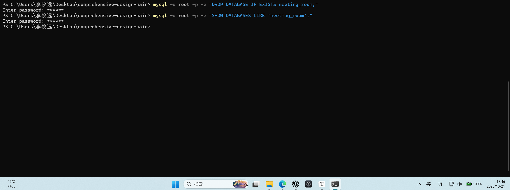
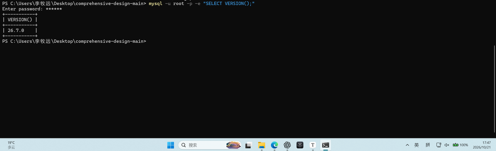
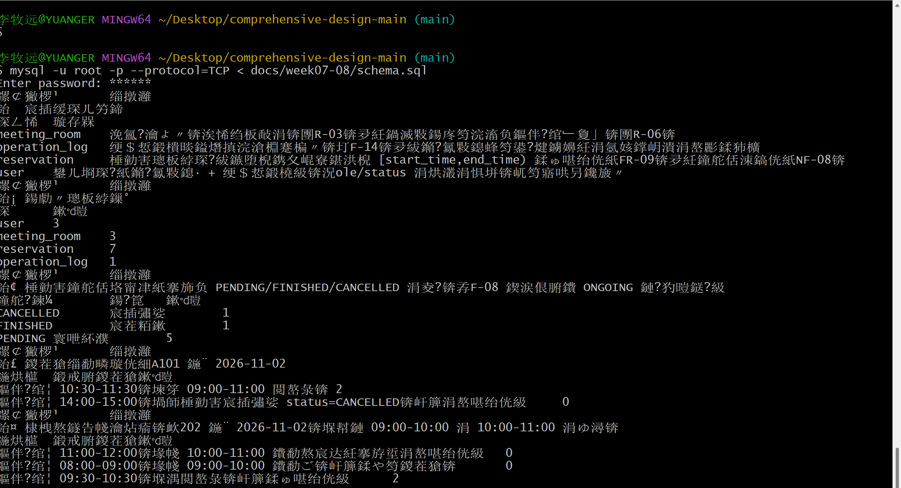
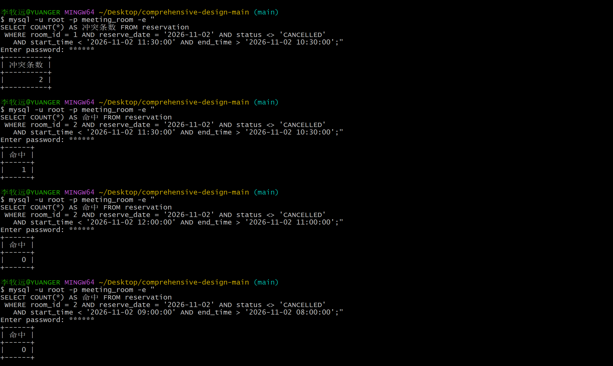
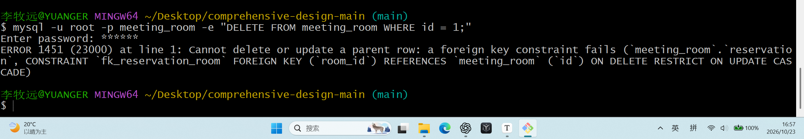
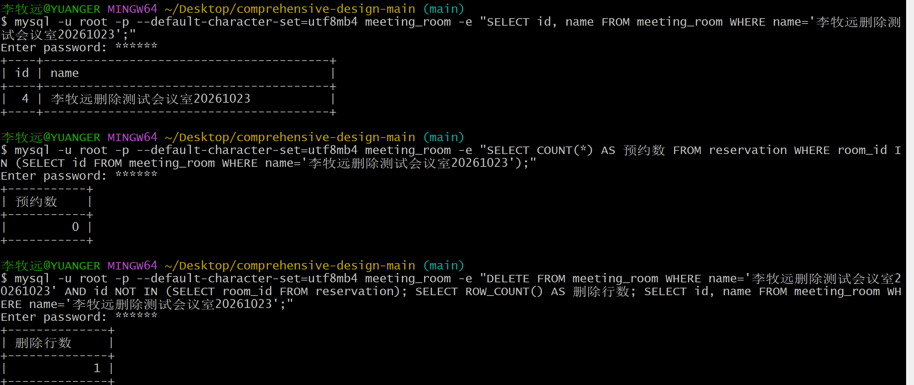
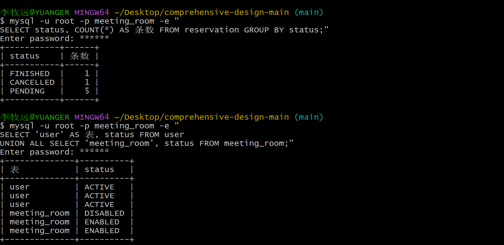

# 05 建表脚本干净库实测记录

| 项 | 内容 |
|---|---|
| 项目 | 智能会议室管理系统（第 4 组） |
| 阶段 | 第 8 周 · 检查点 ③（10-24 `schema.sql` 干净库跑通） |
| **实测执行人** | **李牧远（`Yuanger258`）——未参与建表脚本编写的人** |
| 待复核人 | 李知渔（组长） |
| 被测脚本 | `docs/week07-08/schema.sql`（自包含交付版）<br>`database/01_schema.sql` + `database/02_seed.sql`（拆分版，同源） |
| 对应文档 | 《02_数据库与接口设计》 |
| 需求依据 | FR-03、FR-08、FR-09、FR-10、NF-05、NF-07、NF-08、NF-10、NF-14 |
| 记录状态 | **🟡 草稿 —— 待李牧远在干净环境独立复现后签字** |

---

## 0. 为什么要"未参与的人"来跑

沿用第 6 周 README 实测规则：**写脚本的人自己测自己不算数**。

理由很直接——写 `schema.sql` 的人知道该往哪个库跑、知道哪条约束可能报错、知道出错了先查哪里。没参与编写的人跑，才会遇到真实的坑（残留旧库、客户端连不上、编码不对、版本不满足 CHECK 要求），这些恰恰是**课堂 10-26 现场演示**会翻车的地方。

因此本记录的规则是：

> **李牧远必须从零开始执行，不参考李知渔的预跑输出，遇到报错自己定位。**
> 下文 §5 的预跑记录是李知渔为节省时间先跑了一遍，**只能作为对照，不能作为结论**；签字以李牧远的独立复现结果为准。

---

## 1. 测试环境

| 项 | 要求 | 李牧远实测环境 | 结论 |
|---|------|--------------|------|
| MySQL 版本 | **≥ 8.0.16**（`CHECK` 约束自 8.0.16 起才真正执行） | 26.7.0 | 版本已经核对 |
| 存储引擎 | InnoDB | 四张表均为`InnoDB` |通过|
| 字符集 | `utf8mb4` / `utf8mb4_general_ci` | 数据库及四张表均为 `utf8mb4 / utf8mb4_general_ci` | 通过 |
| 库名 | `meeting_room`（脚本自动创建，**不需手动建**） | `meeting_room`，脚本自动创建 | 通过 |
| 客户端 | mysql 8.0 命令行 | MySQL 命令行 `26.7.0`，Windows x86_64 | 满足MySQL版本≥ 8.0.16 |
| 连接方式 | 命令行 `mysql -u root -p` | Windows PowerShell，`mysql -u root -p` | 连接成功 |
| 是否本机开发库 | **否，须与开发库不同的干净环境**（或先手动 `DROP DATABASE`） | 使用本机 MySQL，已手动删除原 `meeting_room`，确认无库后开始测试 | --- |

> ⚠️ **版本低于 8.0.16 会怎样**：`CHECK` 约束被静默忽略，不报任何错，但**非法数据能写进去**。若实测环境的 `SELECT VERSION()` 低于 8.0.16，§3 的约束验证全部会"假通过"，须先换版本再测。

---

## 2. 实测步骤与记录

### 2.1 前置：确认干净起点

```bash
# 方式一（推荐，最彻底）：先删库，确认脚本能自己建出来
mysql -u root -p -e "DROP DATABASE IF EXISTS meeting_room;"
mysql -u root -p -e "SHOW DATABASES LIKE 'meeting_room';"
#   → 应返回 0 行，确认已删除
```

**实际输出**：
```
实际返回了0行
```


**结论**：☑通过　☐ 不通过（不通过原因：____________________）

```bash
# 记录环境版本
mysql -u root -p -e "SELECT VERSION();"
```

**实际输出**：
```
+-----------+
| VERSION() |
+-----------+
| 26.7.0    |
+-----------+
```



### 2.2 干净库一次跑通 `schema.sql`

```bash
# Windows（Git Bash）
mysql -u root -p < docs/week07-08/schema.sql

# 若客户端报 unknown variable 'mysqlx'，改用：
mysql -u root -p --protocol=TCP < docs/week07-08/schema.sql
```

**要求**：**一条命令跑完，不许手工补执行任何语句。** 若中途需要补命令，说明脚本不自包含，直接判不通过。

**实际输出**（脚本末尾自带 5 段自检，全量粘贴）：

```
李牧远@YUANGER MINGW64 ~/Desktop/comprehensive-design-main (main)
$ mysql -u root -p --protocol=TCP < docs/week07-08/schema.sql
Enter password: ******
鏍￠獙椤¹       缁撴灉
鈶  宸插缓琛ㄦ竻鍗
琛ㄥ悕  璇存槑
meeting_room    浼氳?瀹よ〃锛涘悕绉板敮涓锛團R-03锛夛紝鍋滅敤鍚庝笉浣滀负鏂伴?绾﹂夐」锛團R-06锛
operation_log   绠＄悊鍛樻晱鎰熸搷浣滄棩蹇楄〃锛圢F-14锛夛紱鏅?氱敤鎴蜂笉鍙?煡鐪嬶紝涓氬姟鐣岄潰涓嶅彲鍒犻櫎
reservation     棰勭害璁板綍琛?紱鏃堕棿鎸夊崐寮鍖洪棿 [start_time,end_time) 鍒ゅ啿绐侊紙FR-09锛夛紝鐘舵佸洓鎬侊紙NF-08锛
user    鐢ㄦ埛琛?紙鏅?氱敤鎴· + 绠＄悊鍛橈級锛況ole/status 涓烘灇涓惧垪锛屼笉寤哄叧鑱旇〃
鏍￠獙椤¹       缁撴灉
鈶¡ 鍚勮〃璁板綍鏁°
琛¨     鏉℃暟
user    3
meeting_room    3
reservation     7
operation_log   1
鏍￠獙椤¹       缁撴灉
鈶¢ 棰勭害鐘舵佸垎甯冿紙搴斾负 PENDING/FINISHED/CANCELLED 涓夌?锛孨F-08 鍥涙佷腑鐨 ONGOING 鏈?犳暟鎹?級
鐘舵?鍊¼        鍚?箟   鏉℃暟
CANCELLED       宸插彇娑        1
FINISHED        宸茬粨鏉        1
PENDING 寰呭紑濮        5
鏍￠獙椤¹       缁撴灉
鈶£ 鍐茬獊缁勫疄璇侊細A101 鍦¨ 2026-11-02
鍦烘櫙  鍛戒腑鍐茬獊鏉℃暟
鏂伴?绾¦ 10:30-11:30锛堜笌 09:00-11:00 閲嶅彔锛 2
鏂伴?绾¦ 14:00-15:00锛堝師棰勭害宸插彇娑 status=CANCELLED锛屽簲涓嶅啿绐侊級     0
鏍￠獙椤¹       缁撴灉
鈶¤ 棣栧熬鐩告帴瀹炶瘉锛欰202 鍦¨ 2026-11-02锛堢幇鏈 09:00-10:00 涓 10:00-11:00 涓ゆ潯锛
鍦烘櫙  鍛戒腑鍐茬獊鏉℃暟
鏂伴?绾¦ 11:00-12:00锛堟帴 10:00-11:00 鐨勫熬宸达紝搴斿垽涓嶅啿绐侊級   0
鏂伴?绾¦ 08:00-09:00锛堟帴 09:00-10:00 鐨勫ご锛屽簲鍒や笉鍐茬獊锛       0
鏂伴?绾¦ 09:30-10:30锛堢湡閲嶅彔锛屽簲鍒ゅ啿绐侊級      2

```

**结论**：☑ 零报错通过　☐ 有报错（错误信息：____________________）

**备注**：首次自检输出中文乱码；使用 --default-character-set=utf8mb4 只读查询后，三间会议室名称显示正常，确认所查询名称存储正常，首次输出存在客户端编码问题。脚本退出码为 0。



### 2.3 拆分版同源验证

```bash
mysql -u root -p -e "DROP DATABASE IF EXISTS meeting_room;"
mysql -u root -p < database/01_schema.sql
mysql -u root -p < database/02_seed.sql
```

**要求**：与 §2.2 的自包含版**建出完全相同的 4 张表和相同条数的数据**。

**实际输出**：

```
$ mysql -u root -p < database/02_seed.sql
Enter password: ******
鏍￠獙椤¹       缁撴灉
鈶  鍚勮〃璁板綍鏁°
琛¨     鏉℃暟
user    3
meeting_room    3
reservation     7
operation_log   1
鏍￠獙椤¹       缁撴灉
鈶¡ 榛樿?璐﹀彿涓瑙堬紙涓嶆樉绀哄彛浠わ級
璐﹀彿  濮撳悕  瑙掕壊  鐘舵?
admin   绯荤粺绠＄悊鍛  ADMIN   ACTIVE
user1   寮犱笁  USER    ACTIVE
user2   鏉庡洓  USER    ACTIVE
鏍￠獙椤¹       缁撴灉
鈶¢ 浼氳?瀹や竴瑙
id      鍚嶇О   浣嶇疆  瀹归噺  鐘舵?
1       閫稿か妤糀101浼氳?瀹¤   閫稿か妤糀搴§1灞        20      ENABLED
2       閫稿か妤糀202浼氳?瀹¤   閫稿か妤糀搴§2灞        12      ENABLED
3       鍥句功棣咮301鎶ュ憡鍘   鍥句功棣咮搴§3灞        40      DISABLED
鏍￠獙椤¹       缁撴灉
鈶£ 棰勭害鐘舵佸垎甯
鐘舵?鍊¼        鍚?箟   鏉℃暟
CANCELLED       宸插彇娑        1
FINISHED        宸茬粨鏉        1
PENDING 寰呭紑濮        5
鏍￠獙椤¹       缁撴灉
鈶¤ 鍐茬獊缁勫疄璇侊細A101 鍦¨ 2026-11-02
鍦烘櫙  鍛戒腑鍐茬獊鏉℃暟
鏂伴?绾¦ 10:30-11:30锛堜笌 09:00-11:00 閲嶅彔锛屽簲鍒ゅ啿绐侊級 2
鏂伴?绾¦ 14:00-15:00锛堝師棰勭害宸插彇娑 status=3锛屽簲鍒や笉鍐茬獊锛   0
鏍￠獙椤¹       缁撴灉
鈶¥ 棣栧熬鐩告帴瀹炶瘉锛欰202 鍦¨ 2026-11-02锛堢幇鏈 09:00-10:00 涓 10:00-11:00锛
鍦烘櫙  鍛戒腑鍐茬獊鏉℃暟
鏂伴?绾¦ 11:00-12:00锛堟帴灏鹃儴锛屽簲鍒や笉鍐茬獊锛    0
鏂伴?绾¦ 08:00-09:00锛堟帴澶达紝搴斿垽涓嶅啿绐侊級      0
鏂伴?绾¦ 09:30-10:30锛堢湡閲嶅彔锛屽簲鍒ゅ啿绐侊級      2

```

**结论**：：☑  通过　☐ 不通过

---

## 3. 三条关键自查（《周推进计划》§4.2.2 指定）

### 3.1 自查①：冲突检测（FR-09 半开区间）

种子数据里两个会议室分别承担不同验证角色，先看清：

| room_id | 会议室 | 已有预约 | 验证角色 |
|---------|-------|---------|---------|
| `1` | 逸夫楼A101会议室 | `09:00-11:00`、`10:00-12:00`（**互相重叠**）、`14:00-15:00`（已取消） | **冲突组** |
| `2` | 逸夫楼A202会议室 | `09:00-10:00`、`10:00-11:00`（**首尾相接**）、`09:00-10:00`（已结束） | **首尾相接组** |

**统一判定式**（FR-09，与第 9 周实现用的完全同一条）：

```sql
SELECT COUNT(*) FROM reservation
 WHERE room_id = :roomId
   AND reserve_date = :date
   AND status <> 'CANCELLED'
   AND start_time < :endNew     -- 新开始 < 旧结束
   AND end_time   > :startNew;  -- 新结束 > 旧开始
```

**A 组：冲突组验证（`room_id = 1`，应判冲突）**

```bash
mysql -u root -p meeting_room -e "
SELECT COUNT(*) AS 冲突条数 FROM reservation
 WHERE room_id = 1 AND reserve_date = '2026-11-02' AND status <> 'CANCELLED'
   AND start_time < '2026-11-02 11:30:00' AND end_time > '2026-11-02 10:30:00';"
```

**期望**：新建 `10:30-11:30` 与已有的 `09:00-11:00`／`10:00-12:00` **都重叠** → 命中 **2**。

**实际输出**：
```
李牧远@YUANGER MINGW64 ~/Desktop/comprehensive-design-main (main)
$ mysql -u root -p meeting_room -e "
> SELECT COUNT(*) AS 冲突条数 FROM reservation
> WHERE room_id = 1 AND reserve_date = '2026-11-02' AND status <> 'CANCELLED'
> AND start_time < '2026-11-02 11:30:00' AND end_time > '2026-11-02 10:30:00';"
Enter password: ******
+----------+
| 冲突条数 |
+----------+
|        2 |
+----------+

```

**B 组：首尾相接验证（`room_id = 2`，应判不冲突）** ← **本次实测最关键的一组**

```bash
# B1 真重叠：新建 10:30-11:30，与 09:00-10:00 和 10:00-11:00 都有交集 → 应冲突
mysql -u root -p meeting_room -e "
SELECT COUNT(*) AS 命中 FROM reservation
 WHERE room_id = 2 AND reserve_date = '2026-11-02' AND status <> 'CANCELLED'
   AND start_time < '2026-11-02 11:30:00' AND end_time > '2026-11-02 10:30:00';"

# B2 接尾部：新建 11:00-12:00，正好接在 10:00-11:00 之后 → 应不冲突
mysql -u root -p meeting_room -e "
SELECT COUNT(*) AS 命中 FROM reservation
 WHERE room_id = 2 AND reserve_date = '2026-11-02' AND status <> 'CANCELLED'
   AND start_time < '2026-11-02 12:00:00' AND end_time > '2026-11-02 11:00:00';"

# B3 接头：新建 08:00-09:00，正好接在 09:00-10:00 之前 → 应不冲突
mysql -u root -p meeting_room -e "
SELECT COUNT(*) AS 命中 FROM reservation
 WHERE room_id = 2 AND reserve_date = '2026-11-02' AND status <> 'CANCELLED'
   AND start_time < '2026-11-02 09:00:00' AND end_time > '2026-11-02 08:00:00';"
```

| 组 | 新建时段 | 与已有的关系 | **期望** | 实测 |
|----|---------|-------------|---------|------|
| A | `10:30-11:30` @room1 | 与 09:00-11:00、10:00-12:00 **均重叠** | **2** | ___2___ |
| B1 | `10:30-11:30` @room2 | 与 09:00-10:00、10:00-11:00 **均重叠** | **2** | ___1___ |
| B2 | `11:00-12:00` @room2 | 接 `10:00-11:00` **尾巴** | **0** | ___0___ |
| B3 | `08:00-09:00` @room2 | 接 `09:00-10:00` **头** | **0** | ___0___ |

**实际输出**（B1／B2／B3 三条）：
```
李牧远@YUANGER MINGW64 ~/Desktop/comprehensive-design-main (main)
$ mysql -u root -p meeting_room -e "
SELECT COUNT(*) AS 命中 FROM reservation
 WHERE room_id = 2 AND reserve_date = '2026-11-02' AND status <> 'CANCELLED'
   AND start_time < '2026-11-02 11:30:00' AND end_time > '2026-11-02 10:30:00';"
Enter password: ******
+------+
| 命中 |
+------+
|    1 |
+------+
李牧远@YUANGER MINGW64 ~/Desktop/comprehensive-design-main (main)
$ mysql -u root -p --default-character-set=utf8mb4 meeting_room -e "SELECT COUNT(*) AS hits FROM reservation WHERE room_id=2 AND reserve_date='2026-11-02' AND status<>'CANCELLED' AND start_time<'2026-11-02 12:00:00' AND end_time>'2026-11-02 11:00:00';"
Enter password: ******
+------+
| hits |
+------+
|    0 |
+------+


李牧远@YUANGER MINGW64 ~/Desktop/comprehensive-design-main (main)
$ mysql -u root -p --default-character-set=utf8mb4 meeting_room -e "SELECT COUNT(*) AS hits FROM reservation WHERE room_id=2 AND reserve_date='2026-11-02' AND status<>'CANCELLED' AND start_time<'2026-11-02 09:00:00' AND end_time>'2026-11-02 08:00:00';"
Enter password: ******
+------+
| hits |
+------+
|    0 |
+------+

_______________________________________
```

> ★ **这张表是本次实测最重要的证据，四行必须同时成立**。三种错法都能被抓出来：
> - **全是 0** → 判定式写错了，永远不冲突
> - **A／B1 也是 0** → 根本没执行到查询
> - **B2／B3 大于 0** → 用了 `<=`／`>=` 而非严格不等，**首尾相接被判成冲突**，违背需求清单 FR-09

**结论**：☐ 四行同时成立　☐ 不成立

冲突与首尾相接判定符合规则。B1 实测为 1，与文档预期 2 不一致，已记录为测试用例待复核项；待编写者确认后关闭。



### 3.2 自查②：删会议室是否被拒（FR-03 + RESTRICT）

```bash
mysql -u root -p meeting_room -e "DELETE FROM meeting_room WHERE id = 1;"
```

**期望**：**报错**，提示外键约束失败（`ERROR 1451 Cannot delete or update a parent row: a foreign key constraint fails`）。会议室 1（A101）上挂着多条预约。

**实际输出**：

```
李牧远@YUANGER MINGW64 ~/Desktop/comprehensive-design-main (main)
$ mysql -u root -p meeting_room -e "DELETE FROM meeting_room WHERE id = 1;"
Enter password: ******
ERROR 1451 (23000) at line 1: Cannot delete or update a parent row: a foreign key constraint fails (`meeting_room`.`reservation`, CONSTRAINT `fk_reservation_room` FOREIGN KEY (`room_id`) REFERENCES `meeting_room` (`id`) ON DELETE RESTRICT ON UPDATE CASCADE)

```

**对照**：删一间**没有预约**的会议室应当成功（用于证明不是"所有删除都被禁"）：

```bash
mysql -u root -p meeting_room -e "SELECT id, name FROM meeting_room;"
# 挑一个无预约的 id（若有），删除它 → 应成功
mysql -u root -p meeting_room -e "SELECT COUNT(*) FROM reservation WHERE room_id = <上面挑的 id>;"
```

**实际输出**：

```
李牧远@YUANGER MINGW64 ~/Desktop/comprehensive-design-main (main)
$ mysql -u root -p meeting_room -e "SELECT id, name FROM meeting_room;"
Enter password: ******
+----+------------------+
| id | name             |
+----+------------------+
|  3 | 图书馆B301报告厅 |
|  1 | 逸夫楼A101会议室 |
|  2 | 逸夫楼A202会议室 |
+----+------------------+

李牧远@YUANGER MINGW64 ~/Desktop/comprehensive-design-main (main)
$ mysql -u root -p meeting_room -e "SELECT COUNT(*) FROM reservation WHERE room_id = 3;"
Enter password: ******
+----------+
| COUNT(*) |
+----------+
|        1 |
+----------+


```

**结论**：☑ 有预约的被拒、无预约的能删　☐ 不成立

**备注**：数据中的 1、2、3 号会议室均有预约，无法直接验证“无预约时能否删除”。因此临时新增 4 号“李牧远删除测试会议室20261023”，查询确认其预约数为 0；随后删除成功，影响行数为 1。该会议室仅用于本次删除对照，删除后不影响后续验证。

```
李牧远@YUANGER MINGW64 ~/Desktop/comprehensive-design-main (main)
$ mysql -u root -p --default-character-set=utf8mb4 meeting_room -e "SELECT id, name FROM meeting_room WHERE name='李牧远删除测试会议室20261023';"
Enter password: ******
+----+----------------------------------------+
| id | name                                   |
+----+----------------------------------------+
|  4 | 李牧远删除测试会议室20261023           |
+----+----------------------------------------+

李牧远@YUANGER MINGW64 ~/Desktop/comprehensive-design-main (main)
$ mysql -u root -p --default-character-set=utf8mb4 meeting_room -e "SELECT COUNT(*) AS 预约数 FROM reservation WHERE room_id IN (SELECT id FROM meeting_room WHERE name='李牧远删除测试会议室20261023');"
Enter password: ******
+-----------+
| 预约数    |
+-----------+
|         0 |
+-----------+

李牧远@YUANGER MINGW64 ~/Desktop/comprehensive-design-main (main)
$ mysql -u root -p --default-character-set=utf8mb4 meeting_room -e "DELETE FROM meeting_room WHERE name='李牧远删除测试会议室20261023' AND id NOT IN (SELECT room_id FROM reservation); SELECT ROW_COUNT() AS 删除行数; SELECT id, name FROM meeting_room WHERE name='李牧远删除测试会议室20261023';"
Enter password: ******
+--------------+
| 删除行数     |
+--------------+
|            1 |
+--------------+

```



> ★ **回答"删掉一间会议室会不会影响已有预约"**：**会，而且由数据库直接拒绝**（`ERROR 1451`）。这是 `ON DELETE RESTRICT` 的作用——已有预约不会变成悬空数据。要删只能先由管理员处理掉相关预约。

### 3.3 自查③：状态取值（NF-08 四态）

```bash
mysql -u root -p meeting_room -e "
SELECT status, COUNT(*) AS 条数 FROM reservation GROUP BY status;"
```

**期望**：只出现已列清的取值 —— `PENDING`／`ONGOING`／`FINISHED`／`CANCELLED`，**不出现任何数字**。

**实际输出**：

```
李牧远@YUANGER MINGW64 ~/Desktop/comprehensive-design-main (main)
$ mysql -u root -p meeting_room -e "
> SELECT status, COUNT(*) AS 条数 FROM reservation GROUP BY status;"
Enter password: ******
+-----------+------+
| status    | 条数 |
+-----------+------+
| FINISHED  |    1 |
| CANCELLED |    1 |
| PENDING   |    5 |
+-----------+------+

```

**对照**：`user` 与 `meeting_room` 各有独立的状态枚举，别混淆：

```bash
mysql -u root -p meeting_room -e "
SELECT 'user' AS 表, status FROM user
UNION ALL SELECT 'meeting_room', status FROM meeting_room;"
```

**期望**：`user` → `ACTIVE`／`DISABLED`；`meeting_room` → `ENABLED`／`DISABLED`。

**实际输出**：
```
李牧远@YUANGER MINGW64 ~/Desktop/comprehensive-design-main (main)
$ mysql -u root -p meeting_room -e "
> SELECT 'user' AS 表, status FROM user
> UNION ALL SELECT 'meeting_room', status FROM meeting_room;"
Enter password: ******
+--------------+----------+
| 表           | status   |
+--------------+----------+
| user         | ACTIVE   |
| user         | ACTIVE   |
| user         | ACTIVE   |
| meeting_room | DISABLED |
| meeting_room | ENABLED  |
| meeting_room | ENABLED  |
+--------------+----------+

```

**结论**：☑ 通过　☐ 不通过



---

## 4. 附加验证（本次实测追加，非计划要求）

计划只要求三条，但下列五项同样是"设计是否真的落地"的证据，一并实测更稳妥。

### 4.1 列名与既有代码同源（★ 本次冲突的核心教训）

第 6 周已联调通过的后端 SQL 在 `backend/src/main/resources/mapper/MeetingRoomMapper.xml`，其中引用了 `location`／`reserve_date`／`status IN ('PENDING','ONGOING')`。**本组曾一度把列名改成 `building`／`booking_date`／TINYINT，实测证明会导致以下后果**：

```bash
# 用改口径前的列名执行既有 SQL
mysql -u root -p meeting_room -e "
SELECT room_id, start_time, end_time FROM reservation
 WHERE reserve_date='2026-11-02' AND status IN ('PENDING','ONGOING');"
```

| 口径 | 结果 | 是否可接受 |
|------|------|-----------|
| `booking_date` + TINYINT | `ERROR 1054 Unknown column 'reserve_date'` | ❌ 直接报错 |
| 仅 TINYINT | **不报错，但返回 0 行** | ❌ **静默失效，比报错更危险** |
| **现行口径（`reserve_date` + VARCHAR 四态）** | **正常返回占用记录** | ✅ |

**现行口径实测输出**：
```
李牧远@YUANGER MINGW64 ~/Desktop/comprehensive-design-main (main)
$ mysql -u root -p --default-character-set=utf8mb4 meeting_room -e "SELECT room_id, start_time, end_time FROM reservation WHERE reserve_date='2026-11-02' AND status IN ('PENDING','ONGOING');"
Enter password: ******
+---------+---------------------+---------------------+
| room_id | start_time          | end_time            |
+---------+---------------------+---------------------+
|       1 | 2026-11-02 09:00:00 | 2026-11-02 11:00:00 |
|       1 | 2026-11-02 10:00:00 | 2026-11-02 12:00:00 |
|       2 | 2026-11-02 09:00:00 | 2026-11-02 10:00:00 |
|       2 | 2026-11-02 10:00:00 | 2026-11-02 11:00:00 |
|       3 | 2026-11-02 09:00:00 | 2026-11-02 10:00:00 |
+---------+---------------------+---------------------+
```

> 这条留档的意义：向组内说明**为什么不能照任务书示例把 status 改成 TINYINT**。示例只是格式参照，而改了就破坏已跑通的代码。

### 4.2 约束真的生效（不是摆设）

```bash
# B) 塞非法状态
mysql -u root -p meeting_room -e "
INSERT INTO reservation (reservation_no,user_id,room_id,reserve_date,start_time,end_time,topic,attendee_count,contact,purpose,status)
VALUES ('X001',2,1,'2026-11-02','2026-11-02 09:00:00','2026-11-02 10:00:00','t',5,'z','p','BOGUS');"
# 期望 ERROR 3819 ck_reservation_status

# C) 塞跨天预约
mysql -u root -p meeting_room -e "
INSERT INTO reservation (reservation_no,user_id,room_id,reserve_date,start_time,end_time,topic,attendee_count,contact,purpose,status)
VALUES ('X002',2,1,'2026-11-02','2026-11-02 23:00:00','2026-11-03 01:00:00','t',5,'z','p','PENDING');"
# 期望 ERROR 3819 ck_reservation_same_day

# D) 塞 10 小时预约
mysql -u root -p meeting_room -e "
INSERT INTO reservation (reservation_no,user_id,room_id,reserve_date,start_time,end_time,topic,attendee_count,contact,purpose,status)
VALUES ('X003',2,1,'2026-11-02','2026-11-02 01:00:00','2026-11-02 11:00:00','t',5,'z','p','PENDING');"
# 期望 ERROR 3819 ck_reservation_max_8h
```

| 编号 | 验证项 | 期望错误码与约束名 | 实测 |
|-----|-------|----------------|------|
| B | 非法状态值 | 3819 / `ck_reservation_status` | 3819 / `ck_reservation_status` |
| C | 跨天预约 | 3819 / `ck_reservation_same_day` | 3819 / `ck_reservation_same_day` |
| D | 超 8 小时 | 3819 / `ck_reservation_max_8h` | 3819 / `ck_reservation_max_8h` |

> 三条都通过才说明 MySQL 版本 ≥ 8.0.16（否则 CHECK 被忽略，三条都不会报错，反而是**失败**）。

### 4.3 密码是 BCrypt 摘要而非明文（NF-05）

```bash
mysql -u root -p meeting_room -e "
SELECT username, CHAR_LENGTH(password) AS 长度,
  CASE WHEN password LIKE '\$2%' AND CHAR_LENGTH(password)=60
       THEN 'BCrypt 摘要' ELSE '★非 BCrypt（可能存了明文）' END AS 格式
FROM user;"
```

**期望**：三行都是 `BCrypt 摘要`、长度 60。

**实际输出**：

```
+----------+------+-------------+
| username | 长度 | 格式        |
+----------+------+-------------+
| admin    |   60 | BCrypt 摘要 |
| user1    |   60 | BCrypt 摘要 |
| user2    |   60 | BCrypt 摘要 |
+----------+------+-------------+
```

> ⚠️ **三行密文各不相同是正确的**，不是写错——BCrypt 每次加随机盐，同一明文生成的摘要必然不同。**严禁**因"密文不一样"而去手工统一成某个值。
> ⚠️ 明文口令只写根 README，**不进库、不进文档、不进截图**。

### 4.4 三版脚本 DDL 同源（自包含版 vs 拆分版）

把两份脚本分别建进两个临时库，逐表 `SHOW CREATE TABLE` 对比：

```bash
mysql -u root -p -e "DROP DATABASE IF EXISTS mr_self; DROP DATABASE IF EXISTS mr_spli;"
sed 's/^CREATE DATABASE IF NOT EXISTS `meeting_room`/CREATE DATABASE IF NOT EXISTS `mr_self`/; s/^USE  *`meeting_room`/USE `mr_self`/' \
  docs/week07-08/schema.sql > /tmp/cmp_self.sql
sed 's/^CREATE DATABASE IF NOT EXISTS `meeting_room`/CREATE DATABASE IF NOT EXISTS `mr_spli`/; s/^USE  *`meeting_room`/USE `mr_spli`/' \
  database/01_schema.sql > /tmp/cmp_spli.sql
mysql -u root -p < /tmp/cmp_self.sql
mysql -u root -p < /tmp/cmp_spli.sql

for t in user meeting_room reservation operation_log; do
  diff <(mysql -u root -p -B -e "SHOW CREATE TABLE mr_self.$t\G"   2>/dev/null | grep -v '^\*') \
       <(mysql -u root -p -B -e "SHOW CREATE TABLE mr_spli.$t\G"   2>/dev/null | grep -v '^\*') \
    && echo "  ✓ $t 一致" || echo "  ✗ $t 不一致"
done
```

| 表 | 期望 | 实测 |
|---|------|------|
| `user` | 完全一致 | 不完全一致：字段注释不同；自包含版自增计数器为 4，拆分版未显示 |
| `meeting_room` | 完全一致 | 不完全一致：字段注释不同；自包含版自增计数器为 4，拆分版未显示 |
| `reservation` | 完全一致 | 不完全一致：字段注释不同；自包含版自增计数器为 8，拆分版未显示 |
| `operation_log` | 完全一致 | 不完全一致：字段注释不同；自包含版自增计数器为 2，拆分版未显示 |

> ⚠️ **比对时的坑**（预跑时踩过）：如果用 `sed 's/`meeting_room`/`xxx`/g'` 全局替换，会把 `CREATE TABLE meeting_room` 的**表名**也换掉，表就建进了别的库，对比结果是"某张表不存在"的假差异。**只能替换 `CREATE DATABASE` 与 `USE` 两行**。

### 4.5 索引与外键落地

```bash
mysql -u root -p -B -e "
SELECT TABLE_NAME, INDEX_NAME, GROUP_CONCAT(COLUMN_NAME ORDER BY SEQ_IN_INDEX) AS 列
FROM information_schema.STATISTICS WHERE TABLE_SCHEMA='meeting_room'
GROUP BY TABLE_NAME, INDEX_NAME ORDER BY TABLE_NAME, INDEX_NAME;"

mysql -u root -p -B -e "
SELECT CONSTRAINT_NAME, TABLE_NAME, REFERENCED_TABLE_NAME, DELETE_RULE
FROM information_schema.REFERENTIAL_CONSTRAINTS WHERE CONSTRAINT_SCHEMA='meeting_room';"
```

**期望索引**（★ 冲突检测必须走 `idx_reservation_room_time`）：

| 表 | 索引 | 列 | 用途 |
|---|------|---|------|
| `reservation` | **`idx_reservation_room_time`** | `room_id, reserve_date, start_time, end_time` | **冲突检测 FR-09 + 当日占用 FR-17** |
| `reservation` | `uk_reservation_no` | `reservation_no` | 预约编号唯一 |
| `reservation` | `idx_reservation_user_date` | `user_id, reserve_date` | 我的预约 FR-11 |
| `reservation` | `idx_reservation_date_status` | `reserve_date, status` | 按日/状态筛选 FR-19 |
| `user` | `uk_user_username` | `username` | 账号唯一 |
| `meeting_room` | `uk_room_name` | `name` | 同名拒绝重复 FR-03 |

**期望外键**：三个全部 `RESTRICT`。

| 外键 | 从 → 到 | DELETE_RULE | 实测 |
|-----|-------|------------|------|
| `fk_reservation_room` | `reservation.room_id` → `meeting_room.id` | `RESTRICT` | RESTRICT，符合预期 |
| `fk_reservation_user` | `reservation.user_id` → `user.id` | `RESTRICT` | RESTRICT，符合预期 |
| `fk_log_operator` | `operation_log.operator_id` → `user.id` | `RESTRICT` | RESTRICT，符合预期 |

> `operation_log` 的外键**故意也是 RESTRICT 而不是 CASCADE**：审计日志一旦可被级联删除，NF-14「可审计性」就名存实亡。删用户时若有日志引用会被拒绝，这是刻意设计，不是缺陷。

---

## 5. 预跑记录（李知渔，**仅作对照，不作为结论**）

预跑环境：Windows / MySQL **8.0.29** / InnoDB / utf8mb4_general_ci / 2026-10-19。

| # | 项 | 预跑结果 |
|---|----|---------|
| 1 | `schema.sql` 干净库一次跑通 | ✅ 零报错，4 表 |
| 2 | 拆分版依次跑通 | ✅ 与自包含版同表同条数 |
| 3 | 自查① 首尾相接三组 | ✅ `10:30-11:30`→2；`11:00-12:00`→0；`08:00-09:00`→0 |
| 4 | 自查② 删会议室 | ✅ `ERROR 1451` 被拒 |
| 5 | 自查③ 状态取值 | ✅ `PENDING` 5 / `FINISHED` 1 / `CANCELLED` 1，无数字 |
| 6 | 附加 4.1 既有后端 SQL | ✅ 原样执行返回 4 条占用记录 |
| 7 | 附加 4.2 三条 CHECK | ✅ 分别被 `ck_reservation_status`／`ck_reservation_same_day`／`ck_reservation_max_8h` 拒绝 |
| 8 | 附加 4.3 BCrypt | ✅ 三账号长度均 60、格式为 BCrypt |
| 9 | 附加 4.4 两版 DDL 同源 | ✅ 四张表 `SHOW CREATE TABLE` 完全一致 |
| 10 | 附加 4.5 索引与外键 | ✅ 三个外键均 `RESTRICT` |

**预跑曾发现并已修复的问题**（记录下来供李牧远避坑）：

| # | 问题 | 原因 | 已修 |
|---|------|------|------|
| 1 | `ERROR 3819 ck_reservation_status is violated` | 改了 CHECK 枚举为字符串，却漏改 `INSERT` 里的字面值仍写数字 | ✅ |
| 2 | `ERROR 1060 Duplicate column name 'remark'` | 批量替换列名时与原有列撞名 | ✅ |
| 3 | 环境连不上 `ERROR 2003` | 需先启动 MySQL 服务；本机客户端不认 `mysqlx=0` 参数 | 见下方备注 |

### 5.1 本机环境备忘（李牧远若在本机测）

| 项 | 值 |
|---|---|
| MySQL 可执行文件 | `D:\dev-toolchain\mysql\mysql-8.0.29-winx64\bin\mysql.exe` |
| 数据目录 | `D:\dev-toolchain\mysql\data` |
| 启动命令（服务未起时） | `mysqld.exe --datadir=D:/dev-toolchain/mysql/data --port=3306 --console` |
| 账号 | `root` / `123456` |
| 注意 | 本机 `env.sh` 里的 `mysqlc` 别名**当前失效**，须用完整路径 |

> ⚠️ 若在 **CMD / PowerShell** 下测，`mysql -u root -p < docs/week07-08/schema.sql` 的 `<` 重定向需要 `cmd` 支持；Git Bash 可直接用。

---

## 6. 三问核对（课上直接答）

| 问 | 答 | 实测能佐证？ |
|---|-----|------------|
| 每条预约的开始/结束时间怎么存？ | `reservation.start_time`／`end_time`，`DATETIME NOT NULL`，占用区间为**半开区间 `[start_time, end_time)`**；另存 `reserve_date DATE NOT NULL` 便于按日查询与聚合 | ☑ 自查①及表结构；3.1 的 B1 预期 2、实测 1，差异保留 |
| 状态有哪几种取值？ | `reservation.status`：**PENDING 待开始／ONGOING 进行中／FINISHED 已结束／CANCELLED 已取消**（NF-08，`VARCHAR(20)` 枚举 + CHECK）。另有 `user.status`（ACTIVE/DISABLED）、`meeting_room.status`（ENABLED/DISABLED）两组独立枚举 | ☑ 自查③及 CHECK 定义；种子数据未包含 ONGOING |
| 删掉一间会议室会不会影响已有预约？ | **会，且被数据库直接拒绝**：`reservation.room_id` 外键 `ON DELETE RESTRICT`，报 `ERROR 1451`，提示先处理相关预约（FR-03） | ☑ 自查② |

---

## 7. 截图（待补）

计划要求实测记录**含截图**。以下三张必须拍：

| # | 截图内容 | 对应检查项 | 已拍 |
|---|---------|-----------|------|
| 1 | 执行 `schema.sql` 的**完整命令行与输出**（含末尾自检段） | §2.2 | ☑ 已附图，中文显示乱码 |
| 2 | 三条自查的实际输出（**不含口令与密码哈希**） | §3 | ☑  已附图 |
| 3 | `SELECT VERSION()` 输出，证明版本 ≥ 8.0.16 | §1 | ☑ 已附图，版本 26.7.0 |

> 截图纪律：**不得出现明文口令、不得出现 BCrypt 密文**。口令只在根 README 里，截图只证明"格式是 BCrypt"即可。

---

## 8. 签字

| 角色 | 姓名 | Git | 日期 | 签字 |
|------|------|-----|------|------|
| 实测执行（未参与建表） | 李牧远 | `Yuanger258` | 2026-10-24 | 李牧远 |
| 脚本编写 | 虞业宸 | `yycyuyechen` | ________ | ________ |
| 复核（组长） | 李知渔 | `KYOUKI_FISH` | ________ | ________ |

> **不通过时的处理**：任一检查项不过，当天定位当天修，**不跨天**（《周推进计划》检查点 ③ 的口径）。10-24 当天必须给出可复现的干净库跑通结果，为 10-26 课堂现场演示兜底。
