# 第10周九组冲突测试说明

记录人：李牧远  
执行日期：第1—8组为2026-10-28至2026-10-29；第9组为2026-11-02  
测试环境：`meeting_room_week10_test`；第1—8组使用本地分支 `week06-li-muyuan`，代码基线 `07e046a`；第9组使用含取消接口的 `yyc` 代码副本（`b7b8709`），后端端口8081。九组均由李牧远独立执行。  
造数文件：[01_冲突测试数据.sql](01_冲突测试数据.sql)

> 下表中的 `code` 是接口响应体里的业务码。前五组预期 `409` 并且不新增预约；第六至八组预期 `200` 并且新增预约；第九组取消与重订均预期 `200`，保留取消记录并新增预约。

| 组 | 场景 | 已有数据与本次操作 | 预期结果 | 实际结果 |
|---|---|---|---|---|
| 1 | 完全重叠 | 会议室1，2026-11-05 已有09:00—11:00；再提交同日同室09:00—11:00 | 拒绝；`code=409`，提示“该会议室在此时间段已被占用”，占用时段09:00—11:00；不新增 | **通过。**返回`code=409`及占用时段09:00—11:00；查库只有原预约`MR20261105009`（id=8），无新增。见下方第1组截图。 |
| 2 | 前段重叠 | 会议室1，2026-11-06 已有09:00—11:00；再提交08:00—09:30 | 拒绝；`code=409`，提示时段已占用，返回占用时段09:00—11:00；不新增 | **通过。**返回`code=409`及占用时段09:00—11:00；查库只有原预约`MR20261106001`（id=9），无新增。见下方第2组截图。 |
| 3 | 后段重叠 | 会议室1，2026-11-07 已有09:00—11:00；再提交10:30—12:00 | 拒绝；`code=409`，提示时段已占用，返回占用时段09:00—11:00；不新增 | **通过。**返回`code=409`及占用时段09:00—11:00；查库只有原预约`MR20261107001`（id=10），无新增。见下方第3组截图。 |
| 4 | 新预约包含已有 | 会议室1，2026-11-08 已有10:00—10:30；再提交09:00—11:00 | 拒绝；`code=409`，提示时段已占用，返回占用时段10:00—10:30；不新增 | **通过。**返回`code=409`及占用时段10:00—10:30；查库只有原预约`MR20261108001`（id=11），无新增。见下方第4组截图。 |
| 5 | 新预约被包含 | 会议室1，2026-11-09 已有09:00—11:00；再提交10:00—10:30 | 拒绝；`code=409`，提示时段已占用，返回占用时段09:00—11:00；不新增 | **通过。**返回`code=409`及占用时段09:00—11:00；查库只有原预约`MR20261109001`（id=12），无新增。见下方第5组截图。 |
| 6 | 首尾相接（后） | 会议室1，2026-11-10 已有09:00—11:00；再提交11:00—12:00 | 必须成功；`code=200`，新预约状态`PENDING`；库中有两条首尾相接的预约 | **通过。**返回`code=200`，新预约号`MR20261110002`（id=17）；查库确认原预约id=13与新预约11:00—12:00均存在。见下方第6组截图。 |
| 7 | 首尾相接（前） | 会议室1，2026-11-11 已有09:00—11:00；再提交08:00—09:00 | 必须成功；`code=200`，新预约状态`PENDING`；库中有两条首尾相接的预约 | **通过。**返回`code=200`，新预约号`MR20261111002`（id=18）；查库确认08:00—09:00与原预约09:00—11:00均存在。见下方第7组截图。 |
| 8 | 同日不同会议室 | 2026-11-12 会议室1已有09:00—11:00；再为会议室2提交同日09:00—11:00 | 必须成功；`code=200`，新预约状态`PENDING`；会议室1、2各保留一条预约 | **通过。**返回`code=200`，会议室2新预约号`MR20261112002`（id=19）；查库确认会议室1原预约id=15和会议室2新预约均为09:00—11:00。见下方第8组截图。 |
| 9 | 取消后重订 | 会议室1，2026-11-13 已有09:00—11:00；user1调用`DELETE /api/bookings/16`取消原预约，再通过`POST /api/bookings`提交同一时段 | 取消应返回`code=200`且原记录变为`CANCELLED`；重订应返回`code=200`，新增一条`PENDING`预约 | **通过。**取消原预约`MR20261113001`（id=16）返回`code=200`，查库状态为`CANCELLED`；重订返回`code=200`，新预约号`MR20261113020`（id=20），查库为`PENDING`。两条均为同日同室09:00—11:00，原取消记录保留。见下方第9组截图。 |

## 截图证据

截图已内嵌在说明中。展开对应组即可查看接口请求／响应和数据库查库结果。

第1组：提交请求、冲突响应与查库

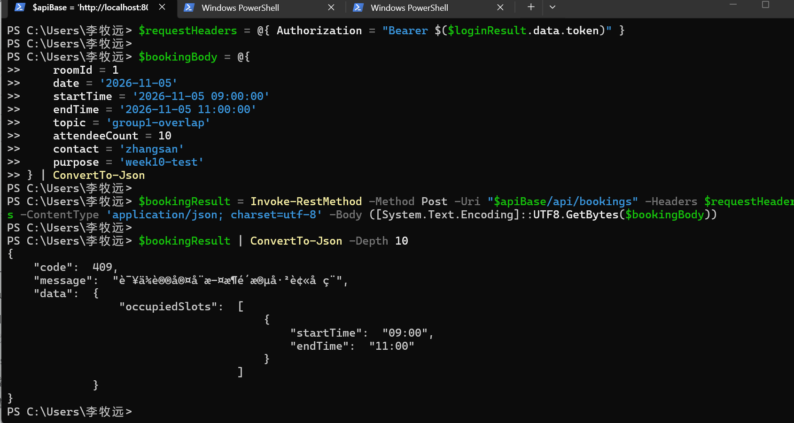

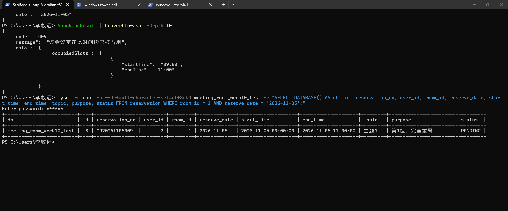

第2组：提交请求、冲突响应与查库

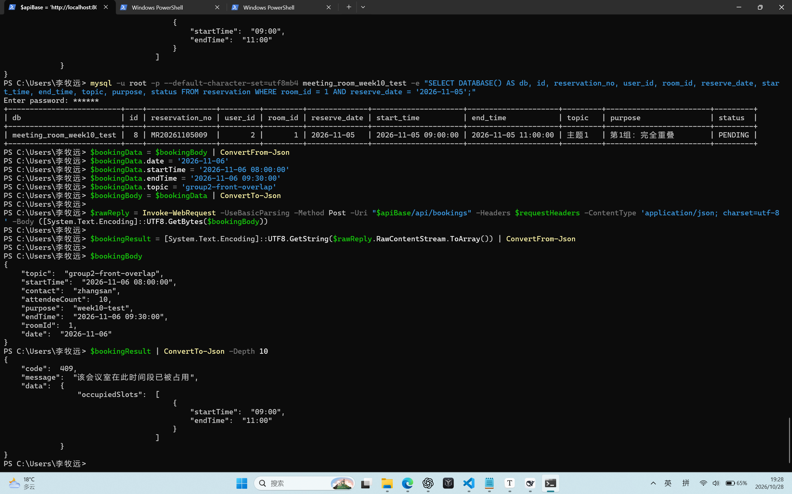

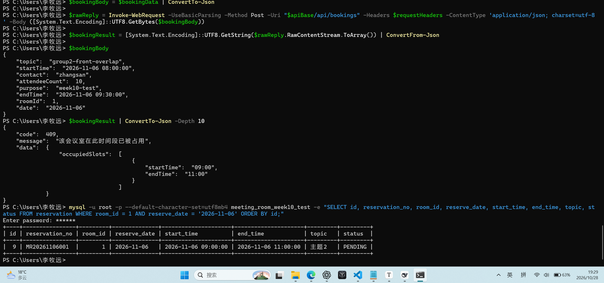

第3组：提交请求、冲突响应与查库

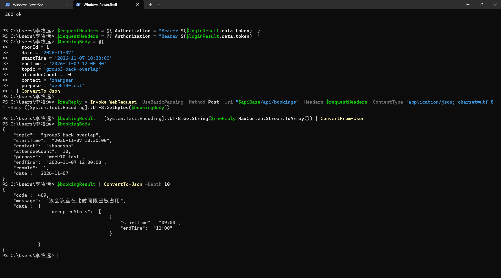

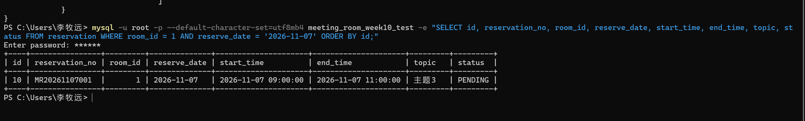

第4组：冲突响应与查库

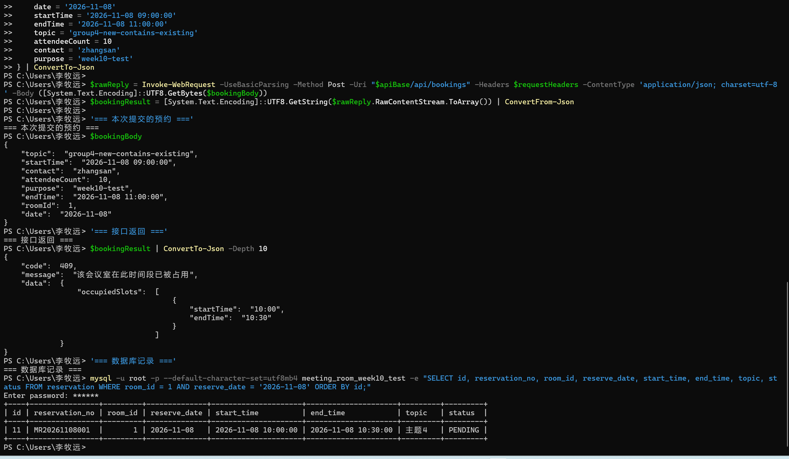

第5组：冲突响应与查库

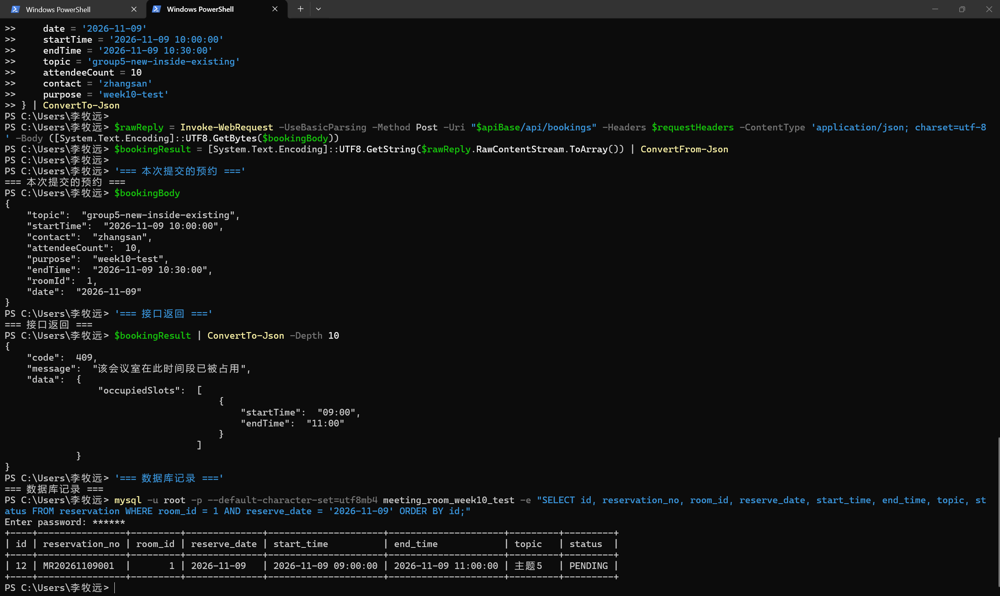

第6组：成功响应与查库

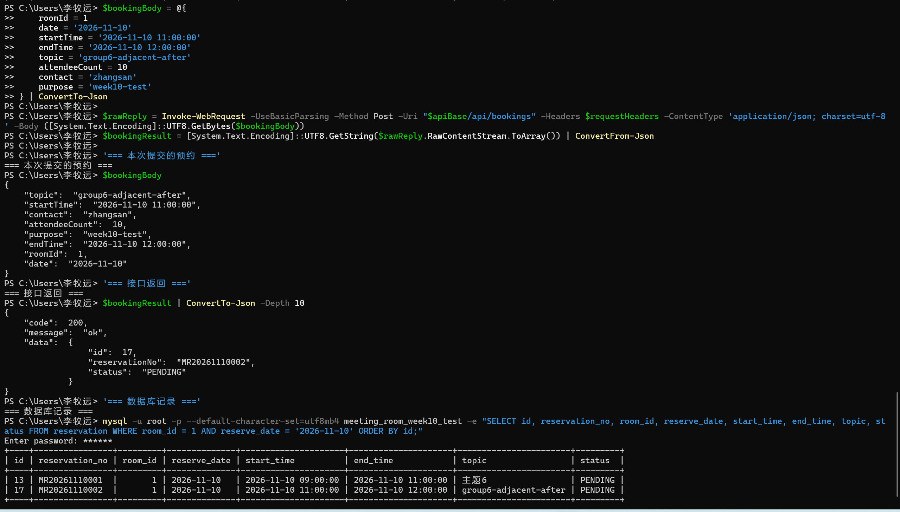

第7组：成功响应与查库

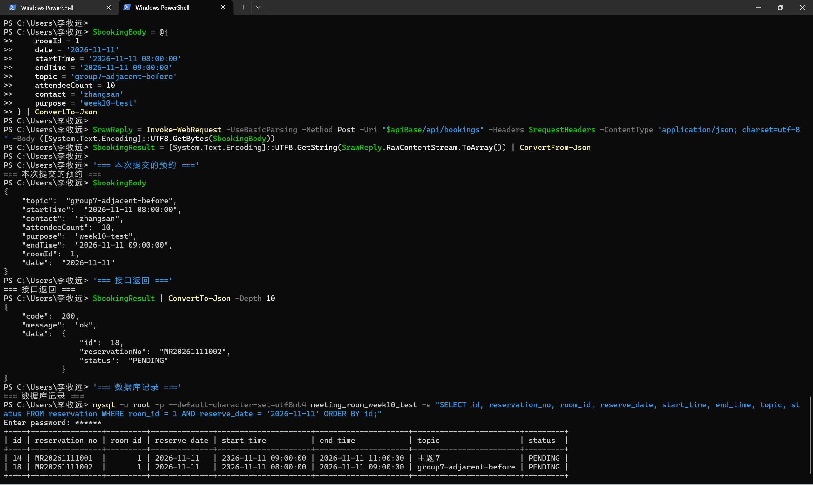

第8组：成功响应与跨会议室查库

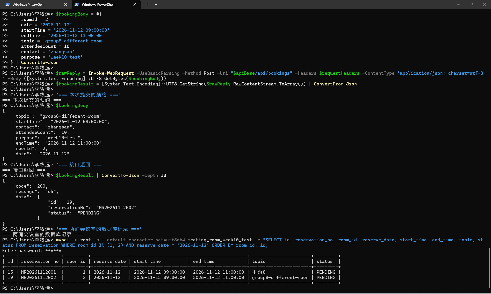

第9组：取消、同一时段重订与查库

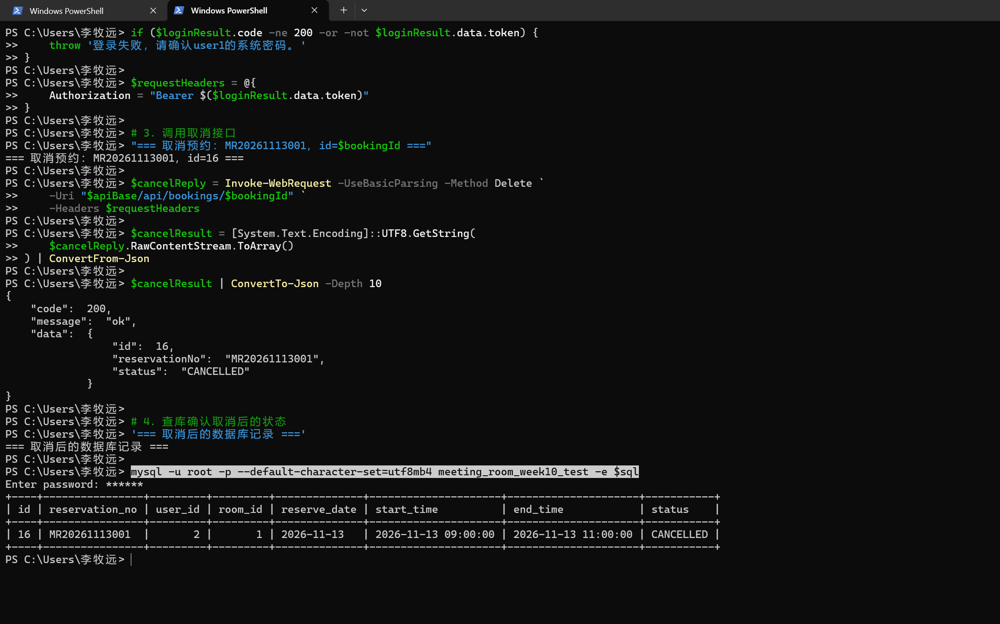

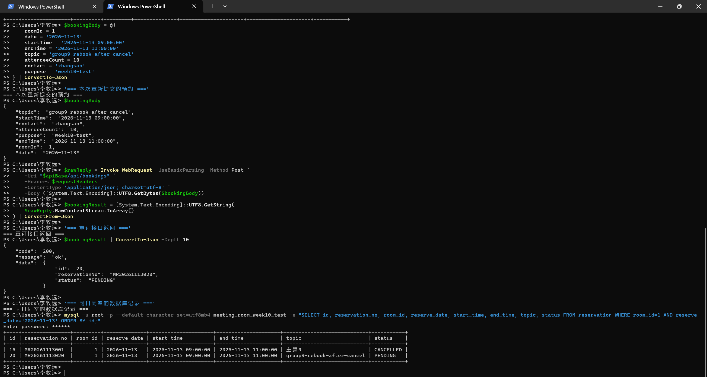

## 结果说明

九组均已执行且符合预期：第1—5组冲突被拒绝且未新增预约；第6—8组成功新增预约；第9组通过接口取消后，同一时段重订成功。第9组为2026-11-02在含取消接口的版本上补测，第1—8组保留原执行日期、版本和证据。

截图文件保存在本文件同目录的 `02_冲突测试说明.assets/`，图片引用使用仓库内相对路径；
