> **文件说明**：本文件是李牧远 **2026-11-02 上午的首轮预演记录**
> （前端 `week06-li-muyuan@8c343ee` ＋ 后端 `yyc@b7b8709` 副本 ＋ 独立测试库），
> 作为**改进前的基线**原样保留，正文与截图未做任何改动。
> 其中 3 条未关闭问题（W10-01／W10-02／W10-03）的处理与复测结果，
> 见同目录《`03_V1.0现场走通验收记录.md`》§5.2「首轮预演的 3 条缺陷：处理结果」。

---

# V1.0 现场走通验收记录

记录人：李牧远（预演）；李知渔（正式验收）  
执行日期：2026-11-02（首轮预演已记录，待补齐页面后复测）  
版本／分支／提交：前端为本地 `week06-li-muyuan` 分支 `8c343ee`；后端使用 `yyc` 代码副本 `b7b8709`。  
测试环境与数据库：前端 `http://localhost:5173`；后端 `http://localhost:8081/api`；数据库 `meeting_room_week10_test`。  

> 按周推进计划第6.1节记录普通用户8步和管理员4步。每步现场执行后填写实际结果并附截图；未执行项保持“待执行”，不能预先标通过。第13、14项是额外验收项，不计入12步。

## 普通用户闭环（8步）

| 步骤 | 操作与通过判据 | 实际结果 | 判定 | 截图 |
|---|---|---|---|---|
| 1 | 普通用户登录；进入普通用户菜单，不能看到管理入口 | user1登录后进入`/rooms`，右上角显示“普通用户 张三”；菜单显示“会议室查询”“提交预约”，未显示管理员入口 | ✅ 通过 | [第1步截图](03_V1.0现场走通验收记录.assets/01_普通用户登录与菜单.png) |
| 2 | 会议室列表按名称或容量筛选；结果数量和内容正确 | 日期2026-11-02，最小容纳人数15；查询后仅显示容量20的逸夫楼A101会议室，容量12的A202被筛除，页面显示共1间 | ✅ 通过 | [第2步截图](03_V1.0现场走通验收记录.assets/02_会议室容量筛选.png) |
| 3 | 打开会议室详情；所选日期占用时段与库内记录相符 | A101详情页在2026-11-02显示09:00—11:00、10:00—12:00两段占用，与库内两条`PENDING`预约一致；14:00—15:00的`CANCELLED`预约未显示为占用 | ✅ 通过 | [详情页](03_V1.0现场走通验收记录.assets/03_会议室详情占用时段.png)／[查库](03_V1.0现场走通验收记录.assets/03_占用时段查库.png) |
| 4 | 提交预约；页面显示成功和预约号，数据库查到该记录 | 页面提示成功，预约号`MR20261106021`；查库id=21、user_id=2、room_id=1，日期2026-11-06，14:00—15:00，主题“V1.0预演会议”、人数10、联系人张三、用途“第十周现场预演”，状态`PENDING`，页面预约号与库内一致 | ✅ 通过 | [成功提示](03_V1.0现场走通验收记录.assets/04_页面提交预约成功.png)／[查库](03_V1.0现场走通验收记录.assets/04_提交预约查库.png) |
| 5 | 提交与已有预约重叠的时段；页面显示明确冲突提示和占用时段，不出现500或白屏 | A101、2026-11-06提交14:30—15:30，页面提示“该会议室在此时间段已被占用”，已填内容保留；查库仍只有id=9和id=21两条原记录，无新增。提示包含真实冲突14:00—15:00，但也多显示不冲突的09:00—11:00，见缺陷W10-01 | 核心拒绝行为通过；提示准确性待修复 | [页面](03_V1.0现场走通验收记录.assets/05_重叠预约页面提示.png)／[查库](03_V1.0现场走通验收记录.assets/05_重叠预约拒绝后查库.png) |
| 6 | 在“我的预约”中找到第4步预约，状态为`PENDING` | 普通用户菜单无“我的预约”；尝试访问`/bookings/mine`后回到`/rooms`，未显示预约列表。当前前端路由未配置该页面，见W10-02 | ⛔ 受阻 | [访问结果](03_V1.0现场走通验收记录.assets/06_我的预约页面访问受阻.png) |
| 7 | 修改距开始超过30分钟的本人预约；页面和数据库均显示更新后的内容 | 依赖第6步的预约列表及修改入口；当前前端缺少对应页面，尚未执行页面修改 | ⛔ 依赖受阻 | 见W10-02 |
| 8 | 取消该预约；状态为`CANCELLED`，详情页显示该时段重新可订 | 依赖第6步的预约列表及取消入口；当前前端缺少对应页面，尚未执行本次预演预约的页面取消；此前第九组接口测试不代替本项页面预演 | ⛔ 依赖受阻 | 见W10-02 |

## 管理员闭环（4步）

| 步骤 | 操作与通过判据 | 实际结果 | 判定 | 截图 |
|---|---|---|---|---|
| 9 | 管理员登录；显示管理员菜单，且与普通用户菜单有区别 | admin登录成功，右上角显示“管理员 系统管理员”；比普通用户增加全部预约、会议室管理、用户管理和操作日志菜单，四项均标“建设中” | ✅ 登录与菜单区分通过 | [管理员菜单](03_V1.0现场走通验收记录.assets/09_管理员登录与菜单.png) |
| 10 | 查看全部预约，按会议室或日期筛选；结果正确 | 点击“全部预约”仅弹出“将在第10周实现（管理员功能）”，未进入预约列表，无法进行筛选，见W10-03 | ⛔ 受阻 | [占位提示](03_V1.0现场走通验收记录.assets/10_全部预约页面建设中.png) |
| 11 | 强制取消一条异常预约；填写取消原因后成功；不填原因时被拒绝并提示 | 依赖全部预约列表和强制取消表单；当前页面未交付，未实际执行填原因或不填原因的取消操作 | ⛔ 依赖受阻 | 见W10-03 |
| 12 | 查看第11步操作记录或状态变化；`operation_log`包含操作人、时间、类型和变更数据 | 第11步未执行，无法核对本次管理员取消产生的日志；操作日志菜单也标为建设中。未据此判定后端日志功能失败 | ⛔ 依赖受阻 | 见W10-03 |

## 额外验收项

| 项目 | 通过判据 | 实际结果 | 判定 | 截图／记录 |
|---|---|---|---|---|
| 九组冲突测试 | 九组结果与[冲突测试说明](02_冲突测试说明.md)一致；第6、7组成功 | 见冲突测试说明；九组均已通过 | ✅ | 见说明中的截图 |
| 10并发预约 | 同一会议室、同时段只成功1条，其余9条明确冲突；数据库只有1条有效预约 | 待执行／待正式验收 | ⏳ | 待补 |

## 截图证据

### 第1步：普通用户登录与菜单

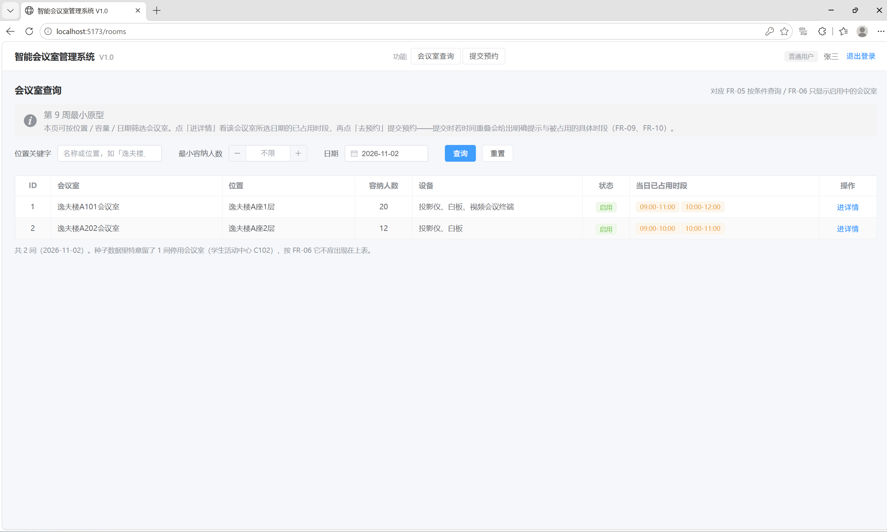

### 第2步：会议室容量筛选

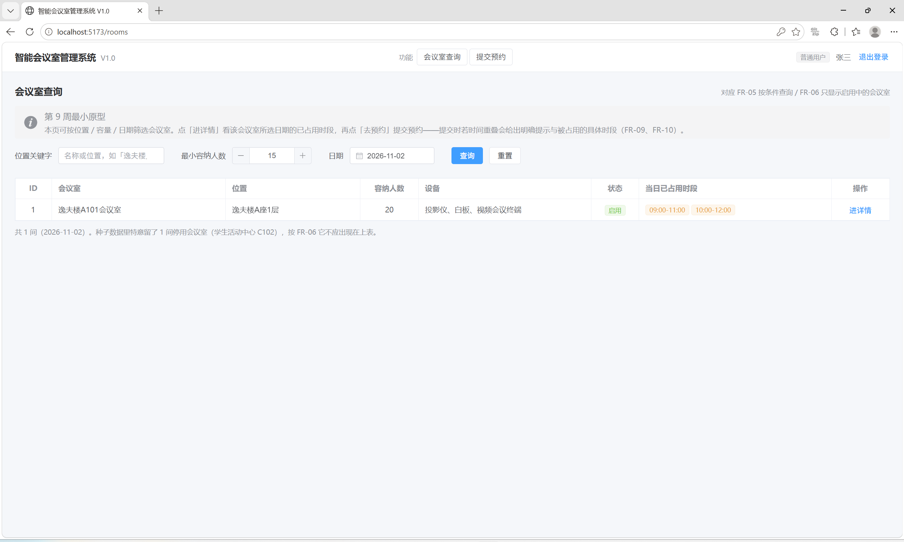

### 第3步：会议室详情与查库核对

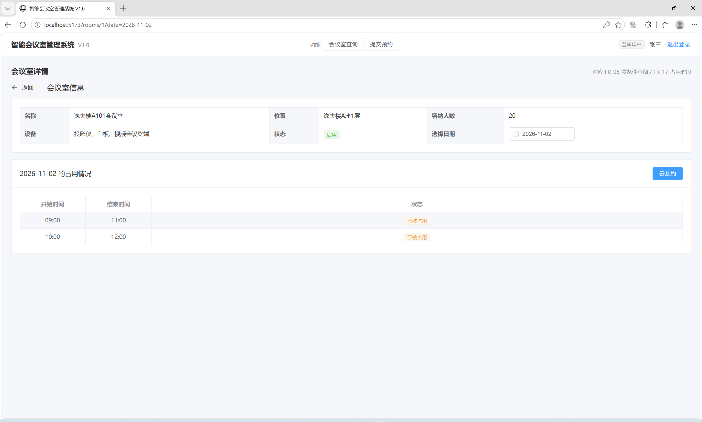

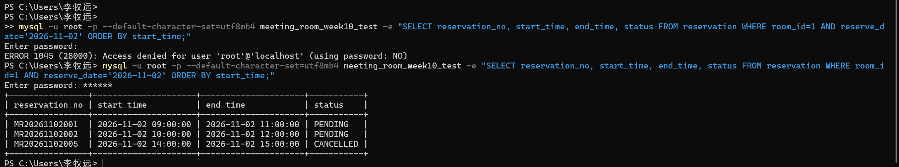

首次查库因未输入密码被MySQL拒绝，重新输入密码后查询成功；该操作失误不计为系统缺陷。

### 第4步：页面提交预约

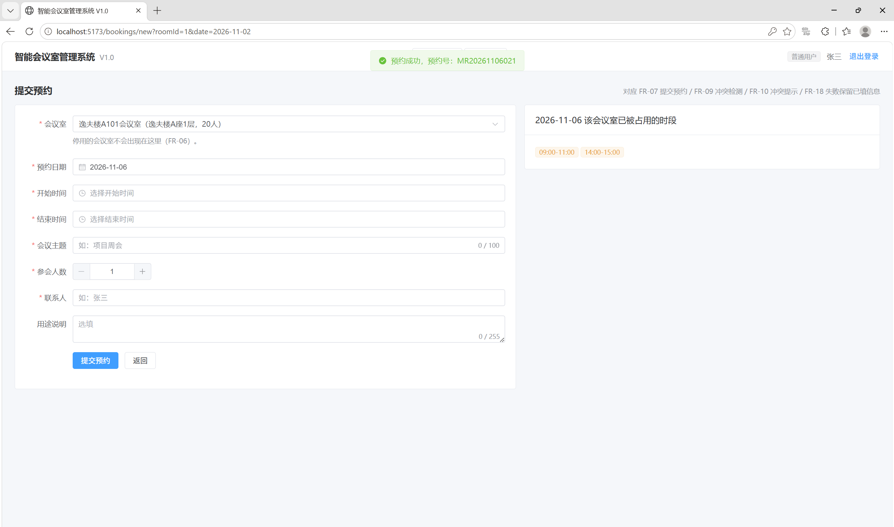

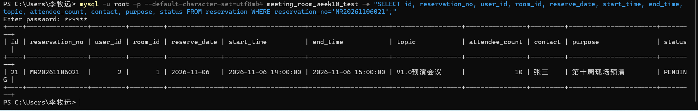

实际操作选择2026-11-06，以实际执行数据为准；页面与数据库预约号、时间及业务字段核对一致。

### 第5步：重叠预约被拒绝

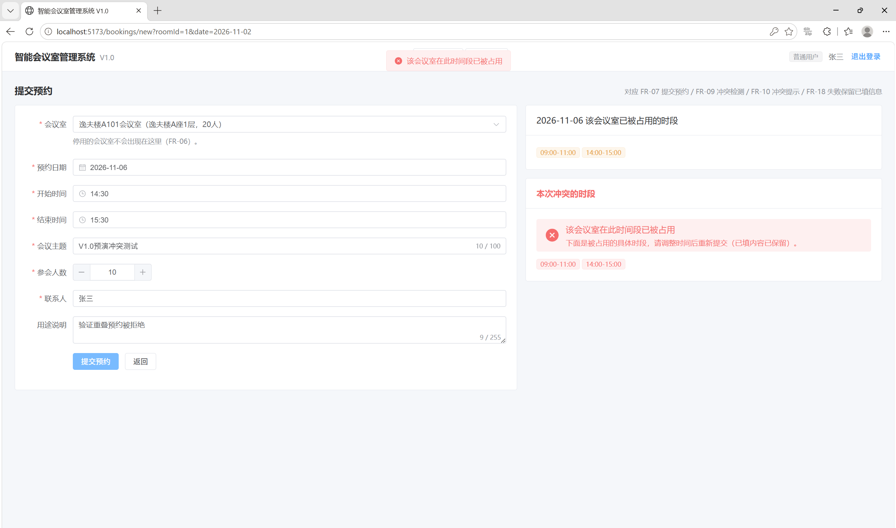

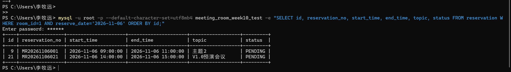

### 第6步：我的预约页面访问受阻

普通用户尝试访问`/bookings/mine`后回到`/rooms`；截图显示最终地址和菜单。核对当前`frontend/src/router/index.ts`，没有我的预约路由，未匹配路径统一重定向到会议室列表。

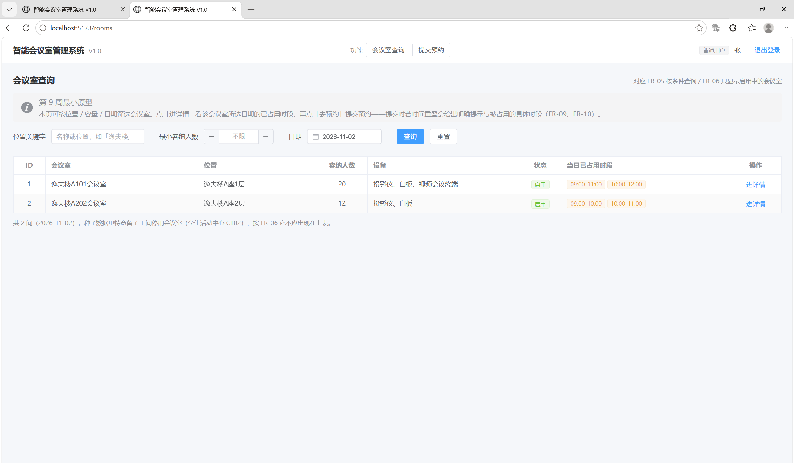

### 第9步：管理员登录与菜单

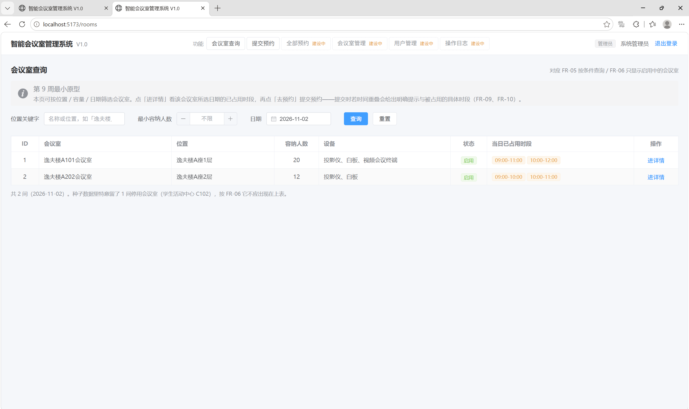

当前管理菜单仍标“建设中”；代码核对`frontend/src/components/RoleMenu.vue`，四项管理菜单均为`pending: true`，点击仅弹出待实现提示，没有跳转管理页面。第10步已现场点击“全部预约”并留证，页面交付后继续第10—12步。

### 第10步：全部预约入口受阻

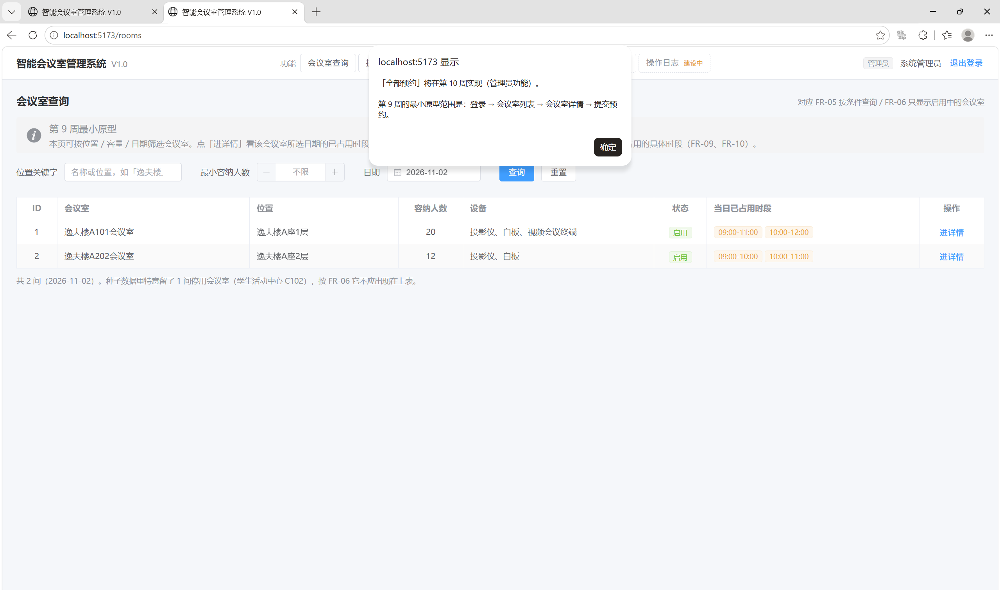

## 首轮缺陷清单

现场发现问题后如实新增一行；若没有发现缺陷，记录“本轮未发现”，不要虚构缺陷。保留修复前现象和失败证据，修复后追加回归结果。

| 编号 | 现象与复现步骤 | 预期结果 | 实际结果／证据 | 定位与修复 | 回归结果 | 状态 |
|---|---|---|---|---|---|---|
| W10-01 | A101在2026-11-06已有09:00—11:00、14:00—15:00；提交14:30—15:30后，查看“本次冲突的时段” | 本次冲突列表仅显示与提交时间重叠的14:00—15:00；全天占用列表可显示全天预约 | 本次冲突列表同时显示09:00—11:00和14:00—15:00；前者与新预约不重叠。见第5步页面截图；预约正确被拒绝且未新增 | 待定位：核对后端冲突响应与前端列表渲染，确认多余时段来自哪一层；待开发同学修复 | 待复测 | 未关闭 |
| W10-02 | user1登录后查找“我的预约”，并尝试访问`/bookings/mine` | 能打开本人预约列表，找到`MR20261106021`，并提供符合条件预约的修改、取消入口 | 菜单无入口，访问该地址后重定向到`/rooms`；普通用户第6—8步页面闭环受阻，见第6步截图 | 当前前端路由未配置我的预约页面；需前端负责人交付并集成列表、修改、取消页面后复测 | 待复测 | 未关闭 |
| W10-03 | admin登录后点击“全部预约” | 打开全部预约列表，能按会议室或日期筛选，并继续强制取消与日志核对 | 仅弹出“将在第10周实现（管理员功能）”，无预约列表；第10—12步页面闭环受阻，见第10步截图 | `RoleMenu.vue`管理菜单仍为`pending: true`，需前端负责人交付并集成管理页面；后端接口是否通过另行验证，不能用接口结果替代页面验收 | 待复测 | 未关闭 |

## 本轮预演结论与后续复测

普通用户第1—4步和管理员第9步通过，共5步；第5步正确拒绝冲突且未新增预约，但冲突时段提示不准确，待修复；第6—8步、第10—12步因页面缺失受阻，共6步。因此本轮不判定V1.0的12步闭环全部通过。

本轮记录3条未关闭问题：W10-01冲突提示多显示时段、W10-02我的预约页面缺失、W10-03管理页面缺失。页面问题交前端负责人配合集成，冲突提示问题由前后端共同定位；修复后由李牧远按原步骤复测，补充截图和回归结果。

九组冲突的独立实测结果保留在[02_冲突测试说明](02_冲突测试说明.md)。本轮没有重新执行10并发额外验收，不能将其他轮次结果直接标为本轮已执行。

本次页面新增预约`MR20261106021`（id=21，2026-11-06 14:00—15:00）保留在测试库，供修改、取消页面交付后接续复测；本轮未取消该记录。正式验收结论由组长在全部必需步骤复测完成后填写。

