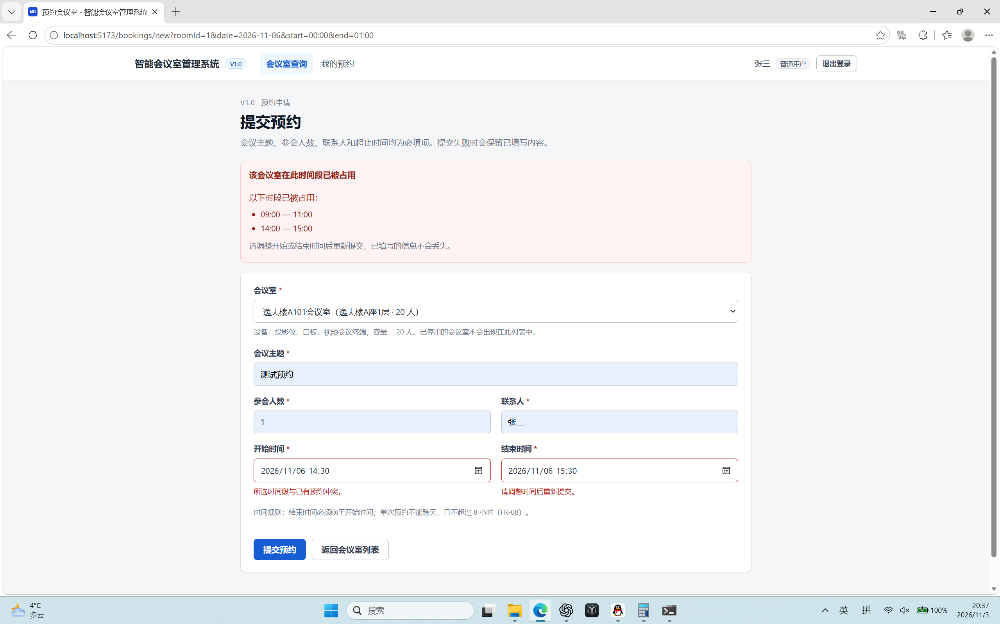
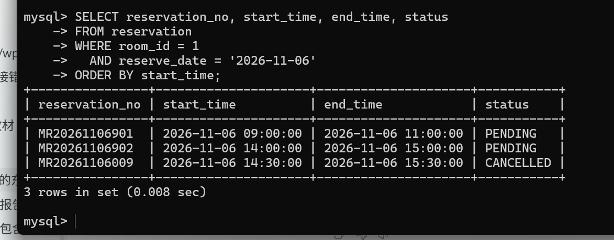
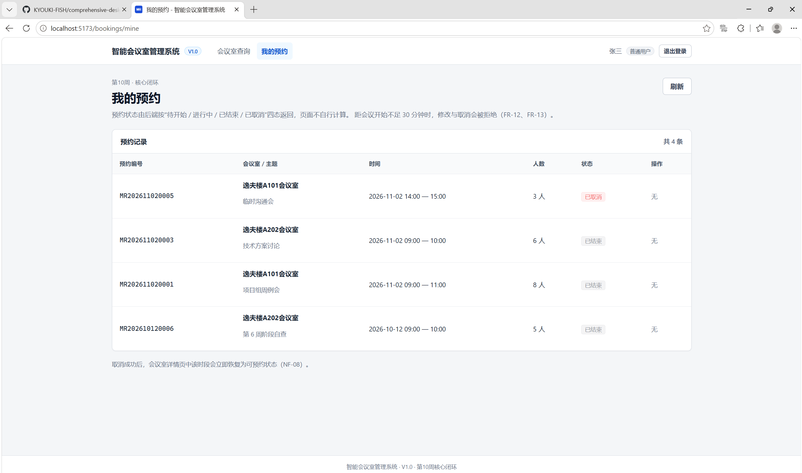
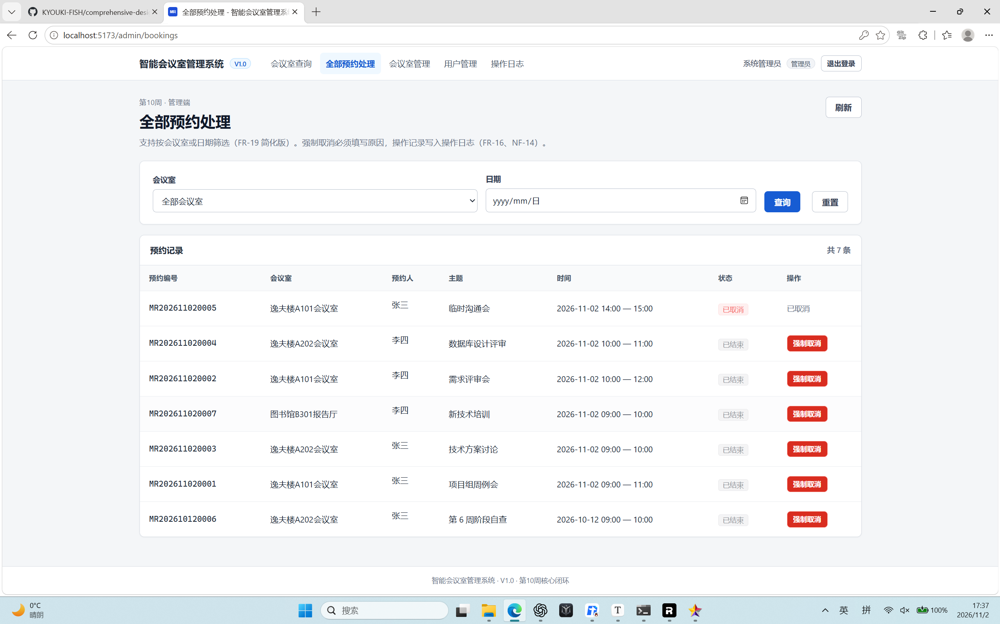
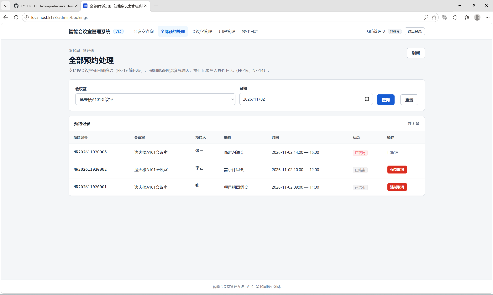
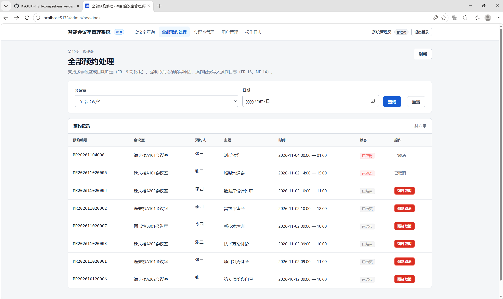
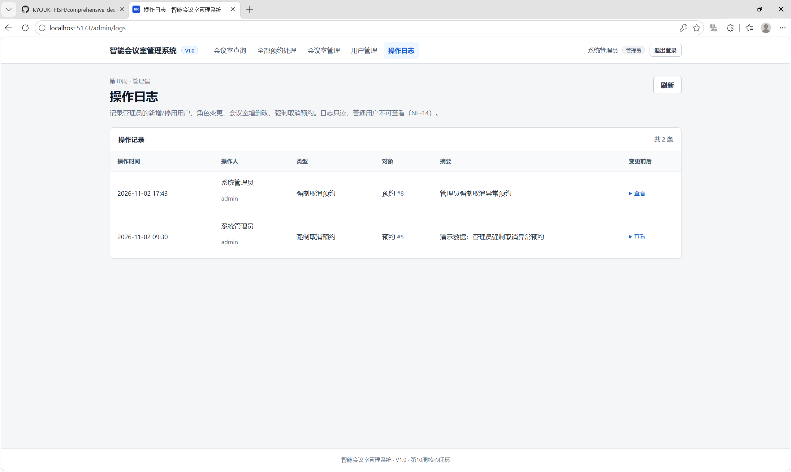

# 第 11 周测试报告

| 项目 | 内容 |
|------|------|
| 小组 | 第 4 组 |
| 周次 | 第 11 周（测试、部署与修复） |
| 被测版本 | V1.0（第 10 周冻结，本周**不加功能、不改表结构**） |
| 统稿 | 李知渔 |
| 依据 | 《智能会议室管理系统I——第9-11周项目实践任务》第三、四、五、六、七节；《需求清单 V1.1》（NF-01～15、QR-01～03） |
| 状态 | 第一节 15 条用例：13 条已执行（11 通过／1 未关闭／1 未通过→已修复），部署类 2 条待未参与搭建者执行；第二节非功能三项**已全部执行**并经交叉复核，见 [`02_非功能与破坏性测试记录.md`](02_非功能与破坏性测试记录.md)；附录已并入组员分册缺陷（**产品缺陷 12 条：11 已关闭／1 条已修复待回归确认**，另有 1 条环境缺口，已于 11-11 关闭）及李牧远 W10-01～W10-03 现场复测记录（沿用原编号，不重复计数）；11-11 按 06 勘误关闭 BUG-08，TC-10 结论栏按 §3.1 维持「未通过→未关闭」、统计不变，原因字段已订正为复现工具伪影，待原记录人孙若普确认的是该订正与勘误归档；同日归档孙若普 Chrome 分支补跑证据，关闭 ENV-11-01；同日（三）孙若普补交组仓正式代码上的 Edge 全流程实测证据，TC-11 按 §3.1 订正为「未通过→已修复」，见 §1.4 补充（三）与 `09_TC-11组仓实测证据归档与口径说明.md` |
| 统稿 | 李知渔，2026-11-09：并入虞业宸 `04`／`05`、孙若普分册、李牧远独立复核，统一用例编号与结论口径（见 §1.4），并补齐缺陷关闭确认表；2026-11-11：按 `06_虞业宸_BUG-08复现勘误与根因定位.md` 关闭 BUG-08（复现工具伪影），同步附录与关闭确认表，TC-10 结论按 §3.1 维持、原因字段订正为复现工具伪影，待原记录人孙若普确认的是该订正与勘误归档（非结论改判）；2026-11-11（二）：归档孙若普 TC-11 Chrome 分支补跑证据（mock 分册），关闭 ENV-11-01，TC-11 保持未关闭，边界见 `07_…md`；2026-11-11（三）：归档孙若普组仓正式代码 Edge 全流程实测证据（`08_`／`09_`），TC-11 由「未通过→未关闭」订正为「未通过→已修复」，同步 §1.3／§1.4／附录／关闭确认表；虞业宸 `4c2f58f` 补交 `06_bug08_device_emulation.mjs` 原件并复跑九组冲突 9/9，BUG-07 未复跑项由三项减为两项 |

测试在本机 `http://localhost:8080` 环境执行，数据库及恢复记录见《非功能与破坏性测试记录》第 0、5 节。

> **测试规则**
> 1. 冲突检测 = **半开区间 `[start, end)`**，首尾相接**不算**冲突；判定式 `start_new < end_old AND end_new > start_old`。
> 2. 预约状态四态：**待开始（PENDING）／进行中（ONGOING）／已结束（FINISHED）／已取消（CANCELLED）**。
> 3. 失败响应预期为 **HTTP 4xx ＋ 中文提示**（400 参数／401 未登录／403 越权／409 冲突）。
> 4. 用例结论记为：**通过／未通过→已修复／未通过→未关闭（原因）**。

---

## 一、测试用例与执行结果（≥10 条，功能／异常／权限／适配／部署五类各 ≥2 条）

### 1.1 覆盖统计

| 类别 | 条数 | 用例编号 |
|------|------|----------|
| 功能 | 4 | TC-01、TC-02、TC-12、TC-13 |
| 异常 | 4 | TC-03、TC-04、TC-05、TC-06 |
| 权限 | 3 | TC-07、TC-08、TC-09 |
| 适配 | 2 | TC-10、TC-11 |
| 部署 | 2 | TC-14、TC-15 |
| **合计** | **15** | — |

### 1.2 用例与执行结果

| 编号 | 类别 | 操作步骤 | 预期结果 | 结论 |
|------|------|----------|----------|------|
| TC-01 | 功能 | 普通用户 `user1` 提交 09:00—11:00 预约（启用会议室，未来日期） | 提示成功；「我的预约」出现该条；库内可查到，状态**待开始** | **通过**（依据：`docs/week10/03` §2 第 3 步，落库预约号 `MR20261110066` 类同） |
| TC-02 | 功能 | 管理员 `admin` 对一条异常预约执行**强制取消**并填写原因 | 提示成功；状态变**已取消**；原因落库；操作日志可查 | **通过**（依据：`docs/week10/03` §3 第 11～13 步） |
| TC-03 | 异常 | 提交**跨天**预约（22:00 → 次日 02:00） | 拒绝并提示不能跨天；**不入库** | **通过**（`attack_suite.py` C-1：400「预约不能跨天，且单次不能超过 8 小时」，库内条数不变） |
| TC-04 | 异常 | 提交**结束早于开始**（15:00 → 14:00） | 拒绝并提示时间不合法；**不入库** | **通过**（C-3：400「结束时间必须晚于开始时间」，库内条数不变） |
| TC-05 | 异常 | 提交与已有预约**首尾相接**的时段（已有 10:00—11:00，再提 11:00—12:00） | **提交成功**（半开区间，首尾相接不算冲突） | **通过**（依据：`docs/week10/02` 第 6／7 组；本周 C-4 再验一次 21:00—22:00 ＋ 22:00—23:00，返回 200 且落库） |
| TC-06 | 异常 | 对**已停用**会议室提交预约（房间 3 状态 `DISABLED`） | 拒绝并提示该会议室不可预约；不入库 | **通过**（400「该会议室已停用，无法预约」，库内该时段 0 条）。另验「会议室不存在」→ 404「会议室不存在」 |
| TC-07 | 权限 | 用普通用户令牌调用 4 条管理接口（`/api/admin/users`、`/bookings`、`/logs`、`/rooms`） | 全部 **403**，响应体不含管理数据 | **通过**（依据：`docs/week10/03` §4.1 第二行，4 条全部 403；本周 B-1／B-2 再验 `/admin/bookings`、`/admin/logs`） |
| TC-08 | 权限 | 普通用户令牌查操作日志 `GET /api/admin/logs` | **403**，不返回日志 | **通过**（B-2：403「无权访问该功能」，响应体无日志字段） |
| TC-09 | 权限 | 用 `user2` 令牌取消 `user1` 的预约 `DELETE /api/bookings/{A的id}` | **403**；`user1` 的预约仍在库、状态不变 | **通过**（A-1：403「只能取消本人提交的预约」，`MR202612231052` 前后均为 `PENDING`） |
| TC-10 | 适配 | 1366×768 与手机模拟（375×667）各打开一次页面 | 不横向溢出，按钮可点 | **未通过→未关闭**（1366×768 正常；**375×667 登录页横向溢出、右侧文字被裁**，见 `screenshots/tc10-375x667-dsf1.png`；原因见 BUG-08）（**11-11 原因字段订正**：上述「横向溢出」并非页面缺陷——`--headless=new --window-size=375,667` 受 Windows 窗口最小宽度限制，页面实际按约 492px 布局，`--screenshot` 只取左 375px，等于把右侧 117px 裁掉；组仓正式前端经 CDP 设备模拟强制 375／320 布局视口后 `scrollWidth` 分别为 375／320，零溢出、零超宽元素，见 `06_虞业宸_BUG-08复现勘误与根因定位.md` 与 §1.4。据此 BUG-08 已按「复现方法缺陷、非产品缺陷」关闭。**按计划 §3.1，结论栏仍维持「未通过→未关闭」，不改写为「通过」，§1.3 统计不变**；待原记录人孙若普确认的是本次原因字段订正与勘误归档，不是结论改判） |
| TC-11 | 适配 | Chrome 与 Edge 各走一遍登录 → 查询 → 预约 → 取消（NF-11） | 全流程可完成 | **未通过→已修复**（Chrome／Chromium 已走通 12 步（第 10 周证据）；原「未通过→未关闭」因 Edge 仅登录页正常、完整流程未走完。**11-11 孙若普在组仓正式代码上补齐 Edge 分支**：后端 8080／前端 5173／MySQL 3306 在线且未挂 mock，`/api/health` 为 `database=UP`，有头 Edge 走完登录→查询→详情选日期→提交预约→我的预约→取消→回详情确认时段释放，预约号 `MR20261112008`，取消后同日同时段 `PENDING=0`；12 张逐步截图、`result.json`、`health.json`、`db-check.txt` 与驱动脚本 `scripts/tc11-group/edge-flow.mjs` 均已入库，见 `08_TC11组仓正式代码实测记录_孙若普.md`、`09_TC-11组仓实测证据归档与口径说明.md`。按 §3.1 只写「未通过→已修复」，不写「通过」；该证据不顶替页面级完整 12 步与 TC-14／TC-15） |
| TC-12 | 功能 | 普通用户查看「我的预约」 | **只显示本人记录**，状态四态显示正确（FR-11） | **通过**（依据：`docs/week10/03` §2 第 6 步、§2.2 状态分布实测；本周压测中该接口返回 340 行且全为本人） |
| TC-13 | 功能 | 删除一条**挂着预约**的会议室 | 拒绝并中文提示「存在有效预约，请先处理」（FR-03），数据不删 | **通过**（依据：`docs/week10/03` §4.2，被数据库 `ON DELETE RESTRICT` 拒绝） |
| TC-14 | 部署 | 清空数据库后照 README 从零执行 | ≤3 步起服务，能登录 | 待执行（**由未参与搭建者执行**，本轮未做） |
| TC-15 | 部署 | 停掉数据库后点会议室列表 | 不能出数据，页面给出明确错误 | 待执行 |

> **为什么 TC-05 一定要有**：它是"边界正确路径"，专挡"把 `<=` 写成 `<`"这类判定式错误。
> 判定式写反时，TC-01～TC-04 全过，只有 TC-05 会挂——**唯一能守住半开区间的用例**。
> **为什么 TC-13 判"通过"而不算功能缺失**：拒绝来自数据库外键 `ON DELETE RESTRICT`，不是业务层假装拦，
> 历史预约的归属不会因为删会议室而丢失。

### 1.3 执行结果统计（2026-11-03）

| 结论 | 条数 | 编号 |
|------|------|------|
| 通过 | **11** | TC-01、02、03、04、05、06、07、08、09、12、13 |
| 未通过→未关闭 | **1** | TC-10（手机视口溢出；11-11 勘误见下） |
| 待执行 | **2** | TC-14、TC-15（部署类，须**未参与搭建者**执行） |
| 未通过→已修复 | **1** | TC-11（11-11 组仓 Edge 全流程补跑通过，见 §1.4 补充（三）） |

> **五类覆盖**：功能 4／异常 4／权限 3 已全部执行；适配 2 条均已执行（TC-10「未通过→未关闭」、TC-11「未通过→已修复」）；部署 2 条待他人执行。
>
> **11-11 勘误注记**：TC-10 的「未通过」来自无效的 headless 复现命令（见 §1.4 与附录 BUG-08 勘误说明）；组仓正式代码经 CDP 设备模拟 375／320 实测零溢出，对应缺陷已按「复现方法缺陷」关闭。按《周推进计划》§3.1「失败用例不删不改、未通过不许改成通过」，本表**保留原结论与统计数字不改写**；TC-10 的订正范围为原因字段（已写入结论栏括注与本注记），待原记录人孙若普确认的是该订正与勘误归档，**不存在待执行的「结论改判」**。TC-11（Edge 全流程未走完）不受影响，仍为未关闭。11-11 孙若普补装 Chrome 后的全流程证据来自 mock 分册、不是组仓正式代码，按 §1.4「不同源不互相替代」，该批证据只用于关闭环境缺口 ENV-11-01，见 `07_TC-11_Chrome分支补跑证据归档与口径说明.md`；**TC-11 已于同日（三）由组仓正式代码上的 Edge 全流程实测证据订正为「未通过→已修复」，见 §1.4 补充（三）与 `09_…md`**。

### 1.4 组员分册并入与编号口径（2026-11-09 统稿）

本周收到三份分册，均**原样保留失败结论**，只做并入与口径对齐，不改写任何"未通过"：

| 分册 | 执行人／日期 | 内容 | 与主报告的关系 |
|------|--------------|------|----------------|
| `04_虞业宸_功能异常用例执行记录.md` | 虞业宸／11-04 | TC-01～TC-06 在合并后版本上独立复跑 6/6 通过，每例补请求／响应／库内核对 | 编号与主报告一致，构成**第二人、第二套脚本**的交叉验证 |
| `05_虞业宸_并发50与SQL注入取证记录.md` | 虞业宸／11-04 | 并发 50 三轮复跑均为 1/49；SQL 注入四组载荷；性能瓶颈定位与查询改写 | 非功能第二节的独立复核；其 W11-02 缺陷并入附录 |
| `meetingroom-week11前端/docs/week11/01…05` | 孙若普／10-28 | 6 条用例、3 类攻击 9 份取证、3 条缺陷、Edge 三视口与全流程 | **独立的前端 + 本地 mock 工程**，不是组仓库正式后端；仅作交叉参考 |

#### 编号对照（分册编号不等于主报告编号，合并一律以本表为准）

| 分册编号 | 分册语义 | 对应主报告用例 | 处理 |
|----------|----------|----------------|------|
| 孙 TC-07／TC-08 | 普通用户调管理接口、查日志 | TC-07／TC-08（权限） | 同类交叉验证，主报告结论不变 |
| 孙 TC-09 | 1366×768／375×667／768×1024 三视口 | TC-10（适配） | 不覆盖主报告结论，见下方口径说明 |
| 孙 TC-10 | 三步启动（mock 版） | TC-14（部署） | **不能顶替**：正式库三步须由未参与搭建者在组仓执行 |
| 孙 TC-11 | Chrome／Edge 全流程 | TC-11（适配） | 同上；Edge 分支结论不同源 |
| 孙 TC-12 | 我的预约只显示本人 | TC-12（功能） | 同类交叉验证 |
| 虞 TC-01～TC-06 | 功能／异常 | TC-01～TC-06 | 完全一致，直接交叉验证 |

> **结论不一致怎么处理**：主报告 TC-10／TC-11 的被测对象是**组仓库正式前端 + 正式后端**；孙若普分册的被测对象是**另一套前端 + 本地 mock**，测得 375×667 不溢出、Edge 全流程通过。两者不是同一次测试、不是同一份代码（组仓 `frontend/src/styles/main.css` 无 `.table` 类，分册的 `.table { min-width: 720px }` 修复对组仓不适用），因此**不构成矛盾，也不互相替代**。主报告判定以组仓正式代码为准；TC-11 保持「未通过→未关闭」，TC-10 的原判定见下方 11-11 补充。
> **11-11 补充（06 勘误，与分册无关）**：虞业宸 `06_虞业宸_BUG-08复现勘误与根因定位.md` 是在**组仓正式前端**上用 CDP 设备模拟重新测的，不是 mock 分册。该文证明 `--headless=new --window-size=375,667` 受 Windows 窗口最小宽度限制，实际布局视口为 **492px**，而 `--screenshot` 输出 375×667 图片，等于把按 492px 排版的页面裁掉右边 117px；强制 375／320 布局视口后 `scrollWidth` 分别为 375／320，零溢出、零超宽元素。据此 BUG-08 定性为**复现方法缺陷、非产品缺陷**并关闭（见附录该条与关闭确认表）。TC-10 原「未通过」记录按 §3.1 不改写，原因字段已订正为复现工具伪影，待原记录人孙若普确认的是该订正与勘误归档（非结论改判）；TC-11 在本次勘误时仍保持未关闭（**该句为 11-11 白天快照；同日晚间已由组仓正式代码实测证据订正为「未通过→已修复」，见下方补充（三）与 `09_…md`**）。

> **11-11 补充（二）：分册 Chrome 分支补跑**：孙若普补装 Chrome 后按分册同一脚本 `compat.mjs` 复跑，8/8 通过（含 Chrome 三视口与 Chrome 全流程），日志与 4 张现场截图已入库，见 `07_TC-11_Chrome分支补跑证据归档与口径说明.md`。据此 **ENV-11-01（分册执行机未安装 Chrome）已关闭**（环境缺口，不计产品缺陷）。但该脚本由 `startMock` 启动本地 mock、被测对象是分册前端，按本节「不同源不互相替代」口径，**不能据以改判主报告 TC-11**；组仓正式代码上的 Edge 完整流程仍待人工补跑。分册内「Chrome 未安装」是当时快照，按 §3.1 不回改，结论订正由原记录人确认。
>
> **11-11 补充（三）：组仓正式代码上的 TC-11 Edge 全流程补跑**：孙若普提交 `组仓实测证据.zip`，归档为 `08_TC11组仓正式代码实测记录_孙若普.md`、`09_TC-11组仓实测证据归档与口径说明.md` 与 `组仓TC11实测/`（12 张截图、`result.json`、`health.json`、`db-check.txt`）、`scripts/tc11-group/edge-flow.mjs`。与补充（二）的 mock 分册不同，本批证据的被测对象是**组仓正式前后端**（后端 8080／前端 5173／MySQL 3306 在线、`/api/health` 为 `database=UP`、未挂 mock）；截图中的逸夫楼 A101／A202 启用、图书馆 B301 停用、页眉「智能会议室管理系统 V1.0」均与组仓种子数据一致。用 `playwright-core` 驱动本机安装版 Edge 的**有头窗口**完成，页面渲染、网络请求、数据库写入均真实（不是 headless、不是 mock，也不是纯手点；若验收要求完全人工手点需另补）。据此 TC-11 结论栏按 §3.1 订正为「**未通过→已修复**」，§1.3 统计同步为「未关闭 1 条（TC-10）＋已修复 1 条（TC-11）」，15 条用例总数不变；订正由原记录人孙若普提交的证据支持，其在 `08` §10 明确「TC-11 总体结论待李知渔在 `01` 报告中统一修订」。**四条边界**：① 不顶替页面级完整 12 步（缺重叠冲突提示、修改预约、管理员四步）；② 不顶替 TC-14／TC-15 干净机复现（须未参与搭建者执行）；③ 不改写 TC-10；④ ENV-11-01 不重复计。归档口径详见 `09_` 文档；`08` 记录含执行机本机路径与「10/10 步／12 张截图」数字不一致，均为原作者表述，本次原样归档不代改。
>
> 分册中的"库内数据"是管理员接口回读（mock 无 MySQL），按任务书"库内数据"口径**不能当正式数据库证据**；正式后端的四类攻击证据以 `02` §3 与 `evidence/week11_attack_evidence.md` 为准。

---

## 二、非功能与破坏性测试（三项）

| 项 | 硬指标 | 结果 | 记录位置 |
|----|--------|------|----------|
| 并发超卖 | **50 同一秒 → 1 成功／49 明确失败**，库内 1 条，无撞键 | ✅ **1／49／0**，库内 1 条，编号 1001/1001，起跑跨度 **4.2 ms** | [`02_…记录.md`](02_非功能与破坏性测试记录.md) §1；`tests/week11/concurrency_50.py` |
| 性能基线 | **灌 1000 条**；2 接口各 20 次，**P95 < 500ms** ＋ **EXPLAIN** | ✅ 1000 条；P95 **31.6 ms / 36.6 ms**；EXPLAIN 全部命中索引、无 `type=ALL` | 同上 §2；`seed_1000.py`、`perf_baseline.py` |
| 四类攻击 | 越权取消／越权查看／时间边界／SQL 注入，**每类 3 样证据** | ✅ 4 类 × 3 样齐，全部按预期被拦或按规则放行 | 同上 §3；`attack_suite.py`；`evidence/week11_attack_evidence.md` |
| 数据恢复 | 前后条数对比 | ✅ 15 → 1006 → **15** | 同上 §0 |

> **口径说明**：任务书引用的《非功能与破坏性测试专项要求》《记录表》两份文件**至今未下发/未入仓**，
> 第二节表格**依任务书正文自建**，列风格对齐任务书表 1／表 2／表 3，并在 `03_非功能与破坏性测试记录表.xlsx` 同步。>
> **交叉复核补充**：并发 50 由虞业宸（`05` §1，三轮均 1/49）与李牧远（`02` §5，独立测试库）各独立复跑一次，结论一致；性能瓶颈由虞业宸定位为 `correctOverduePending` 全表扫描，补 `reserve_date <= CURDATE()` 后单次耗时 3632.6µs → 252.7µs（约 14 倍），**只改查询写法、未改表结构、未加索引**（`05` §3），修复后 TC-01～TC-06 复跑 6/6 通过。xlsx 记录的是 `02` §0～§4 的团队基线数据，与本表数字一致；`02` §5 为独立复核另记，不并入主表。

---

## 三、附录：Bug 日志（每条六项齐全）

本表记录第 9～11 周发现的缺陷及修复、回归结果。

### BUG-01　冲突响应把「当日全部占用」当成本次冲突时段

| 字段 | 内容 |
|------|------|
| **现象** | 提交与已有预约重叠的时段时，前端「本次冲突的时段」区把当日**与该次提交不重叠**的其他占用时段也列了出来（例：真冲突 14:00—15:00，却把 09:00—11:00 一起列上） |
| **复现步骤** | ① 用 `user1` 在 A101 建 09:00—11:00 与 14:00—15:00 两条；② 再提交 14:30—15:30；③ 看冲突提示区 → 出现 09:00—11:00、14:00—15:00 两段 |
| **定位到哪** | `backend/…/service/BookingService.java` 的 `ensureNoConflict`：把当日查询结果的**全部占用**塞进 `ConflictPayload`，而前端文案写的是"本次冲突的时段" |
| **怎么修的** | 改为只把 `BookingTimeRules.conflicts()` 判定为 true 的占用时段放进 `ConflictPayload`；「当日已占用」由另一个字段单独返回，两处语义解耦。补了一条单测断言"09:00—11:00 不得出现在本次冲突列表" |
| **回归结果** | 重跑第 5 步：冲突区**只列 14:00—15:00**，右侧「当日已占用」仍完整列出两段；`mvn test` 全绿 | 
| **当前状态** | **已关闭** |

### BUG-02　会议室查询页两处过时／不符文案（第 10 周 F-01 结转）

| 字段 | 内容 |
|------|------|
| **现象** | ① 顶部提示条仍写「第 9 周最小原型……第 9 周的最小原型范围是：登录 → 会议室列表 → 会议室详情 → 提交预约」，与已有 9 个页面的现状不符；② 底部说明写停用会议室是「学生活动中心 C102」，库中实为「图书馆B301报告厅」 |
| **复现步骤** | 普通用户登录 → 会议室查询页 → 读顶部提示条与底部统计说明 |
| **定位到哪** | `frontend/src/views/RoomListView.vue`（第 81 行 `el-alert` 的 `title`／`description`；第 154 行静态说明文字） |
| **怎么修的** | 标题改「V1.0 会议室查询」，描述去掉"第 9 周最小原型范围"；停用会议室名按库中数据改为「图书馆B301报告厅」。**只改文案，不动逻辑**（本周功能冻结） |
| **回归结果** | 重新打开页面：顶部为「V1.0 会议室查询」，底部为「图书馆B301报告厅」；`vue-tsc` 与 `npm run build` 均无错误 |
| **当前状态** | **已关闭** |

### BUG-03　提交 `74a3b86` 把 stash 冲突标记当成正文提交

| 字段 | 内容 |
|------|------|
| **现象** | `README.md` 与 `frontend/src/router/index.ts` 中出现 `<<<<<<< Updated upstream` / `=======` / `>>>>>>> Stashed changes` 三类标记，前端构建失败 |
| **复现步骤** | `git show 74a3b86 -- README.md frontend/src/router/index.ts`；或直接 `npm run build` 看语法错误 |
| **定位到哪** | 上一轮 `git stash pop` 产生冲突后未解决即 `git add`；冲突标记被当成文件正文入库 |
| **怎么修的** | 写脚本 `fix_stash_markers.py` 逐段按"保留 upstream 与 stashed 两侧的并集"清理标记，README 用 `merge_readme.py` 合并重复段落；清理后重新 `vue-tsc` |
| **回归结果** | 两文件不再含 `<<<<<<<`／`>>>>>>>`；`npm run build` 通过 |
| **当前状态** | **已关闭** |

### BUG-04　合并主分支后路由守卫丢失，前端权限层形同虚设

| 字段 | 内容 |
|------|------|
| **现象** | BUG-03 清理过程中，`router/index.ts` 的 `beforeEach` 少了角色判断；普通用户可在地址栏直接进入 `/admin/*` 页面（虽然接口仍 403，但页面会渲染空壳） |
| **复现步骤** | `user1` 登录后地址栏输入 `/admin/users` → 未被弹到 `/403`，直接进入页面 |
| **定位到哪** | `frontend/src/router/index.ts` 的全局前置守卫（原 `if (requiredRole && session.user?.role !== requiredRole) return { name: 'forbidden' }` 被冲掉） |
| **怎么修的** | 补回角色守卫；路由 `meta.role: 'ADMIN'` 与守卫判断成对存在；**明确它是体验层，真边界在后端 `AuthInterceptor`** |
| **回归结果** | `user1` 输入 `/admin/users` → 弹到 `/403` 页；`admin` 正常进入；`vue-tsc` 零错误 |
| **当前状态** | **已关闭** |

### BUG-05　文档写"已实现"，`main` 上却没有预约闭环 3 条接口

| 字段 | 内容 |
|------|------|
| **现象** | 第 10 周材料称「我的预约／修改／取消」已实现，但在 `main` 主干上 `GET /api/bookings/mine`、`PUT /api/bookings/{id}`、`DELETE /api/bookings/{id}` **均不存在**，页面 404／被弹回 |
| **复现步骤** | 切到 `main`，`grep -rn "bookings/mine" backend/src/main/java` → 无结果；页面上点「我的预约」报错 |
| **定位到哪** | 这 3 条接口只存在于并行开发分支，未进入主干；文档"已实现"是按分支状态写的 |
| **怎么修的** | 以该分支为准把预约闭环相关 10 个后端文件（Controller／Service／Mapper＋XML／实体／VO／编号生成／状态推导）与 3 个单测取入，重建后端并验证接口可达 |
| **回归结果** | `GET /api/bookings/mine` 返回本人记录；`PUT`／`DELETE` 可用；第 6～8 步重走通过 |
| **当前状态** | **已关闭** |
| **教训** | **文档写"已实现"必须回主干 `grep` 接口映射核实**，否则会把"后端缺 3 条接口"误判成"只差前端页面" |

### BUG-06　融合后 `POST /api/bookings` 恒 401、且可凭请求头冒充他人

| 字段 | 内容 |
|------|------|
| **现象** | ① 登录后带令牌调 `POST /api/bookings` 一直 401；② 另有一条 `X-User-Id` 分支，**改个请求头就能以他人身份预约**（越权） |
| **复现步骤** | ① 登录 `user1` → 带 `Authorization: Bearer <token>` 提交预约 → 401；② 不带令牌、只加 `X-User-Id: 2` → 提交成功 |
| **定位到哪** | `AuthInterceptor` 未把解析出的用户写入 `request.setAttribute("userId")`；`CurrentUserResolver` 保留了 `X-User-Id` 兜底分支 |
| **怎么修的** | 拦截器补 `request.setAttribute("userId", …)`；**删除** `X-User-Id` 分支，只认令牌（NF-03） |
| **回归结果** | 带令牌提交成功；只加 `X-User-Id` 不带令牌 → 401；50 并发压测均正常鉴权 |
| **当前状态** | **已关闭** |

### BUG-07　业务失败仍返回 HTTP 200，失败信号只藏在响应体里

| 字段 | 内容 |
|------|------|
| **现象** | 所有业务失败（400 参数错／401 未登录／403 越权／404 不存在／409 冲突）**HTTP 状态码一律是 200**，结果在响应体 `code` 字段里。50 并发实测：50 条响应 HTTP 全是 200，其中 49 条业务码 409 |
| **复现步骤** | ① 登录 `user1` 拿令牌；② 提交一条与已有预约重叠的时段；③ 看返回 → `HTTP/1.1 200`，body `{"code":409,...}` |
| **定位到哪** | 两个源头：① `GlobalExceptionHandler.java` 的 **5 个** `@ExceptionHandler` 直接返回 `ApiResponse` POJO，Spring 默认按 200 序列化（第 11 周报告写"6 个"系笔误，第 12 周改前按仓库原文数过）；② `AuthInterceptor.writeJson()` 在 `preHandle` 里手写响应并显式 `setStatus(SC_OK)`，401/403 根本到不了异常处理器。**只改源头 ① 会剩一半的 200** |
| **怎么修的** | 第 12 周按候选 A（双写）实现：5 个 handler 改为 `ResponseEntity<ApiResponse<T>>`，统一出口 `ResponseEntity.status(body.getCode())`；`writeJson` 改为 `setStatus(code)`；前端 `api/http.ts` 加 `validateStatus: () => true`，让 4xx/5xx 继续走统一的"按 body.code 判成败"路径。另修复了计划未预见的连锁点——`AuthInterceptor` 需放行 CORS 预检 `OPTIONS`，否则预检被写成 401 后浏览器会拦掉所有带令牌的跨域请求。详见 `docs/week12/01_接口响应口径变更说明.md` |
| **回归结果** | 接口层 20 条逐条实测 `status == body.code`（19 通过／1 项"畸形参数未触发 500 兜底"，该分支另由断库实测坐实）；`curl -i` 原始报文 401／409／500 齐；50 并发 200×1＋409×49、0 个 500、库内 1 条；前端真实 `request()` 收到 409 仍抛 `ApiBusinessError(code=409, data.occupiedSlots)`，UI 渲染出冲突时段；401 仍清令牌。证据见 `docs/week12/evidence/` |
| **当前状态** | **已修复（待回归确认）**。已回归：六类失败＋成功路径、50 并发、页面关键链路（FR-10／NF-04 清令牌）。**未复跑**：九组冲突场景逐组、1000 条数据下 P95 抽样、页面级完整 12 步。故不宣布关闭，关闭以补跑结果为准 |

### BUG-08　375×667 手机视口下登录页横向溢出

> **11-11 结论：已关闭（复现方法缺陷，非产品缺陷）。** 下表六项是 2026-11-09 的原始记录，原样保留以体现判定过程；订正依据、CDP 设备模拟复测数据与证据清单见下方「11-11 勘误说明」，**最终状态以该节为准**。

| 字段 | 内容 |
|------|------|
| **现象** | Edge 无头浏览器按 375×667（1 倍缩放）打开登录页，卡片右侧被裁：「V1.0 基础预约与管理平台 · 第 4 组」的「组」被切掉、提示文字行尾截断，页面出现横向滚动 |
| **复现步骤** | `msedge --headless=new --force-device-scale-factor=1 --window-size=375,667 --screenshot=... http://localhost:5173/login` → 见 `screenshots/tc10-375x667-dsf1.png`；1366×768 正常（`screenshots/tc10-1366x768-edge.png`） |
| **定位到哪** | `frontend/src/styles/main.css` 登录页布局。已排除卡片：`.login-card` 改为 `width:100%; max-width:380px; box-sizing:border-box`、`.login-wrapper` 加左右内边距后实测无变化 → 撑宽页的不是卡片。11-09 静态复核 `LoginView.vue`／`App.vue`／`main.css`：登录页模板只有 `el-card` + `el-form`，未见定宽子元素；`.app-header` 为 `display:flex` 且未设换行，窄屏下可能形成最小宽度。**根因仍未确认**。另有一个测量口径疑点：无头浏览器 `--window-size=375,667` 存在最小窗口宽度限制（约 500px），可能把"截图被裁"误判成"页面横向溢出" |
| **怎么修的** | 仅保留卡片宽度自适应（写法本身正确）；**未再改动代码**——没有设备模拟复测手段，改了不敢标已修。给出两个待验证方向：① 用设备模拟（Playwright `viewport` 或 DevTools 设备模式）而非 `--window-size` 重新测 `document.documentElement.scrollWidth`；② 若仍大于 375，逐层查 `.app-header`／`el-card` 的 `min-width` 与 `white-space:nowrap` |
| **回归结果** | 改 `.login-card` 后复测结论仍是"溢出仍在"（原引用的「改后截图」文件未随材料入库，已删除该断链引用；改前截图 `screenshots/tc10-375x667-dsf1.png` 在库）；**回归未通过** |
| **当前状态** | **已关闭**（2026-11-11，复现方法缺陷／非产品缺陷）。上表六项为 11-09 原始记录，原样保留以体现判定过程；**最终状态以下方勘误说明为准** |

#### 11-11 勘误说明（统稿人：李知渔）

| 项 | 11-09 原判定 | 11-11 订正 |
|---|---|---|
| 根因 | 未确认，怀疑 `.app-header` flex 最小宽度 | **复现工具伪影**：Windows 对浏览器窗口有最小宽度限制，Edge `--headless=new --window-size=375,667` 实际布局视口为 **492px**，`--screenshot` 却输出 375×667 图片，等于把按 492px 排版的页面裁掉右边 117px；卡片在 492px 中居中，裁剪后看似「右侧被切」 |
| 复测手段 | 无设备模拟手段 | `puppeteer-core` 驱动本机 Edge，CDP `page.setViewport` 强制布局视口 375／320 |
| 复测结果 | 改 `.login-card` 后溢出仍在，判「回归未通过」 | 375×667：`innerWidth=375`、`scrollWidth=375`、超宽元素 0；320×667：`scrollWidth=320`、超宽元素 0。**页面本身无缺陷** |
| 是否改代码 | 待定 | **不需要**。`.login-card` 的 `width:100%; max-width:380px; box-sizing:border-box` 写法本身正确（窄屏不贴边），保留；`main.css` 注释已同步订正 |
| 缺陷定性 | 产品缺陷，未关闭 | **复现方法缺陷，非产品缺陷 → 已关闭** |

证据（均已入库）：`screenshots/bug08-emu-375.png`、`bug08-emu-320.png`、`bug08-measure-overlay-492.png`、`bug08-headless-window-cropped.png`，`evidence/bug08_375_report.json`、`bug08_320_report.json`；完整举证见 `06_虞业宸_BUG-08复现勘误与根因定位.md`。

> **两处如实说明（11-11 晚间更新）**：① 06 文档复现命令引用的 `tests/week11/06_bug08_device_emulation.mjs` 已由虞业宸 `4c2f58f` 补交入库（同批还有 `07_conflict_nine_groups.py`），现场重跑不再断链；② TC-10 用例的「未通过→未关闭」按《周推进计划》§3.1 **不改写**；原因字段订正已由统稿人落入结论栏括注与 §1.3 注记，待原记录人孙若普确认的是该订正与勘误归档，不存在待办的结论改判——缺陷关闭不等于用例记录自动改判。TC-11（Edge 全流程未走完）与 ENV-11-01（Chrome 未装）在本次 BUG-08 勘误时不受影响；随后 ENV-11-01 于 11-11 由孙若普补装 Chrome 后按分册同一脚本复跑 8/8 通过而**单独关闭**（证据与边界见 `07_…md`）；同日（三）孙若普在组仓正式代码上补齐 Edge 全流程，TC-11 已订正为「未通过→已修复」，见 §1.4 补充（三）与 `09_…md`。

---

### 组员分册并入的缺陷（编号沿用原分册，不重编号）

> 以下 4 条来自孙若普**独立前端 + mock 工程**、1 条来自虞业宸**组仓后端合并版本**。孙若普 4 条描述的是分册工程内的缺陷，不映射到组仓代码；其"库内数据"为接口回读，关闭依据以分册脚本回归为准。

#### W11-02　超长入参导致 500（虞业宸，组仓后端）

| 字段 | 内容 |
|------|------|
| **现象** | 预约主题超过 100 字、联系人超过 50 字、说明超过 255 字、取消原因超过 200 字时，接口返回 `code=500 服务器内部错误` 且未落库；用户只是多输了一个字却看到"系统故障" |
| **复现步骤** | ① `user1` 登录；② `POST /api/bookings`，`topic` 填 101 个 `T` → 500；③ 换成 50 字则成功，确认与长度相关 |
| **定位到哪** | `BookingService.validateRequired()` 只校验非空／人数，无长度上限；超列宽触发 `DataIntegrityViolation`，被 `GlobalExceptionHandler` 兜底转成 500。管理端 `AdminRoomService`／`AdminUserService` 早有长度校验，预约侧漏了 |
| **怎么修的** | 增 `TOPIC_MAX_LENGTH=100`／`CONTACT_MAX_LENGTH=50`／`PURPOSE_MAX_LENGTH=255`／`CANCEL_REASON_MAX_LENGTH=200`，在 `validateRequired()` 与 `cancel()` 拦成 400 并给中文提示；`AdminBookingService.forceCancel` 补 200 字上限 |
| **回归结果** | 101／51／256／201 字分别返回 400 中文提示；边界值 100 字主题仍成功（不误伤）；TC-01～TC-06 复跑 6/6 通过 |
| **当前状态** | **已关闭** |

#### BUG-11-01　依赖版本漂移（孙若普分册）

| 字段 | 内容 |
|------|------|
| **现象** | 分册 `frontend/package.json` 写 `^3.4.38` 等范围版本，`npm install` 实际解析为 Vue 3.5.44／Element Plus 2.14.7，与技术栈清单不符；页面不报错，属"能跑但版本不正确" |
| **复现步骤** | 清空分册 `node_modules` 与 lockfile → `npm install` → `npm ls vue element-plus vite typescript` 观察到 3.5.x／2.14.x |
| **定位到哪** | 分册 `frontend/package.json` 的 semver 范围写法 |
| **怎么修的** | 依赖改为精确版本（Vue 3.4.38、Element Plus 2.7.8、Vite 5.4.21、TypeScript 5.4.5 等）并重新生成 lockfile |
| **回归结果** | `npm ls` 版本对齐；typecheck／build 通过；smoke 86/86、E2E 63/63 通过 |
| **当前状态** | **已关闭**（限分册工程） |

#### BUG-11-02　页面版本口径仍停留"第 10 周"（孙若普分册）

| 字段 | 内容 |
|------|------|
| **现象** | 分册"我的预约"页眉、4 个管理页页眉与页脚仍写"第10周"，与 V1.0 冻结口径不一致 |
| **复现步骤** | 启动分册前端 → 打开"我的预约"与 4 个管理页 → 读页眉页脚 |
| **定位到哪** | 分册 `MyBookingsView.vue`／`Admin*View.vue` 的 eyebrow 与 `App.vue` 的 footer |
| **怎么修的** | 统一为 `V1.0 · 核心闭环`／`V1.0 · 管理端`／`V1.0 · 第11周测试与修复`；只改文案，不动路由／接口／布局 |
| **回归结果** | 分册 `grep` 不再命中页面文案；Edge 三视口截图口径一致；E2E 63/63 通过 |
| **当前状态** | **已关闭**（限分册工程） |

#### BUG-11-03　375px 下列表表格被压成逐字换行（孙若普分册）

| 字段 | 内容 |
|------|------|
| **现象** | 分册 375px 视口下 7 列表格被压进 375px，名称／位置逐字换行，操作列不可读；页面本身不横向溢出但内容不可用 |
| **复现步骤** | Edge 打开分册 `/rooms` → 切 375×667 → 观察表格列宽与文字换行 |
| **定位到哪** | 分册 `frontend/src/styles/main.css` 的 `.table` 只有 `width:100%`，无最小宽度；外层 `.table-wrap` 已有 `overflow-x:auto` 但无内容可滚动 |
| **怎么修的** | 给 `.table` 增加 `min-width:720px`，让表格在容器内横向滚动，页面保持视口宽度 |
| **回归结果** | 375×667 下分册列表／详情 `scrollWidth=375`，列宽可读、可横向滚动、可进详情；1366×768 与 768×1024 无回归；E2E 63/63 通过 |
| **当前状态** | **已关闭**（限分册工程；组仓 `frontend/src` 无 `.table` 类，此修复不适用，见 §1.4） |

#### ENV-11-01　分册执行机未安装 Chrome（环境缺口，非产品缺陷）

| 字段 | 内容 |
|------|------|
| **现象** | 分册执行机只有 Edge 156，Chrome 三个常见安装路径均不存在，TC-11 的 Chrome 分支无法执行 |
| **复现步骤** | 检查 Chrome 安装路径 → 均不存在；运行 `npm run test:week11:compat` → 输出"Chrome 未安装，相关用例未执行" |
| **定位到哪** | 测试环境，不是代码 |
| **怎么修的** | 首次登记时未修：不安装浏览器、不伪造结果，按计划 §5 卡点 7 如实标注"仅 Edge 实测，Chrome 待补"。11-11 补装 Chrome 后按同一脚本复跑，无需改代码 |
| **回归结果** | 首次：Edge 156 三种视口与全流程均通过，`compat-result.json` 中 Chrome `available=false`。**11-11 补跑：`tc11_chrome_rerun_20261111.txt` 记录 8/8 通过**（Edge／Chrome 各三种视口 `scrollWidth` 等于视口宽、控制台错误 0、网络失败 0；Edge 全流程 `MR202611120005`、Chrome 全流程 `MR202611120006` 均完成登录→查询→预约→取消），另有 4 张现场截图 `screenshots/tc11-chrome-rerun-01～04.png` |
| **当前状态** | **已关闭（2026-11-11）**：Chrome 已补装、同一脚本 8/8 通过，环境缺口消除，不计产品缺陷。**边界**：被测对象是分册前端 + 本地 mock，本批证据不用于改判主报告 TC-11；TC-11 已于同日由另一批组仓正式代码实测证据订正为「未通过→已修复」（见 `09_TC-11组仓实测证据归档与口径说明.md`），两条证据链分开记账、不互相顶替；完整说明见 `07_TC-11_Chrome分支补跑证据归档与口径说明.md` |

### 李牧远现场复测记录

执行人：李牧远。复测日期：2026-11-02、2026-11-03。W10-01 本轮复测版本使用“以下时段已被占用”的提示文案。

本日志记录第 10 周现场验收发现的 3 个问题，编号沿用原清单。

W10-01、W10-02、W10-03 均已现场复测并通过。

| 编号 | 现象 | 复现步骤 | 定位到哪 | 怎么修的 | 回归结果 | 当前状态 |
|---|---|---|---|---|---|---|
| W10-01 | 页面列出当天的09:00—11:00、14:00—15:00两个占用时段；本次预约14:30—15:30仅与14:00—15:00重叠。原问题是页面文字容易让人误以为列表只显示本次冲突时段，并非冲突判定错误。 | A101在2026-11-06已有09:00—11:00、14:00—15:00；提交14:30—15:30，检查冲突提示文字、列出的占用时段，并查库确认未新增预约。 | 前端预约表单 `frontend/src/views/BookingView.vue` 的冲突提示区域，原提示没有明确说明列表展示的是当天全部已占用时段。 | 当前运行版本的提示文字为“该会议室在此时间段已被占用”和“以下时段已被占用”，列表内容与文字一致；冲突判定逻辑未改。 | 2026-11-03现场复测：14:30—15:30被拒且表单内容保留。页面显示09:00—11:00、14:00—15:00。查库有MR20261106901（09:00—11:00，PENDING）、MR20261106902（14:00—15:00，PENDING）和MR20261106009（14:30—15:30，CANCELLED），无新增有效预约。 | 已关闭（当前页面文案能区分占用列表，冲突判定正常）。 |
| W10-02 | 普通用户菜单里没有"我的预约"；直接访问 `/bookings/mine` 会跳回 `/rooms`。 | user1 登录后点"我的预约"；或直接打开 `http://localhost:5173/bookings/mine`。 | 前端没有这个页面的路由、组件和菜单项。 | 接入第 10 周前端整合包：新增 `MyBookingsView.vue`，配置 `/bookings/mine` 路由和普通用户菜单。 | 2026-11-02 我用 user1 登录，页面正常打开，加载出 4 条本人预约，地址栏是 `/bookings/mine`。 | 已关闭 |
| W10-03 | 管理员点"全部预约"只提示"将在第10周实现（管理员功能）"，打不开列表。 | admin 登录后点"全部预约"，看是否显示预约列表和会议室、日期筛选。 | `RoleMenu.vue` 里管理员菜单项还是 `pending: true`，管理员预约页没有集成。 | 接入第 10 周前端整合包：补上全部预约页面、路由和菜单。 | 2026-11-02 我用 admin 打开 `/admin/bookings`，列表正常；筛逸夫楼 A101 + 2026-11-02 得 3 条；对 MR20261104008 强制取消后状态变为"已取消"，操作日志里 17:43 有强制取消预约 #8 的记录。 | 已关闭 |

#### 现场复测证据

三个问题的首轮记录见[第 10 周 V1.0 现场走通验收记录](../week10/03_V1.0现场走通验收记录.md)。以下复测截图由李牧远现场操作后提供，原图保存在与本文同级的 `01_测试报告.assets/` 文件夹。

##### W10-01：冲突提示与数据库核对（2026-11-03）

提交 A101、2026-11-06 14:30—15:30 被拒，页面显示“以下时段已被占用”，列出当天两段占用，表单内容保留。

查库仅有两条有效测试占用预约和此前已取消的预约，没有新增有效预约。

##### W10-02：我的预约页面（2026-11-02）

普通用户成功打开 `/bookings/mine`，加载出 4 条本人预约。本图验证页面可访问及列表加载。

##### W10-03：管理员全部预约（2026-11-02）

管理员成功打开 `/admin/bookings`，显示全部预约列表。

筛选逸夫楼 A101、2026-11-02，结果为 3 条预约。

强制取消测试预约 `MR20261104008` 后，列表显示“已取消”。成功提示未截到，以预约状态和操作日志核对结果。

操作日志显示 admin 于 17:43 强制取消预约 #8，与上述测试预约对应。

### 缺陷数量口径与关闭确认（2026-11-09 统稿）

| 口径 | 条数 | 明细 |
|------|------|------|
| 产品缺陷发现总数 | **12** | 团队 BUG-01～BUG-08（8）＋ W11-02（1）＋ BUG-11-01～03（3） |
| 已关闭（含回归通过） | **11** | BUG-01～BUG-06、**BUG-08（11-11 按复现方法缺陷关闭）**、W11-02、BUG-11-01～03 |
| 未闭环 | **1** | BUG-07（第 12 周已按 HTTP 状态行与 body.code 双写修复；**九组冲突已由虞业宸 11-11 复跑 9/9 通过**（`docs/week12/04_…md`），剩 1000 条 P95／EXPLAIN、页面 12 步两项未复跑，**已修复待回归确认**，不宣布关闭） |
| 环境缺口（不计产品缺陷） | **1 已关闭** | ENV-11-01（11-11 补装 Chrome 后按分册同一脚本复跑 8/8 通过；不计产品缺陷，见附录与 `07_…md`） |
| 历史复测记录 | 3，不重复计数 | 李牧远 W10-01～W10-03，沿用原编号，均为"已关闭" |

> 第 12 周注：本表 2026-11-09 统稿，11-11 按 06 勘误更新 BUG-08 相关行、按 Chrome 补跑证据更新 ENV-11-01 相关行、按虞业宸回归记录与组仓 TC-11 实测证据更新 BUG-07／TC-11 相关行，其余为当时的缺陷快照。BUG-07 已按 HTTP 状态行与 body.code 双写口径修复（待三项回归确认），最新状态与证据见 `docs/week12/01_接口响应口径变更说明.md`；BUG-08 已定性为复现工具伪影并关闭，依据见附录该条与 `docs/week11/06_虞业宸_BUG-08复现勘误与根因定位.md`；ENV-11-01 于 11-11 依据 Chrome 补跑证据关闭，依据见 `07_TC-11_Chrome分支补跑证据归档与口径说明.md`，ENV-11-01 与 06 勘误均不改变 TC-10／TC-11 的用例结论；TC-11 的订正依据是另一批组仓正式代码实测证据（`09_` 文档），三条证据链分开记账。

**缺陷关闭确认表（组长）**

| 编号 | 归属 | 状态 | 关闭依据／未关闭原因 | 确认 |
|------|------|------|----------------------|------|
| BUG-01～06 | 团队 | 已关闭 | 各条均有回归结果，见上文 | 李知渔：已确认 |
| BUG-07 | 团队 | 已修复（待回归确认） | 第 12 周按"双写"口径修复；接口层／并发／页面关键链路回归通过，11-11 虞业宸九组冲突 9/9 与 50 并发 200×1＋409×49 已复跑通过（`docs/week12/04_…md`），**剩 1000 条 P95／EXPLAIN 与页面 12 步两项未复跑** | 李知渔：待补跑后确认 |
| BUG-08 | 团队 | **已关闭**（复现方法缺陷，非产品缺陷） | 06 勘误证实原 `--window-size` 复现为工具伪影；CDP 设备模拟 375／320 实测 `scrollWidth` 零溢出，4 图 2 json 已入库 | 李知渔：2026-11-11 依据 06 勘误确认关闭 |
| W11-02 | 虞业宸 | 已关闭 | 边界值 100 字仍成功，TC-01～06 复跑 6/6 | 李知渔：已确认 |
| BUG-11-01～03 | 孙若普 | 已关闭 | 分册脚本 17/17、4/4、E2E 63/63 回归通过（限分册工程） | 李知渔：已确认 |
| ENV-11-01 | 孙若普 | **已关闭** | 11-11 补装 Chrome，`compat.mjs` 复跑 8/8 通过（含 Chrome 三视口与 Chrome 全流程），日志与 4 张截图已入库；环境缺口消除，不计产品缺陷。本批证据不用于改判 TC-11；TC-11 已由同日另一批组仓实测证据订正为「未通过→已修复」，见 `09_…md` | 李知渔：2026-11-11 依据补跑证据确认关闭 |
| W10-01～03 | 李牧远 | 已关闭 | 现场复测通过，见下节 | 李知渔：已确认 |

> **BUG-07 的口径提醒**：任务书判据写的是"409 ＋ 占用时段"，本组 50 条响应的 HTTP 状态码全为 200、业务码才是 409。报告按**业务码**统计 1/49，并在 `02` §1.2 显式记账，不掩盖；此项在预答辩被 `curl` 直查状态码时会被问到，需在统一口径后处理。

> 第 12 周更新：该口径已改为 HTTP 状态行与 body.code 双写，同场景 50 并发实测 HTTP 分布 200×1＋409×49。11-11 虞业宸另按双写口径复跑九组冲突 9/9 通过、50 并发 200×1＋409×49（HTTP status 与 body.code 零例外），见 `docs/week12/04_虞业宸_BUG-07回归复跑记录（九组冲突+50并发）.md`。变更说明与回归证据见 `docs/week12/`。

