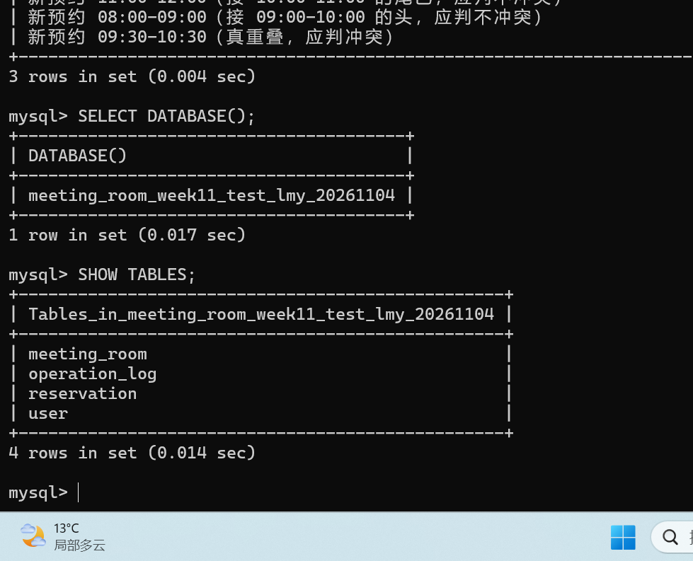
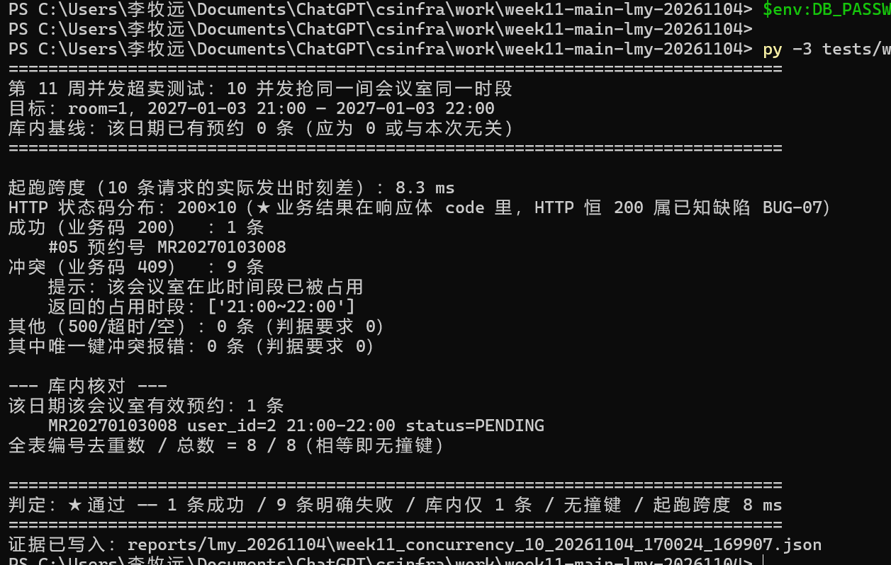
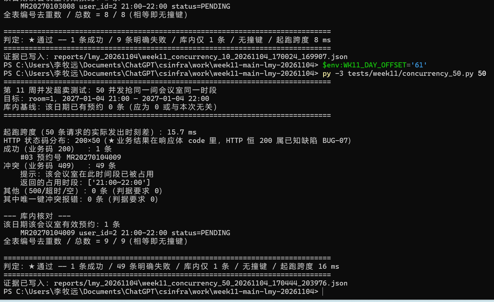
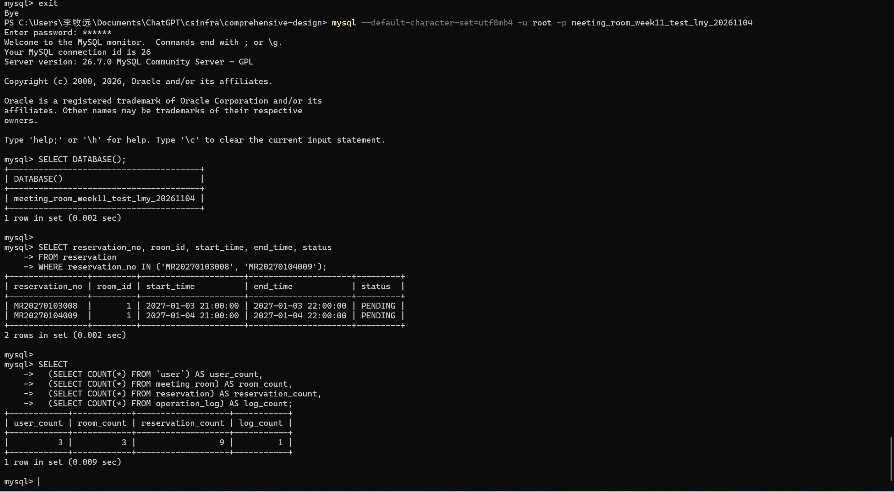
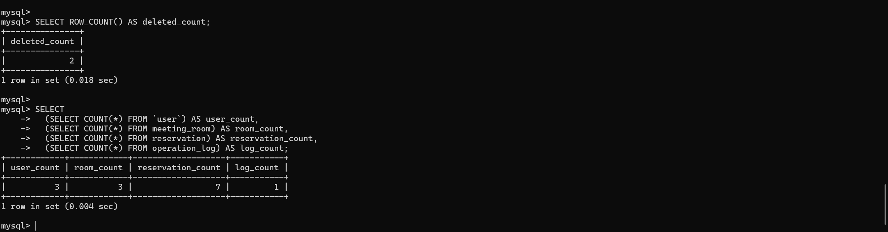

# 第 11 周 非功能与破坏性测试记录

> 第 0～4 节保留团队已有记录（执行日期 2026-11-03，记录人见原表）；第 5 节为李牧远于 2026-11-04 本人执行的并发独立复核与数据恢复记录。两轮使用的数据库与基线分别记录。
>
> 配套团队表格：[03_非功能与破坏性测试记录表.xlsx（远端）](https://github.com/KYOUKI-FISH/comprehensive-design/blob/main/docs/week11/03_非功能与破坏性测试记录表.xlsx)。

| 项目 | 内容 |
|------|------|
| 被测版本 | V1.0（第 10 周冻结：**本周不加功能、不改表结构**） |
| 环境 | 本机 MySQL 8.0.29（库 `meeting_room`）＋ 后端 `localhost:8080` ＋ 前端 `localhost:5173` |
| 目标地址 | **仅 `http://localhost:8080`**（任务书第三节边界；未对任何非本机服务发请求） |
| 执行日期 | 2026-11-03 23:03—23:35 |
| 记录人 | 李知渔（性能＋统稿）；并发／注入脚本本轮由统稿方代为执行，结果待虞业宸独立复核 |
| 模板说明 | 任务书引用的《非功能与破坏性测试专项要求》《记录表》**未下发**，本表**依任务书正文自建**，xlsx 见 `03_非功能与破坏性测试记录表.xlsx` |

> **脚本与证据位置**：`tests/week11/`（并发 `concurrency_50.py`／灌数 `seed_1000.py`／性能 `perf_baseline.py`／攻击 `attack_suite.py`），
> 原始输出 `reports/week11_*.json`（工作区内部），攻击逐条证据 [`evidence/week11_attack_evidence.md`](https://github.com/KYOUKI-FISH/comprehensive-design/blob/main/docs/week11/evidence/week11_attack_evidence.md)。

---

## 0. 数据基线与恢复（NF-15）

| 阶段 | 时间 | user | meeting_room | reservation | operation_log |
|------|------|------|--------------|-------------|---------------|
| **测试前基线** | 23:03 | 3 | 3 | **15** | 3 |
| 跑完全部测试 | 23:33 | 3 | 3 | **1006** | 3 |
| **恢复后** | 23:35 | 3 | 3 | **15** | 3 |

- **恢复方式**：整库快照（`mysqldump --single-transaction --databases meeting_room`）导出 → 测试完成后整库回灌，**条数与基线逐项相等**。
- **测试数据隔离说明**：本轮在 `meeting_room` 库上执行，未单开测试库；因此**必须**依赖快照回灌恢复，恢复证明见上表。
- **影响范围**：仅本机 `meeting_room` 库。造数（`topic` 以「性能基线造数」「第11周并发」「边界用例」开头）与注入载荷记录已随回灌清零。
- **口径**：任务书要求"测试后恢复数据"并给出对比，故三行都留（**不减数据量、也不美化**）。

---

## 1. 并发超卖（FR-07 ＋ NF-07）

**方法**：`threading.Barrier` 让 50 个线程全部就位后**同一时刻起跑**（非 for 循环顺序发）；
脚本记录每条请求的**实际发出时刻**并算出起跑跨度，跨度 > 1 秒即判定"不满足同一秒"。
同一间会议室、同一时段、同一用户令牌。

### 1.1 实测结果

| 项 | 10 并发（先跑，廉价复验） | **50 并发（正式）** | 判据 |
|----|---------------------------|---------------------|------|
| 目标 | room 1，2026-12-16 21:00—22:00 | room 1，2026-12-17 21:00—22:00 | 同房同时段 |
| **起跑跨度** | **0.8 ms** | **4.2 ms** | ≤ 1000 ms（同一秒） |
| 成功（业务码 200） | **1** | **1** | 恰好 1 |
| 冲突（业务码 409 ＋ occupiedSlots） | **9** | **49** | 其余全部明确失败 |
| 其他（500／超时／空响应） | **0** | **0** | 0 |
| 唯一键冲突报错（`uk_reservation_no`） | **0** | **0** | 0 |
| 库内该时段有效预约 | **1 条** | **1 条** | 1 |
| 全表编号去重数 / 总数 | 19 / 19 | **1001 / 1001** | 相等（无撞键） |

- 50 并发幸存者：`MR202612171053`（库内 `PENDING`，user 2，21:00—22:00）。
- 49 条失败响应均为：`{"code":409,"message":"该会议室在此时间段已被占用","data":{"occupiedSlots":[{"startTime":"21:00","endTime":"22:00"}]}}` —— **带被占用时段，不是 500、不是空响应**。

### 1.2 ★ 记账口径（重要，不掩盖）

50 条响应的 **HTTP 状态码全部是 200**，业务结果在响应体 `code` 里（409）。
任务书判据写的是"返回冲突提示（**409** ＋ 占用时段）"，严格按 HTTP 状态码看**不达标** ——
已作为缺陷 **BUG-07** 记入报告附录，状态「未关闭（待决策：改响应状态码属跨前后端的行为变更，需评估后统一改并回归）」。

> 因此本节的"1 成功 / 49 失败"是按**业务码**统计的；"明确失败"指响应体给出 409 与占用时段，页面能据此给用户明确提示。

### 1.3 取证三样

脚本（`tests/week11/concurrency_50.py`）＋ 50 条响应统计（脚本输出 ＋ `reports/week11_concurrency_50.json`）＋ 库内记录（脚本内 `SELECT` 核对输出，上述"1 条"即其结论）。

---

## 2. 性能基线（NF-01 ＋ 任务书第三节）

**数据量**：`reservation` 灌到 **1000 条**（编号去重 1000/1000，无重复）；**未减数据量**，两个接口也**不分页、返回全量**。

| 接口 | 20 次耗时明细（ms） | min | avg | max | **P95** | 阈值 | 结论 |
|------|---------------------|-----|-----|-----|---------|------|------|
| `GET /api/rooms` | 57.1, 19.8, 7.1, 7.4, 31.6, 7.4, 24.2, 8.0, 24.1, 29.6, 30.7, 6.8, 23.1, 31.0, 31.4, 30.7, 6.8, 6.8, 6.6, 26.7 | 6.6 | 20.8 | 57.1 | **31.6** | 500 | **达标** |
| `GET /api/bookings/mine` | 54.5, 16.7, 14.5, 15.0, 12.9, 13.7, 14.2, 29.8, 11.3, 11.5, 36.6, 29.0, 11.0, 33.0, 30.2, 12.6, 33.8, 12.4, 32.6, 10.9 | 10.9 | 21.8 | 54.5 | **36.6** | 500 | **达标** |

- 返回行数：`/api/rooms` **3 行**（全部启用会议室）；`/api/bookings/mine` **340 行**（该用户全部预约，**未截断成前 10 条**）。
- 20 次均成功（20/20），无一次 4xx／5xx。

### 2.1 EXPLAIN 结果

| 查询 | 表 | type | key | rows | Extra |
|------|----|------|-----|------|-------|
| 会议室列表 | `meeting_room` | index | `PRIMARY` | 1 | — |
| 当日占用时段（`selectOccupiedSlots`） | `reservation` | **range** | **`idx_reservation_room_time`** | 2 | Using index condition; Using where |
| 我的预约（`selectMine`） | `meeting_room m` | index | `uk_room_name` | 1 | Using index; **Using temporary; Using filesort** |
| 我的预约（`selectMine`） | `reservation r` | ref | `idx_reservation_room_time` | 6 | Using where |

**解读（结论要跟数据走）**：

1. **无全表扫描**：三处均为 `index / range / ref`，`key` 均非 NULL，**没有 `type=ALL`**。
2. 占用时段查询走的是 `idx_reservation_room_time (room_id, reserve_date, start_time, end_time)` 的 `room_id + reserve_date` 前缀 —— 这正是第 8 周为该查询设计的索引，**命中符合预期**。
3. `selectMine` 的 `ORDER BY start_time DESC, id DESC` 与 `idx_reservation_user_date (user_id, reserve_date)` **排序列不匹配**，EXPLAIN 显示 `Using temporary; Using filesort`；且优化器选择以 `meeting_room` 为驱动表（房间只有 3 行），再回 `reservation` 取行。
   **在 1000 条规模下 P95 仍只有 36.6ms**，远低于 500ms 阈值，故**本轮不做索引调整**；
   若数据量再上一个量级，`(user_id, start_time)` 复合索引才是正解 —— 但**第 11 周冻结表结构，加索引也算改表结构**，只能如实记录，留待指导教师确认。

---

## 3. 四类攻击（每类 3 样：请求 ＋ 响应 ＋ 库内数据）

逐条原始记录见 [`evidence/week11_attack_evidence.md`](https://github.com/KYOUKI-FISH/comprehensive-design/blob/main/docs/week11/evidence/week11_attack_evidence.md)。下表为汇总：

| # | 攻击 | 实际请求 | 实际响应 | 库内数据（前→后） | 结论 |
|---|------|----------|----------|-------------------|------|
| 1 | **越权取消** | `DELETE /api/bookings/1052`，带 **user2** 令牌 | `HTTP 200`，业务码 **403**「只能取消本人提交的预约」 | `MR202612231052 / PENDING` → **未变** | **通过**（未执行、未泄露） |
| 2 | **越权查看** | `GET /api/admin/bookings`、`GET /api/admin/logs`，带 **user1** 令牌 | 两条均业务码 **403**「无权访问该功能」，响应体无任何预约／日志字段 | `reservation` 1001 → 1001 | **通过** |
| 3 | **时间边界** | `POST /api/bookings` 四组：跨天 22:00→次日02:00；超 8 小时 08:00—20:00；逆序 15:00→14:00；首尾相接 22:00—23:00（已有 21:00—22:00） | 前三条 **400**（「预约不能跨天，且单次不能超过 8 小时」／「结束时间必须晚于开始时间」）；第四条 **200** 落库 `MR202612181055` | 非法三条：1001→1001（**零落库**）；首尾相接：1002→1003（**只多合法那条**） | **通过** |
| 4 | **SQL 注入** | 3 组载荷（`' OR '1'='1`、`1; DROP TABLE reservation--`、`'; UPDATE user SET role='ADMIN' WHERE 1=1-- `）× 3 个入口（登录账号名、`/api/rooms?location=`、预约主题／联系人） | 登录：**401**「账号或密码错误」；位置筛选：**200 且返回 0 条**（当普通字符串比对）；主题：**200 落库，库内 topic 原样保存** | `meeting_room` 库表数量 **4 → 4**；`reservation` 1003 → 1006（+3 为 D-3 三条**合法落库**，无 DROP/TRUNCATE 痕迹） | **通过**（打不动＝结论） |

**边界声明**：以上请求目标地址全部为 `http://localhost:8080`；脚本每次发请求前校验主机名，非本机直接拒绝执行。
未对学校在用系统、其他课程系统或互联网真实服务发起任何注入／越权／压测。

---

## 4. 本节结论

| 项 | 硬指标 | 实测 | 判定 |
|----|--------|------|------|
| 并发超卖 | 50 同一秒 → 1 成功 / 49 明确失败，库内 1 条，无撞键 | 1 / 49 / 0，库内 1 条，编号 1001/1001 | **通过**（按业务码；HTTP 状态码问题见 BUG-07） |
| 性能基线 | 1000 条 ＋ 2 接口 × 20 次，P95 < 500ms ＋ EXPLAIN | P95 31.6 / 36.6 ms；EXPLAIN 全部命中索引，无 `type=ALL` | **通过** |
| 四类攻击 | 每类 3 样证据 | 4 类 × 3 样齐 | **通过** |
| 数据恢复 | 前后条数可对比 | 15 → 1006 → **15** | **通过** |

**未关闭项**：BUG-07（业务失败仍返回 HTTP 200）、BUG-08（375×667 视口横向溢出），见《测试报告》附录。


---

## 5. 李牧远独立复核与数据恢复（2026-11-04）

### 5.1 环境与范围

| 项目 | 本轮实际 |
|---|---|
| 执行、查库及记录 | 李牧远 |
| 后端源码版本 | `4dc647183dd45afd4158b9dceff3cb113663188e`；独立工作目录，未修改业务代码 |
| 环境 | Windows PowerShell；Python 3.14；Java 17.0.20.1；Spring Boot 3.2.5；MySQL 26.7.0 |
| 请求目标 | `http://localhost:8080/api` |
| 独立测试库 | `meeting_room_week11_test_lmy_20261104`，后端与脚本均连接本库 |
| 初始化 | 依据 main 的第 8 周自包含 schema 调整目标库名、移除删表语句，业务表结构保持原样；[本轮初始化 SQL](evidence/lmy_20261104/init_test_database.sql) |
| 并发方式 | 团队脚本的 `threading.Barrier` 同时放行；本轮补充每条请求、响应及发起时间留存，并逐条核对是否处于同一自然秒 |
| 取证脚本 | [concurrency_50.py](evidence/lmy_20261104/concurrency_50.py)、[wk11_common.py](evidence/lmy_20261104/wk11_common.py) |
| 本轮范围 | 10 并发复验、50 并发正式复核、独立 SQL 查库、定向清理与四表条数比较；性能和攻击结果来源仍为第 2、3 节团队记录 |

独立测试库初始化后，查询确认库名与四张表：



### 5.2 并发复核记录表

| 项目 | 10 并发复验 | 50 并发正式复核 |
|---|---|---|
| 执行时间（本机 UTC+8） | 2026-11-04 17:00 | 2026-11-04 17:04 |
| 目标 | room 1，2027-01-03 21:00—22:00 | room 1，2027-01-04 21:00—22:00 |
| 测试前目标重叠预约 | 0 条 | 0 条 |
| 完整请求、响应记录 | 10 条 | 50 条 |
| 同一自然秒发起 | 是（逐条 epoch 时间取整数后相同） | 是（逐条 epoch 时间取整数后相同） |
| 起跑跨度 | 8.27 ms | 15.69 ms |
| 成功（响应体 code=200） | 1 条 | 1 条 |
| 冲突（响应体 code=409） | 9 条，每条带 occupiedSlots | 49 条，每条带 occupiedSlots |
| 其他错误、超时、空响应 | 0 条 | 0 条 |
| 唯一键冲突报错 | 0 条 | 0 条 |
| HTTP 状态码分布 | 200 × 10 | 200 × 50 |
| 库内目标时段有效预约 | 1 条 | 1 条 |
| 幸存预约号 | MR20270103008 | MR20270104009 |
| 全表编号去重数／总数 | 8／8 | 9／9 |

**结论**：同秒并发、1 成功／其余业务冲突、库内目标时段仅 1 条、无编号撞键的判据满足。冲突响应的 HTTP 状态码仍为 200；按 HTTP 409 严格口径，该项仍为“未通过→未关闭”，沿用团队 BUG-07，不因脚本打印 PASS 而关闭。

- [10 并发完整请求、响应与时间](evidence/lmy_20261104/week11_concurrency_10_20261104_170024_169907.json)
- [50 并发完整请求、响应与时间](evidence/lmy_20261104/week11_concurrency_50_20261104_170444_203976.json)





### 5.3 本人 SQL 查库

在 MySQL 窗口确认当前库为本轮独立测试库，查到：

| 预约编号 | room_id | 开始 | 结束 | 状态 |
|---|---|---|---|---|
| MR20270103008 | 1 | 2027-01-03 21:00 | 2027-01-03 22:00 | PENDING |
| MR20270104009 | 1 | 2027-01-04 21:00 | 2027-01-04 22:00 | PENDING |



### 5.4 测试数据恢复证明

| 阶段 | user | meeting_room | reservation | operation_log | 证据来源 |
|---|---:|---:|---:|---:|---|
| 测试前 | 3 | 3 | 7 | 1 | 本人初始化后执行四表 COUNT，并提供终端文本结果 |
| 10 并发后 | — | — | 8 | — | 脚本全表预约条数 8／8；新增 MR20270103008；其余表此阶段未单独查数 |
| 50 并发后、清理前 | 3 | 3 | 9 | 1 | 本人 SQL 查库截图 |
| 删除本轮两条预约后 | 3 | 3 | 7 | 1 | 事务内查询截图；随后本人执行 COMMIT 并确认完成 |

清理范围限定为本轮两个预约号，并附加 room_id、user_id、测试主题条件；未重置表结构。恢复证明以四表条数回到基线为口径，自增序列未回退。

```sql
USE meeting_room_week11_test_lmy_20261104;
START TRANSACTION;

DELETE FROM reservation
WHERE reservation_no IN ('MR20270103008', 'MR20270104009')
  AND room_id = 1
  AND user_id = 2
  AND topic LIKE '第11周并发-%';

SELECT ROW_COUNT() AS deleted_count;
-- 本人实际结果：2。
-- 四表 COUNT 实际结果：3、3、7、1；核对后执行：
COMMIT;
```

下图为提交前在同一事务内的核对结果；COMMIT 成功由本人后续确认



