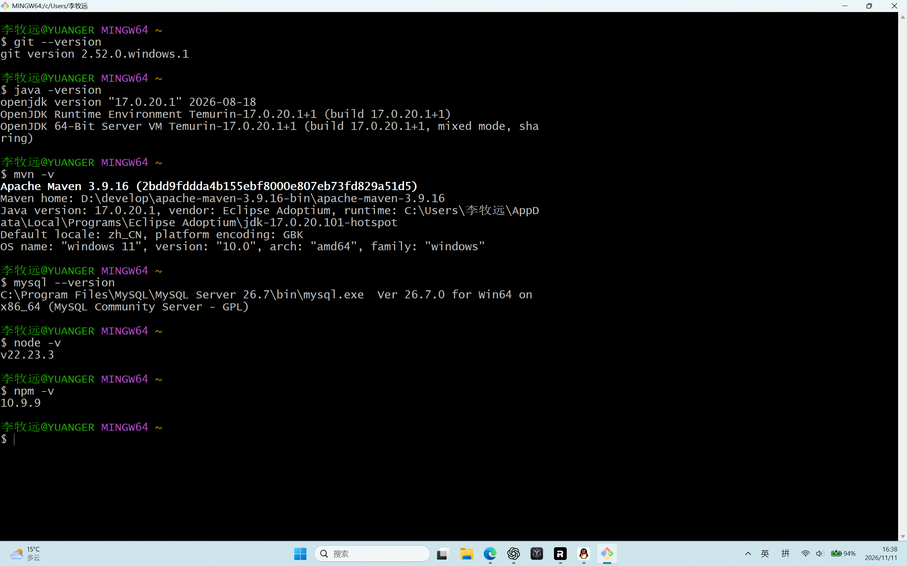
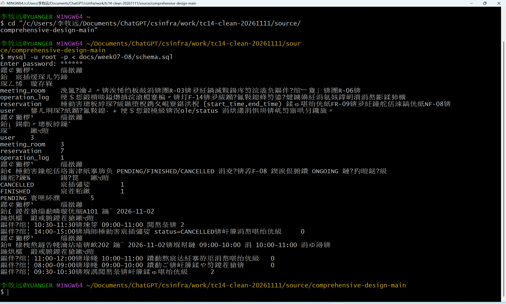
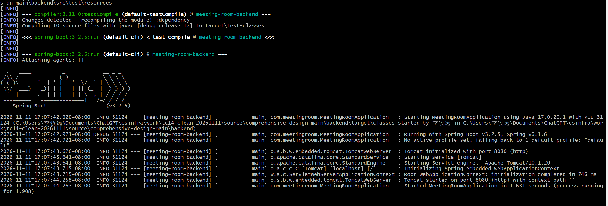
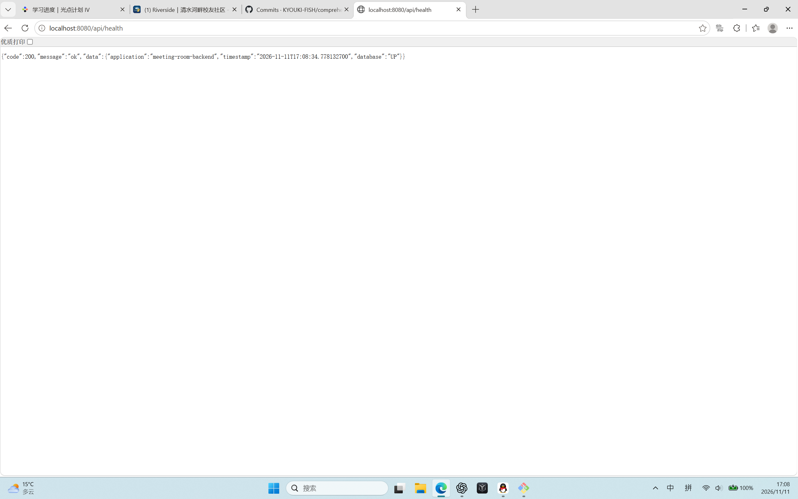
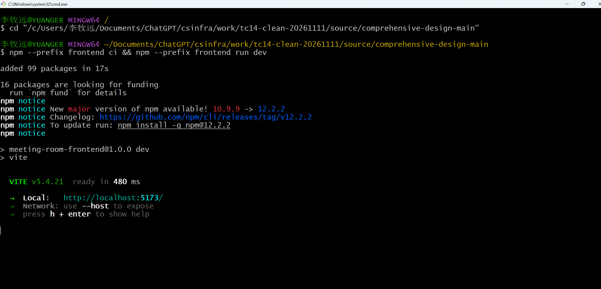
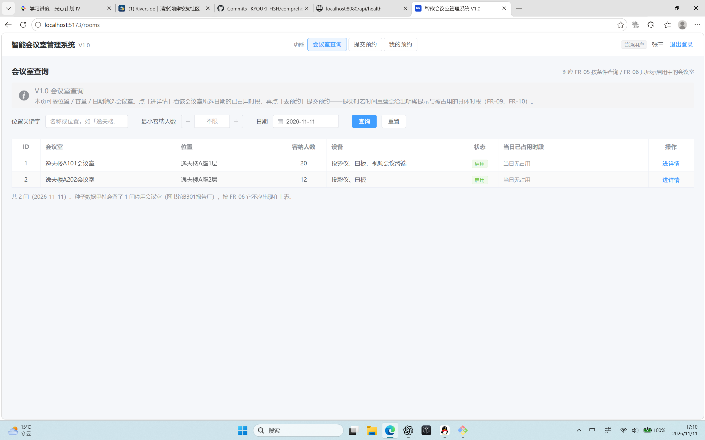

# TC-14 干净源码与重新初始化数据库的三步复现记录

交付口径：本人在原Windows电脑上使用干净源码、重新初始化数据库，按根README三步完成启动、连库及登录验证。这里的“干净”限定为新解压源码无旧依赖目录和构建产物，以及数据库重新初始化；复用本机已安装工具

- 执行人：李牧远；日期：2026-11-11；平台：Windows 11、Git Bash、Edge。
- 源码：本人从GitHub下载的main ZIP；ZIP注释中的提交号为039598bc2f5e9418941f9356846f3f445c0e1da3。
- 压缩包SHA256：40F71B7C3AA6290E4B7420579FBC731D77CA1FCB720594B04EF76760ED1A1C4F。
- 测试目录：`C:\Users\李牧远\Documents\ChatGPT\csinfra\work\tc14-clean-20261111\source\comprehensive-design-main`。
- 初始源码检查：新解压时无frontend/node_modules、frontend/dist、backend/target。原电脑此前运行过本项目；未清空全局Maven/npm缓存。
- 工具：Git 2.52.0.windows.1、Java17.0.20.1、Maven3.9.16、Node22.23.3、npm10.9.9；mysql客户端报告26.7.0（来自版本截图，不等同于服务端版本）。

## 执行及观察

| 步骤 | 本人操作与实际结果 | 证据 |
|---|---|---|
| 准备源码 | Git克隆先遇到连接重置及443超时，改用GitHub浏览器下载main ZIP；另行解压到测试目录。 | ZIP提交号和哈希如上；网络错误见本次聊天原始记录 |
| 数据库初始化 | 执行`mysql -u root -p < docs/week07-08/schema.sql`；截图显示user 3、meeting_room 3、reservation 7、operation_log 1，无可见ERROR。 | evidence/TC14_02_数据库初始化.png |
| 后端启动 | 按README以DB_PASSWORD环境变量提供数据库口令，运行`mvn -f backend/pom.xml spring-boot:run`；日志显示Tomcat在8080启动，17:07:44启动完成。 | evidence/TC14_03_后端启动.png |
| 数据库连接 | 浏览器访问`http://localhost:8080/api/health`，code=200、database=UP，返回时间17:08:34。 | evidence/TC14_04_数据库健康检查.png |
| 前端启动 | 执行`npm --prefix frontend ci && npm --prefix frontend run dev`；新增99个包，Vite5.4.21启动，地址localhost:5173。 | evidence/TC14_05_前端启动.png |
| 登录验收 | user1登录后进入`/rooms`，显示普通用户张三及两间启用会议室（A101、A202），中文正常。 | evidence/TC14_06_登录与会议室列表.png |

## 卡点及结论

- 卡点：GitHub克隆网络失败，改用ZIP获取源码；SQL终端中文输出乱码，但初始化条数可读，登录后的页面中文正常。
- 三步启动及登录链路在本机新目录中执行成功。数据库初始化前的DROP命令未收到单独执行截图。
- 结论边界：本次支持“原Windows电脑的新源码目录初始化、启动、连库及登录成功”。严格“干净机从零复现”是否满足由组长按课程判据确认。
- 本次未使用新建的Ubuntu环境；该环境已停止。
- TC-15、BUG-07页面12步回归、附1第20/21项另见各自记录，不并入本条结论。

## 截图

