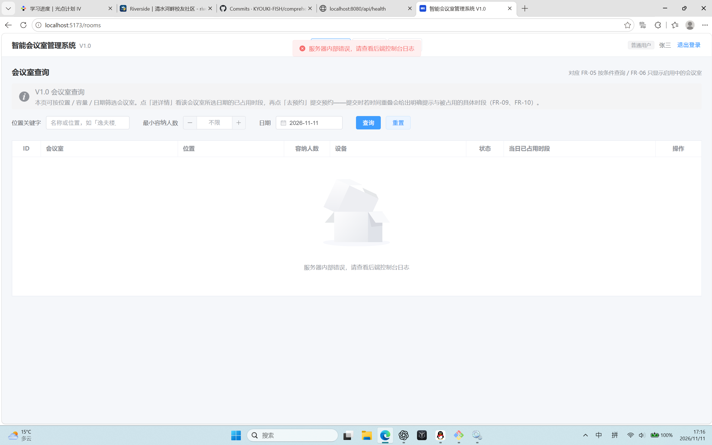
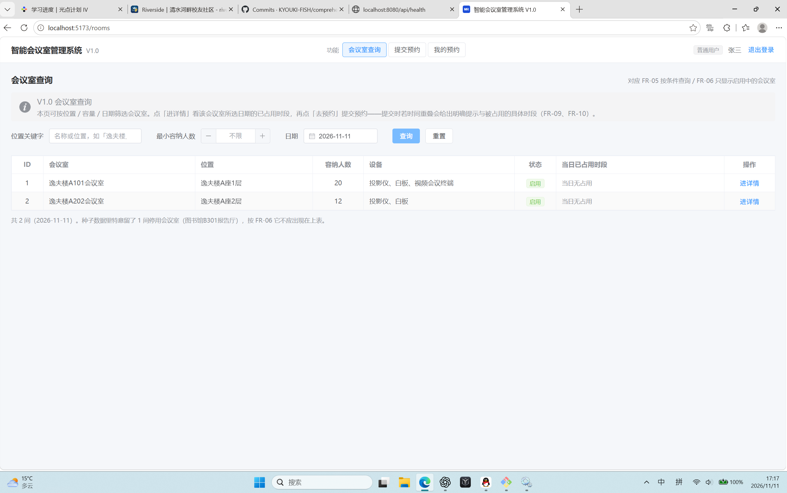
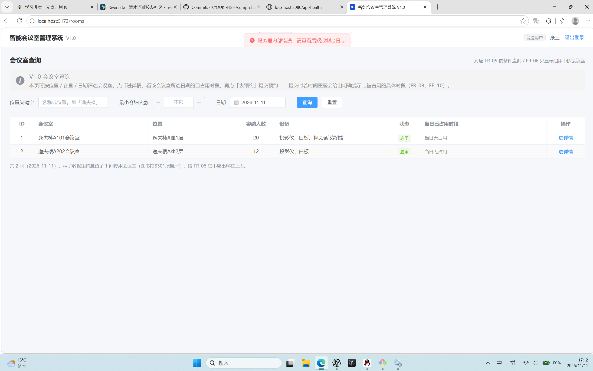
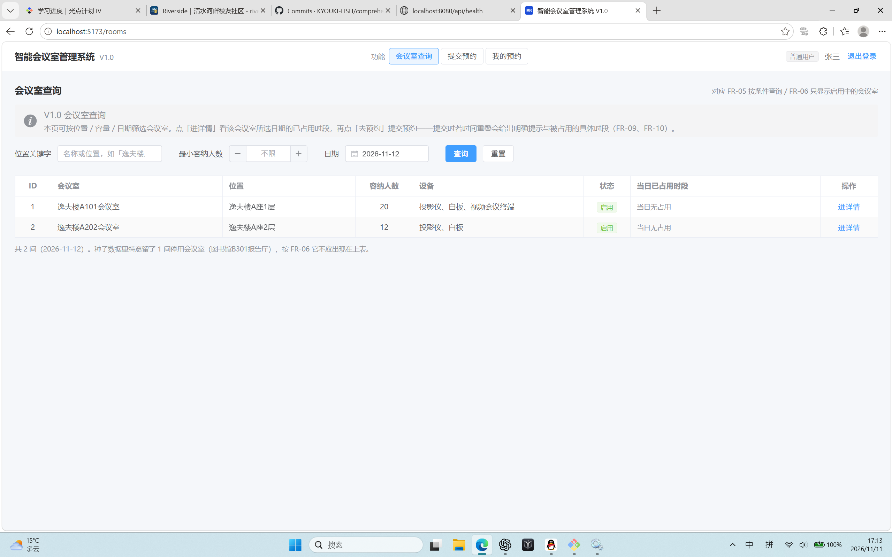

# TC-15 数据库停止后的页面表现（供组长并入报告）

- 执行人：李牧远；日期：2026-11-11；Windows、Edge，源码版本039598bc2f5e9418941f9356846f3f445c0e1da3。
- 按本次指导流程，保持前后端运行，停止MySQL267服务后在会议室页面点击查询；截图时刻17:12。随后恢复服务并再次查询，截图时刻17:13。
- 服务停止/恢复操作由本人进行；当前提供的是两张页面截图，未另外取得服务状态截图或Network请求响应。

| 检查点 | 实际观察 | 结论 |
|---|---|---|
| 数据库断开后明确报错 | 页面提示“服务器内部错误，请查看后端控制台日志”。 | 满足明确错误提示判据 |
| 失败查询不显示数据 | 报错截图仍显示上一次查询的A101、A202两条记录，未清空或标记为旧数据。 | 首轮未通过：旧列表未清空；修复及复测结果见下文 |
| 数据库恢复后重新查询 | 第二张截图的查询日期为2026-11-12，列表显示两条会议室记录，无可见错误提示。 | 本人按恢复后查询步骤取证，页面显示正常 |

首轮结论：未通过。查询失败后旧列表未清空，修复及复测结果见下文。本阶段未修改团队主报告。

## 首次失败后的修复及本人页面复测

- 首轮截图和结论保留。
- 在本机测试副本的`frontend/src/views/RoomListView.vue`中修复：查询异常时清空rooms，保存错误提示供空列表持续显示；查询恢复成功后正常展示数据和数量。未改接口、依赖或数据库。
- 修前原件、修后文件、差异补丁位于本交付目录的`fixes/`。此修改尚未提交到远端main；修后版本应记为`039598b + TC15前端修复`。
- 复测流程：先正常查到两条 → 停止MySQL267后点击查询，错误提示且列表为空 → 启动MySQL267后点击查询，两条恢复。

### 2026-11-11 17:16—17:17 复测结果

李牧远按上述流程操作并提供截图：17:16断库查询时，顶部错误提示与空列表中的持续错误说明均可见，旧记录和正常数量说明已清除；17:17恢复数据库再查询，A101、A202两间会议室正常显示，数量为2。

**最终结论：首次未通过→已修复，复测通过。** 该结论仅适用于本机`039598b + TC15前端修复`版本；远端main尚未合入此补丁。前端类型检查及生产构建已通过；未新增依赖或修改数据库结构。补丁需随结果提交组长整合。

